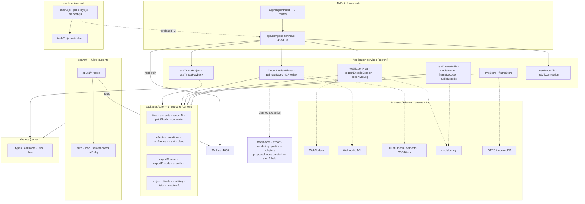

# TM Studio (TMCut)

A standalone video creation suite that runs as a Nuxt 4 web app and as an Electron desktop app,
built on one shared media engine with **no FFmpeg and no FFprobe** anywhere in the product.

TMCut is the video studio module of TM Studio: an editor, a template library, an automatic-cut
workspace, an HTML/CSS video renderer, a voice/TTS surface, a production process board and a
video factory. The application is a satellite of **TM Hub**, which owns identity, roles, routes
and the AI provider catalogue.

**Repository state:** this README describes the code as it exists on `main`. Sections marked
*planned* describe a direction, not a feature. Nothing here is a roadmap promise.

---

## 1. Project overview

| | |
|---|---|
| Product | TM Studio — video creation suite; TMCut is its studio module |
| Runtimes | Browser (Nuxt 4 SPA, port 4003) and Electron desktop shell |
| Control plane | TM Hub at `http://localhost:4000`, app id `tm-studio_749app` |
| Media engine | Mediabunny + WebCodecs + Web Audio API + Canvas 2D, shared by both runtimes |
| Domain engine | `packages/core` (`tmcut-core`) — pure, zero-dependency |
| Persistence | Local first: project JSON, browser byte cache (OPFS → IndexedDB), local media |

### TM Hub relationship

The studio does not own accounts. Login, registration, token refresh, user profile, the route
tree that builds the sidebar, role checks and configuration all live in TM Hub. The app calls the
hub through `useHub()`, which attaches the bearer token and the `X-App-Id` header. The sidebar is
generated at runtime from `system_routes` and filtered by `isVisible !== false`.

The studio's own Nitro server keeps three jobs: verify the hub token, persist uploaded bytes and
production artifacts, and relay AI requests to the hub so the renderer never holds a hub
credential.

---

## 2. Feature overview

### 2.1 Implemented

Verified in source; each row names where the capability lives.

| Feature | What it does | Where |
|---|---|---|
| Timeline editing | multi-track add/move/split/trim/duplicate/ripple-delete, snapping, groups, markers | `app/components/tmcut/TmcutTimeline.vue`, `useTmcutProject.ts`, core `editing.mjs` |
| Preview | HTML media + DOM stacking + CSS filters, transitions, blend, grain, text overlay | `TmcutPreviewPlayer.vue`, `paintSurfaces.ts`, core `composite.mjs` |
| Playback transport | frame-grid playhead, drift-corrected follow law, honest buffering and stall states | `useTmcutPlayback.ts`, core `playback.mjs`, `pace.mjs` |
| Media library | import, probe, thumbnails, filmstrip, relink, byte cache, "Media Offline" states | `useTmcutMedia.ts`, `mediaProbe.ts`, `frameStore.ts`, `byteStore.ts` |
| Effects | 29 effect types with parameter bounds and a preview face per definition | core `effects.mjs`, `fxPreview.ts` |
| Transitions | 45 named transitions with preview geometry and legality checks | core `transitions.mjs`, `fxCatalog.ts` |
| Keyframes | opacity/scale/position/volume keyframes with five easings | core `keyframes.mjs`, `TmcutKeyframeEditor.vue` |
| Text and captions | styled text clips, animation types, SRT import/export, caption cues | core `textStyle.mjs`, `caption.mjs`, `captions.ts` |
| Export | WebCodecs encode + Mediabunny mux to MP4/WebM, with a named refusal for what it cannot bake | `webExportHost.ts`, `exportEncodeSession.ts`, core `exportContent.mjs` |
| Audio | Web Audio mix graph, per-track gain, fades, waveform generation from decoded PCM | `audioMixer.ts`, `waveformService.ts`, core `audioMix.mjs` |
| AutoCut | scene cut detection from decoded frames, silence detection from decoded PCM, review wizard | `sceneScan.ts`, `silenceScan.ts`, `useTmcutAutocut.ts` |
| AI script and AI editor | script generation, scene planning, task registry with validated JSON contracts | `aiScript.ts`, `aiTasks.ts`, `useTmcutAi*.ts`, core `aiPlan.mjs` |
| Templates | template library, versioned export/import, customization modal | `useTmcutTemplates.ts`, `templateIo.ts`, core `templates.mjs` |
| Asset Center | starter catalog, provider assets, checksum-verified offline installs | `useTmcutAssetCenter.ts`, core `assetCenter.mjs` |
| Video Factory | batch assembly from template version + input rows, budget guard, retry policy | `videoFactory.ts`, `videoAssembly.ts`, core `templatePlan.mjs` |
| HTML/CSS video | sandboxed iframe compositions driven by a deterministic `seek(t)` contract | `TmcutHtmlVideoStudio.vue`, core `htmlVideo.mjs` |
| Production process | stage board with artifacts and human approval gates | `useTmcutProcess.ts`, `app/utils/process/` |
| Voice / TTS | text-to-speech through the server, voice command planner with risk classes | `useTmcutVoiceCommands.ts`, `server/api/v1/media/tts*` |
| Provider / model integration | hub AI catalogue, local encrypted vault for desktop keys, provider routing | `useHubAi.ts`, `hubAiConnection.ts`, core `providerRouting.mjs` |
| Desktop capabilities | secured IPC, local files, native dialogs, updater, encrypted AI slots | `electron/main.cjs`, `electron/tools/*` |
| Push notifications | unified FCM and VAPID web push | `useWebPush.ts`, `public/push-sw.js` |

### 2.2 Partial or capability-dependent

These work, but not for every input. The application says so rather than mis-rendering.

| Area | Limit | Evidence |
|---|---|---|
| Export coverage | 7 of 29 effect types are baked into the file; transitions, text, mask, blend, rotation, stacked rows and the remaining effects are refused by name | `packages/core/src/exportContent.mjs:97`, `planEncodeContent` at `:253` |
| Codec support | whatever the runtime's WebCodecs advertises; an unsupported codec is reported as a capability limitation, never swapped for a fallback | `exportEncodePlan.ts`, core `exportEncode.mjs` |
| GPU rendering | none. The browser may have a GPU; this editor does not use it for painting | `useTmcutPlatform.ts:95,109` |
| HTML-video capture | no capture session exists on either host; the studio renders HTML-video by seeking an iframe, not by capturing frames | `useTmcutPlatform.ts:12-17` (`open()` throws at `:159-161`), `TmcutHtmlVideoStudio.vue:15` |
| Audio pan | the `pan` field is preserved in stored projects but no mixer applies it | `capability_honesty` spec, ADR-028 |
| Firefox | encode of AAC and WebGPU adapter were missing in the recorded 32-test compatibility run | `docs/audit/zero-ffmpeg-audit.md` §59.6 |

### 2.3 Planned

Not implemented, listed so the difference stays visible:

- A GPU compositor for preview (WebGL2 / WebGPU). No source exists today.
- Export of transitions, text overlays, masks, blend modes, or stacked footage rows.
- Cloud or background render. Both capability flags are `false` on both hosts.
- Extraction of `media-core`, `export`, `rendering` and `platform-adapters` into workspace
  packages. Step 1 is `BLOCKED / DEFERRED` as of 2026-11-11: the owner reviewed the measurements and
  chose not to move the four media modules while the exit criteria cannot be met, so the code stays
  where it is and no empty package was created. The dependency mechanism a package would need is
  written up in [core-package-contract.md](file:///D:/Applications/tm-studio/docs/architecture/core-package-contract.md);
  the criteria are in [package boundaries](file:///D:/Applications/tm-studio/docs/architecture/package-boundaries.md) §2.2.

---

## 3. Technology stack

Read from `package.json` and confirmed in source.

| Layer | Choice | Notes |
|---|---|---|
| App framework | Nuxt 4 (`nuxt ^4.6.2`), SPA only | `ssr: false` |
| UI | Vue 3.5, Nuxt UI v4, Tailwind CSS v4 | one icon family, `i-lucide-*` |
| Language | TypeScript 6 in the app, plain ESM JavaScript in the core | `vue-tsc 3.3.13` pinned |
| Desktop | Electron `^44.9.1`, electron-builder `^26` | NSIS installer target |
| Demux / probe / mux | `mediabunny` 1.65.1 | pinned; the only media library in the product |
| Decode / encode | WebCodecs (`VideoDecoder`, `VideoEncoder`, `AudioDecoder`, `AudioEncoder`) | capability is asked before use |
| Audio | Web Audio API | mix graph and offline PCM for export |
| Paint | Canvas 2D for export frames; DOM + CSS filters for preview | no WebGL2 or WebGPU renderer exists |
| State | Pinia + composables | project store is `useTmcutProject` |
| Validation | zod 4 | shared contracts and API bodies |
| Auth | `tm-hub-client`, `jose` | RS256 hub tokens |

### 3.1 Zero FFmpeg

This is a hard constraint, not a preference:

- No FFmpeg, FFprobe, FFmpeg.wasm or FFprobe-like WASM in dependencies, source, build, worker or
  docs instructions.
- No spawn or exec of a media binary, and no hidden CLI fallback.
- No Electron-only media engine. One engine serves both runtimes.
- A codec or container the runtime does not support is reported as a capability limitation. The
  product does not quietly switch to another path.

Decisions: [ADR-028 to ADR-033](file:///D:/Applications/tm-studio/docs/adr/zero-ffmpeg-decisions.md).
Measurements: [zero-FFmpeg audit](file:///D:/Applications/tm-studio/docs/audit/zero-ffmpeg-audit.md).

---

## 4. Architecture

Solid arrows exist in source today. Dotted arrows are runtime APIs the host provides without an
import. `planned` marks a boundary that does not exist yet.



`electron/` has no import edge into `shared/`: no module under `electron/` imports it, and both
type-only references there are comments. `electron-builder.yml` does ship `shared/**/*` in the
package, but that is packaging inclusion, not a dependency.

The two rules that keep this shape stable:

1. **Core never reaches out.** `packages/core/tools/check-boundaries.mjs` fails the build if any
   core module imports Vue, Nuxt, Electron, a Node builtin, or a DOM global.
2. **One media answer.** Preview and export ask the same core functions which layer is on screen,
   where a plate lands, and what the encode may contain. A second implementation of any of those
   questions is treated as a bug, not as an optimisation.

---

## 5. Current repository structure

This is the tree as it exists, not a target layout.

```text
tm-studio/
├── app/                       Nuxt 4 application (srcDir)
│   ├── pages/tmcut/           8 TMCut routes
│   │   ├── index.vue          project dashboard
│   │   ├── editor.vue         timeline editor
│   │   ├── templates.vue      template library
│   │   ├── autocut.vue        automatic cut wizard
│   │   ├── html-video.vue     HTML/CSS video studio
│   │   ├── voice.vue          voice / TTS studio
│   │   ├── process.vue        production process board
│   │   └── factory.vue        video factory batch runs
│   ├── components/tmcut/      45 editor components
│   ├── composables/           33 useTmcut* composables
│   ├── utils/tmcut/           50 engine seam modules
│   ├── pages/                 auth, resources, system routes
│   ├── middleware/            auth.global.ts route guard
│   └── layouts/               default layout with dynamic sidebar
├── electron/                  Desktop shell
│   ├── main.cjs               window lifecycle, controller registration
│   ├── preload.cjs            context-bridged API
│   ├── ipcPolicy.cjs          sender gate + channel allowlists
│   ├── media-protocol.cjs     media:// with Range support
│   └── tools/                 controllers, AI vault, provider adapters
├── server/                    Nitro: token verify, uploads, artifacts, AI relay
│   ├── api/v1/                media, process, ai, stock routes
│   ├── middleware/            auth.ts, rbac.ts
│   └── utils/                 jwt, aiRelay, serverAccess, uploads
├── shared/                    Cross app/server/electron contracts
│   ├── types/                 auth, rbac, electron bridge, device, api
│   ├── contracts/             IPC payload schemas
│   └── utils/                 pure guards both sides run
├── packages/core/             tmcut-core — pure domain package
│   ├── src/                   63 engine modules (the artifact hosts read)
│   ├── types/                 DSL v3 type surface
│   ├── test/                  66 node:test files
│   ├── tools/                 check-boundaries.mjs
│   └── dist/                  npm publish output only (gitignored)
├── tests/
│   ├── unit/                  140 specs incl. 6 documentation guards
│   └── e2e/                   live browser / Electron probe scripts
├── docs/                      ADRs, audits, architecture, guides
├── i18n/locales/              en.json, vi.json
├── scripts/                   check-source-hygiene.mts
├── nuxt.config.ts             alias, i18n, runtimeConfig, Vite
└── electron-builder.yml       packaged file list
```

What each area is for:

- **`packages/core`** — the only workspace package. Pure decisions in plain ESM with no
  dependencies: time, timeline evaluation, composition plans, editing laws, media facts, export
  planning. Read from `src/` by every host; `dist/` exists only for npm.
- **`app/`** — pages, components, composables and the engine seams. The seams in
  `app/utils/tmcut/` are the only place that touches a decoder, an encoder, an audio graph, or
  browser storage.
- **`electron/`** — host lifecycle, secured IPC, native files, the local AI vault, provider
  adapters. It runs the same media services as the browser; it is not a second engine.
- **`server/`** — token verification, upload persistence, production artifacts, AI relay, stock
  proxy. It does not render.
- **`shared/`** — types and pure utilities that both the app and the server must agree on.
- **`tests/`** — `unit/` runs under plain Node via `tsx`; `e2e/` drives a live browser or the
  Electron app.
- **`docs/`** — the decision register, measurement audits, architecture notes and user guides.

---

## 6. Requirements

| Requirement | Value | Source |
|---|---|---|
| Node.js | `^22.22.3 \|\| ^24.15.0 \|\| >=26.0.0` — the range Nuxt 4.6 itself declares, because Nuxt is the strictest package in the tree; Node 23 and 25 are excluded by that range. `.nvmrc` pins `24.22.2`, the version this repository is developed on | `package.json` (`engines`), `.nvmrc`, and `node_modules/nuxt/package.json` (`engines.node`) |
| pnpm | `12.15.0` | `package.json:86` (`packageManager`) |
| Windows, desktop build only | Developer Mode on, and an output directory whose integrity label is Medium | the asar step needs `SeCreateSymbolicLinkPrivilege`, and an NSIS installer will not start from a Low-integrity folder; see the zero-FFmpeg audit sections 58.1.3 and 59.2 |
| TM Hub | reachable at `NUXT_PUBLIC_HUB_URL`, default `http://localhost:4000` | `nuxt.config.ts` runtimeConfig |
| Free port | 4003 | `package.json:14` |

A web-only run needs neither Windows, Electron, nor any native media binary.

---

## 7. Installation and development

```bash
pnpm install            # installs, then runs nuxt prepare via postinstall
cp .env.example .env    # then fill the public values; see below
pnpm dev                # Nuxt dev server on http://localhost:4003
pnpm dev:electron       # Nuxt dev server plus the Electron window
pnpm build              # production Nuxt build into .output/
pnpm build:core         # tsup build of packages/core into dist/ (npm only)
```

`.env` holds **public** configuration only, because Vite bakes it into the bundle:

```dotenv
NUXT_PUBLIC_HUB_URL=http://localhost:4000
NUXT_PUBLIC_HUB_APP_ID=your-app-id
AUTH_PROVIDER=hub
```

Everything in the "server-only credentials" block of `.env.example` is read at runtime and must
stay empty in a packaged desktop build. Per-install secrets live in `userData/config.env`,
encrypted with the OS keychain. **Never commit a filled `.env`.**

Desktop packaging:

```bash
pnpm build:electron:win    # NSIS installer in release/
pnpm build:electron:dir    # unpacked app in release/win-unpacked
```

Both pass `--publish never`. `electron-builder.yml` names a GitHub repository, and a local build
must not create a release.

---

## 8. Testing and quality gates

Every command below exists in `package.json`.

| Gate | Command | Covers |
|---|---|---|
| App typecheck | `pnpm typecheck` | `vue-tsc` over the app, server and shared trees |
| App lint | `pnpm lint` | ESLint over the repository (see the note below) |
| Core typecheck | `pnpm typecheck:core` | the core's `.d.ts` against its `types/` |
| Core boundaries | `pnpm check:core` | forbidden-import scan on the core |
| Core tests | `pnpm test:core` | 919 tests across 136 suites |
| Unit specs | `pnpm test:unit` | 140 specs: behaviour, source contracts, documentation guards |
| Browser integration | `pnpm test:browser` | 11 checks over the real media modules in Chromium; needs `pnpm dev` and a browser |
| Electron tests | `pnpm test:electron` | 6 node:test files over Electron tool modules |
| Everything | `pnpm test` | unit suite then Electron suite (not the browser check) |
| Hygiene | `pnpm check:hygiene` | fails if compiled `.js` sits next to its `.ts` source |

Distinctions that matter:

- **Core tests** are pure domain assertions under `node --test`, with no bundler and no DOM.
- **Unit specs** are standalone scripts, one process per file; a spec may report SKIP, and the
  runner reports SKIP as SKIP rather than PASS.
- **Browser integration** is the only gate that decodes real pixels and samples. Plain Node can
  demux a fixture but has no `VideoDecoder`/`AudioDecoder`, so a decode check there answers `null`;
  `tests/e2e/browser_media_integration.mts` runs the same modules in Chromium instead. It is kept
  out of `pnpm test` because it needs a browser and a running dev server, and it prints SKIP with
  the reason when either is missing rather than passing silently. Set `TMCUT_BROWSER_REQUIRED=1`
  in CI: that turns a skip into a non-zero exit, so a job that exists to measure decode cannot go
  green having measured nothing. Locally the default stays permissive.
- **Electron tests** exercise the main-process tool modules in plain Node, not in a live window.
- **Hygiene** guards against a `.js` twin shadowing its `.ts` source at resolution time.

Two working notes:

- Run `pnpm typecheck` **before** linting a file you touched. `nuxt typecheck` regenerates
  `.nuxt/eslint.config.mjs`, which the root config re-exports; a lint result obtained before that
  regeneration can be stale.
- `pnpm lint` is `eslint .`. When a change touches a handful of files, lint those files by name
  rather than the whole tree, so pre-existing debt elsewhere is not attributed to the change.

The documentation guards are part of the unit suite: link integrity, table shape, prose line
length, character set, source citation resolution, and the markdown reader itself.

---

## 9. Project data and local-first behaviour

| Concern | Behaviour |
|---|---|
| Project schema | **v3**, two shapes, both real and both guarded: the app file (`schemaVersion: 3`, flat `timeline { version, tracks, durationMs, markers }`) and the core normalized project (`version: 3`, DSL `timeline { version, tracks, markers }`). The guard is `tests/unit/tmcut_project_schema_v3.spec.ts` |
| Time base | integer ticks, `TICKS_PER_SECOND = 120000`; ticks are `number`, so projects stay JSON-serializable |
| Media location | local first. The browser uploads bytes to the studio's own server route; the desktop reads them from disk through `media://` |
| Client byte cache | OPFS first, IndexedDB fallback, keyed by a revision fingerprint. `byteStore.ts` is the only module in `app/` that opens either backend |
| Derived artifacts | waveforms and similar are cached under their own `fingerprint-kind-vN` key, so an algorithm change cannot read an old artifact as if it were the new one |
| Relink | a missing file is relinked through `useTmcutRelink`; project data is never destroyed by a move |
| Cloud upload | not performed by default. The only upload is the local server route above; there is no third-party media upload path |

---

## 10. AI and TM Hub

Three layers, in the order a request travels:

1. **Hub catalogue** — `useHubAi()` reads provider and model definitions and the user's
   connections from TM Hub. The studio does not ship a model list.
2. **Server relay** — the renderer calls `/api/v1/ai/relay/*` on the studio's own Nitro server.
   That route forwards to the hub using the server's service identity (`NUXT_HUB_APP_SECRET`,
   read per request, never baked into the bundle). Provider credentials never leave the hub.
3. **Local vault (desktop only)** — `electron/tools/ai-gateway.cjs` plus `ai-secure.cjs` store
   keys in `config.env` under `userData`, encrypted with the OS keychain. The adoption bridge from
   a hub connection to a local slot is `app/utils/tmcut/hubAiConnection.ts`.

Identity is the hub's. The studio verifies the hub's JWT server-side, then applies its own
default-deny authorization policy. Routes, roles and menus come from the hub route tree.

No secret, API key, token, or per-user value belongs in this repository, in an issue, or in a
README.

---

## 11. Documentation index

Read these in this order unless you have a reason not to.

### Source of truth

| Document | What it settles |
|---|---|
| [AGENTS.md](file:///D:/Applications/tm-studio/AGENTS.md) | how to work here: commands, boundaries, UI conventions, i18n rules |
| [ADR-028 to ADR-033](file:///D:/Applications/tm-studio/docs/adr/zero-ffmpeg-decisions.md) | binding decisions on the zero-FFmpeg, browser-first architecture |
| [Zero-FFmpeg audit](file:///D:/Applications/tm-studio/docs/audit/zero-ffmpeg-audit.md) | the measurement record; sections 58 to 64 describe the current tree |
| [Repository and package audit](file:///D:/Applications/tm-studio/docs/audit/repository-package-architecture-audit.md) | what packages exist, what lives in the app, what is missing |
| [Package boundaries](file:///D:/Applications/tm-studio/docs/architecture/package-boundaries.md) | dependency rules and extraction order, with exit criteria |
| [Core package contract](file:///D:/Applications/tm-studio/docs/architecture/core-package-contract.md) | what a second workspace package could rely on: resolution per consumer, public exports, restart conditions |

### Architecture and security

| Document | What it explains |
|---|---|
| [Online editor stack](file:///D:/Applications/tm-studio/docs/video-editor-stack.md) | the official library stack and the capability matrix. The matrix is research, not dependencies; no GPU library is installed |
| [Electron build security](file:///D:/Applications/tm-studio/docs/architecture/electron-build-security.md) | what may be baked into a build, root-only surfaces, secret handling |
| [Browser-first roadmap](file:///D:/Applications/tm-studio/docs/tmcut-zero-ffmpeg-zero-ffprobe-browser-first-roadmap.md) | the implementation plan the zero-FFmpeg work followed |
| [Next-slices execution brief](file:///D:/Applications/tm-studio/docs/tmcut-zero-ffmpeg-next-slices-agent-execution-brief.md) | slice-by-slice instructions for the same programme |

### Historical, superseded, or proposal

| Document | Status |
|---|---|
| [V4 universal rendering roadmap](file:///D:/Applications/tm-studio/docs/tmcut-v4-universal-rendering-multiplatform-roadmap.md) | **proposal**. Its package list is a target, not a state; wherever it allowed FFmpeg it is superseded by ADR-028 |
| [V4 Phase 0 audit](file:///D:/Applications/tm-studio/docs/v4-phase-0-audit.md) | **historical, superseded**. A snapshot from when FFmpeg was still the renderer |
| [Extraction plan](file:///D:/Applications/tm-studio/docs/extraction-plan.md) | **historical log** of the split from `tm-tools`; it stops at entry #81 |
| [Design specs](file:///D:/Applications/tm-studio/docs/design/tmcut-studio-spatial-glass-3d-ui-spec.md) | mixed status; the three design specs disagree with each other and the Three.js / spatial-3D one describes an aspiration the code does not implement |

### User and operator guides

| Document | Audience |
|---|---|
| [User guide](file:///D:/Applications/tm-studio/docs/content/user-guide.md) | editors using the studio |
| [System setup guide](file:///D:/Applications/tm-studio/docs/content/system-setup-and-configuration-guide.md) | operators wiring the studio to a hub |
| [Asset sources catalogue](file:///D:/Applications/tm-studio/docs/asset-sources-catalog.md) | which stock and asset providers are integrated, and under what licence |

---

## 12. Known limitations

Taken from the current audit record and the source. Each has evidence; none is a TODO dressed up
as a defect.

| Limitation | Consequence | Evidence |
|---|---|---|
| Export bakes 7 of 29 effect types | a project with any other effect is refused, with the effect named | `packages/core/src/exportContent.mjs:97,253` |
| Transitions, text, mask, blend, rotation and stacked rows are not exported | the export modal lists them as blockers instead of producing a wrong file | `planEncodeContent`, `EXPORT_REFUSAL_REASONS` |
| No GPU renderer | preview is bounded by DOM/CSS compositing | `useTmcutPlatform.ts:95,109` |
| No HTML-video capture session | HTML-video stays inside its own studio view | `useTmcutPlatform.ts:12-17`, `TmcutHtmlVideoStudio.vue:15` |
| Pan is stored but not applied | a project with a non-zero pan shows a warning; the value is never reset | ADR-028; the capability-honesty spec |
| Windows installer needs Developer Mode and a Medium-integrity output folder | the audit measured two distinct blockers: the asar symlink step needs `SeCreateSymbolicLinkPrivilege`, and an NSIS installer inherits a Low-integrity label from its parent folder and hangs before `.onInit` | zero-FFmpeg audit sections 58.1.3, 59.2 |
| Live QA on three routes needs a hub session | `/tmcut/editor`, `/tmcut/templates`, `/tmcut/factory` call the AI catalogue on mount and log 401 without one | zero-FFmpeg audit section 58.1.2 |
| Firefox lacked AAC encode and a WebGPU adapter in the recorded run | export and GPU paths are limited there | zero-FFmpeg audit section 59.6 |

---

## 13. License and contribution

**License verification: PENDING / OWNER REVIEW.** The `LICENSE` file is unmodified and stays that
way until its provenance is verified.

The repository ships an [MIT LICENSE](file:///D:/Applications/tm-studio/LICENSE) file. Its copyright
line still reads `2025 Nuxt UI Templates`: it was inherited with the project template and has never
been rewritten. The effective licensing is therefore **unverified** — do not treat this repository as
licensed for reuse until the owner confirms the intended copyright holder. Changing that name, or
replacing the licence, is the owner's decision and not a documentation edit.

Contribution practice, as the repository actually enforces it:

- Work in small slices; each one ends with the gates in section 8 green.
- Do not add FFmpeg, FFprobe, FFmpeg.wasm, or a media CLI, including as a fallback.
- Do not add a second media engine for Electron.
- All user-facing strings go in `i18n/locales/en.json` and `vi.json`, invoked through `t()` with
  no inline fallback string.
- Source comments and commit messages are written in English.
- Run the documentation guards after touching anything under `docs/`.

There is no `CONTRIBUTING.md`, no code of conduct, and no CI workflow in the repository at this
commit. Do not invent one in a pull request without the owner's agreement.

---

## Tiếng Việt — tóm tắt

**TM Studio (TMCut)** là bộ công cụ dựng video chạy được cả trên trình duyệt (Nuxt 4, cổng 4003)
và trên desktop (Electron), dùng **một media engine duy nhất**: Mediabunny + WebCodecs + Web Audio
API, **không có FFmpeg và không có FFprobe** ở bất kỳ đâu trong sản phẩm.

- Toàn bộ luật dựng phim nằm trong `packages/core` (`tmcut-core`): timebase `TICKS_PER_SECOND =
  120000`, timeline evaluator, effects/transitions/keyframes, composition plan, export plan.
  Package này thuần, không phụ thuộc gì, đọc từ `src/` chứ không đọc `dist/`.
- Giao diện và các seam kỹ thuật nằm trong `app/`; desktop host trong `electron/`; server Nitro
  chỉ làm nhiệm vụ xác thực token, lưu file, lưu artifact và relay AI — không render.
- Đăng nhập, phân quyền, menu và danh mục AI do **TM Hub** quyết định; studio chỉ là satellite.
- Chạy thử: `pnpm install`, `pnpm dev` (cổng 4003) hoặc `pnpm dev:electron`.
- Kiểm tra: `pnpm typecheck`, `pnpm test:core`, `pnpm test:unit`, `pnpm check:core`,
  `pnpm check:hygiene`; kiểm tra decode thật trong trình duyệt bằng `pnpm test:browser`
  (cần `pnpm dev` và một browser).
- Giới hạn đã biết: exporter chỉ nung được 7/29 effect; transition, text, mask, blend và stacked
  rows bị từ chối có nêu tên; chưa có GPU renderer; chưa export được HTML-video ra file trực tiếp
  từ studio đó.

Chi tiết đầy đủ xem các tài liệu ở mục 11.
