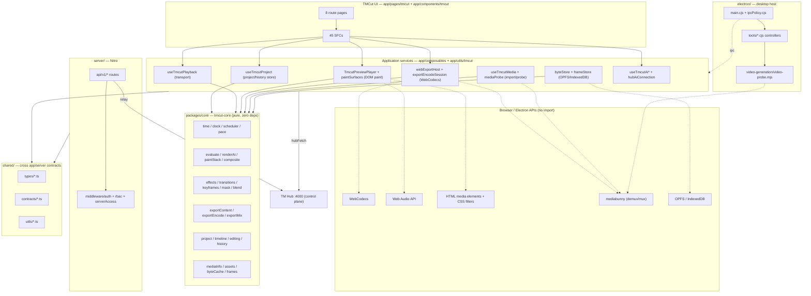

# TM Studio — Repository and Package Architecture Audit

Measured on 2026-11-11 against `HEAD fa07c4c` (branch `main`, clean working tree).
Scope: source structure, real import edges, and the distance between the repository as it
exists and a target package layout. **This document changes no source code.** No file was
moved, renamed, or repackaged for it.

Every claim below cites the file and symbol it was read from. Where a claim could not be
verified from source it is marked **unverified** rather than written as fact.

---

## 1. Repository overview

| Item | Value | Evidence |
|---|---|---|
| Root package | `tm-studio` 1.0.0, private, ESM | `package.json:2-7` |
| Package manager | `pnpm@12.15.0` | `package.json:86` |
| Node floor | `^22.22.3 \|\| ^24.15.0 \|\| >=26.0.0`, pinned to `24.22.2` | `package.json:83-85` (`engines`), `.nvmrc` |
| Workspace | one glob, `packages/*` | `pnpm-workspace.yaml:1-2` |
| Workspace packages | **exactly one**: `tmcut-core` | `packages/` holds only `core/` |
| App framework | Nuxt 4, SPA only | `nuxt.config.ts:13` (`ssr: false`) |
| Desktop shell | Electron `^44.9.1`, entry `electron/main.cjs` | `package.json:8`, `package.json:74` |
| Dev port | 4003 | `package.json:14` |
| App surface | 272 files / 71 170 lines | `find app -name '*.ts' -o -name '*.vue'` |
| Electron | 41 files / 9 034 lines | `find electron -name '*.cjs' -o -name '*.mjs'` |
| Nitro server | 31 files / 2 108 lines | `find server -name '*.ts'` |
| Shared contracts | 17 files / 1 817 lines | `find shared -name '*.ts'` |
| Core source | 63 modules / 15 413 lines | `wc -l packages/core/src/*.mjs` |
| Core tests | 66 files / 12 336 lines | `wc -l packages/core/test/*.mjs` |
| Unit specs | 139 files | `ls tests/unit/*.spec.ts` |

The repository is one application plus one pure domain package. There is no `packages/editor`,
`packages/rendering`, `packages/media-core`, or any other package a target blueprint might
name. Those responsibilities exist, but they live inside `app/`, `core`, `electron/`, `server/`
and `shared/`.

---

## 2. Current workspace packages

**`packages/core` → `tmcut-core` 0.1.0.** The only workspace member.

| Fact | Evidence |
|---|---|
| Zero runtime dependencies; dev deps are `tsup` and `typescript` | `packages/core/package.json:54-57` |
| Entry points: `.`, `./generationAdapter`, `./providerAdapter`, `./package.json` | `packages/core/package.json:9-26` |
| Published artifact is `dist/` only | `packages/core/package.json:27-29` |
| Build: `tsup && node scripts/prepare-dist.mjs` | `packages/core/package.json:31` |
| Test: `node --test "test/*.test.mjs"` | `packages/core/package.json:33` |
| Boundary check: `node tools/check-boundaries.mjs` | `packages/core/package.json:34` |
| Type check: `tsc --noEmit` (uses `tsconfig.check.json`) | `packages/core/package.json:36` |
| Public barrel: 64 re-export lines over 62 unique modules (two modules are re-exported twice) | `packages/core/src/index.mjs:1-65` |
| Type surface bound to the engine by `src/index.d.ts` + `types/` | `packages/core/tsconfig.check.json:9` |

`dist/` exists on this machine but is **not** a source dependency. `tests/unit/tmcut_core_source.spec.ts:80`
`readsBuildArtifact()` fails the suite if any source file resolves into `packages/core/dist`, and
`tests/unit/tmcut_core_source.spec.ts:252` proves the packaged app ships the whole transitive
closure that `electron/` loads from `packages/core/src`.

---

## 3. Current runtime modules

"Runtime" here means code that executes as part of the product, as opposed to tests and docs.

| Area | Count | Where |
|---|---|---|
| TMCut client utils | 50 modules, 12 987 lines | `app/utils/tmcut/*.ts` |
| TMCut composables | 33 modules, 10 102 lines | `app/composables/useTmcut*.ts` |
| TMCut components | 45 SFCs | `app/components/tmcut/*.vue` |
| TMCut pages | 8 routes | `app/pages/tmcut/*.vue` |
| Electron controllers/tools | 31 modules | `electron/tools/*.cjs`, `electron/tools/*.mjs` |
| Nitro routes + utils | 31 files | `server/api/**`, `server/utils/**` |
| Core modules | 63 | `packages/core/src/*.mjs` |

The three largest client modules are `useTmcutProject.ts` (1 900 lines, editor store),
`useTmcutMedia.ts` (1 055, import/probe/relink) and `useTmcutPlayback.ts` (743, transport).
The three largest core modules are `templates.mjs` (2 061), `exportEncode.mjs` (839) and
`transitions.mjs` (644).

---

## 4. Architecture diagram

Solid arrows are import edges that exist in source today. Dotted arrows are edges the browser
or Electron runtime provides without an import statement (URL schemes, IPC).

**`electron/` has no import edge into `shared/`.** Measured: no module under `electron/` imports
`shared/` or `#shared/`; the two references to shared file names in `electron/tools/process-store.cjs`
are comments. `electron-builder.yml` ships `shared/**/*` in the package, which is packaging
inclusion, not a dependency. The audit's section 5 table records the same finding.

**Nothing in `app/` imports from `server/`, and nothing in `server/` imports from `app/`.**
Verified by grep over both trees: `grep -rn "#server/|~~/server/|~/server/" app` returns 0 hits,
and `grep -rn "tmcut-core|packages/core" server` returns only one comment reference
(`server/utils/uploads.ts:18`) with no import.

---

## 5. Dependency direction

Measured, not intended. Each row is a grep result over the whole tree.

| From to | Allowed? | Actually happens | Evidence |
|---|---|---|---|
| `app/` to `tmcut-core` | yes | **yes**, 63 files | `grep -rl "from 'tmcut-core'" app` returned 63 paths |
| `app/` to `server/` | no | no | 0 hits for `#server/`, `~~/server/`, `~/server/` |
| `app/` to `electron/` (by import) | no | no | 0 hits; the renderer reaches the host only through the preload bridge |
| `electron/` to `packages/core/src` | yes | **yes**, relative path only | `electron/tools/video-generation/controller.mjs:25,30` |
| `electron/` to `app/` | no | no | 0 hits |
| `server/` to `tmcut-core` | not used today | no | one comment only, `server/utils/uploads.ts:18` |
| `shared/` to anything above | no | no | `shared/types/electron.ts:1-3` imports `~~/shared/contracts/*` only |
| `packages/core` to anything outside itself | **forbidden** | **no** | `grep -rn "from '[^.]" packages/core/src/*.mjs` = 0 |

The core's non-import of the outside world is enforced mechanically by
`packages/core/tools/check-boundaries.mjs:12-24` — a forbidden-pattern list covering `vue`,
`nuxt`, `electron`, `node:`, `window.`, `document.`, `localStorage`, `ipcRenderer`, `ipcMain`,
`@nuxt/` and `~/`. It exits 1 on any hit. Run today: exit 0, "core imports nothing
platform-specific".

One nuance the boundary checker does not catch, and the reader should know about:
`packages/core/src/crashRecovery.mjs:186` reads `globalThis.process.getBuiltinModule` and
`:197` hands it `fs/promises`, and `packages/core/src/crashRecovery.mjs:219` reads a WebGL context
off `globalThis.document` when one exists. Both are capability *probes* inside a function that
takes the host objects as parameters, not module-scope imports, so they are legal under the
current rule. Any future extraction that moves `crashRecovery` into a package with a stricter
"no host object at all" rule would have to split the probe from the law.

Two names the core must never load, pinned by `tests/unit/tmcut_core_source.spec.ts:162`:
the retired `@tmcut-core` alias and the retired `@tmcut/core` installed specifier. Both are
rebuilt from fragments inside the spec so the spec itself does not spell them.

---

## 6. Core responsibilities

`packages/core` is a pure domain library. Its 63 modules group into eight responsibilities:

| Responsibility | Modules | Representative symbols |
|---|---|---|
| Timebase and clock | `time`, `clock`, `pace`, `scheduler`, `playback` | `TICKS_PER_SECOND` (`time.mjs:9`), `createFrameScheduler` (`scheduler.mjs:65`), `planPlaybackFollow` (`playback.mjs:56`) |
| Timeline evaluation | `timeline`, `evaluate`, `renderAt` | `evaluateTimeline` (`evaluate.mjs:348`), `renderAt` (`renderAt.mjs:51`) |
| Composition plans | `paintStack`, `composite`, `blend` | `paintStackAt` (`paintStack.mjs:92`), `compositePlan` (`composite.mjs:53`) |
| Effects, transitions, motion | `effects`, `transitions`, `keyframes`, `mask`, `retime`, `sticker`, `caption`, `textStyle` | `EFFECT_REGISTRY` (`effects.mjs:31`, 29 types), `KNOWN_TRANSITIONS` (`transitions.mjs:29`, 45 keys) |
| Editing operations | `editing`, `selection`, `markers`, `history`, `project`, `v1compat` | `splitClip` (`timeline.mjs:236`), `rippleDelete` (`editing.mjs:149`), `createProject` (`project.mjs:53`) |
| Media facts and cache law | `media`, `mediaInfo`, `assets`, `cache`, `byteCache`, `frames`, `waveform` | `buildMediaInfo` (`mediaInfo.mjs:231`), `frameRequestKey` (`frames.mjs:164`), `byteCacheBudgetBytes` (`byteCache.mjs:38`) |
| Export planning | `exportContent`, `exportEncode`, `exportMix` | `planEncodeContent` (`exportContent.mjs:253`), `planEncodePresets` (`exportEncode.mjs:304`), `planExportMixPacket` (`exportMix.mjs:147`) |
| Product plans and adapters | `aiPlan`, `templatePlan`, `autocutPlan`, `audioOrchestration`, `assetCenter`, `marketplaceCatalog`, `takedown`, `catalogPublish`, `providerRouting`, `generationAdapter`, `providerAdapter`, `usageTracker`, `telemetry`, `crashRecovery` | `routeScene` (`providerRouting.mjs:68`) |

The core does **not** own: decoding, encoding, painting pixels, reading files, or talking to a
network. Those live in `app/utils/tmcut/*` and `electron/tools/*`. The core owns the *decisions*
those callers ask it for.

---

## 7. App/UI responsibilities

`app/` holds four distinct layers that are currently separated only by convention:

| Layer | Location | Responsibility |
|---|---|---|
| Pages | `app/pages/tmcut/*.vue` (8 routes) | routing, page chrome via `BasePage` |
| Components | `app/components/tmcut/*.vue` (45 SFCs) | editor chrome, panels, modals, tiles |
| Composables | `app/composables/useTmcut*.ts` (33) | reactive state, stores, host orchestration |
| Utils | `app/utils/tmcut/*.ts` (50) | the real engine seams |

The utils layer is where a package extraction would find its material. Grouped by what they
touch:

| Group | Modules | Lines |
|---|---|---|
| Media decoding | `mediaProbe`, `frameDecode`, `audioDecode`, `mediaElement` | 818 |
| Byte/frame storage | `byteStore`, `frameStore`, `frameStrip`, `playbackBytes`, `localStore` | 1 055 |
| Preview paint | `paintSurfaces`, `fxPreview`, `fxCatalog`, `fxLibrary`, `exportEffectPaint` | 1 937 |
| Export runtime | `exportEncodeSession`, `exportEncodePlan`, `webCodecsExport`, `webExportHost`, `exportMixLeg`, `webExportChoice`, `audioMixer` | 2 522 |
| Analysis | `sceneScan`, `silenceScan`, `autocutDetect`, `waveform`, `waveformService` | 617 |
| AI and generation | `aiScript`, `aiTasks`, `hubAiConnection`, `videoFactory`, `videoFactoryRunner`, `videoAssembly`, `outputSources` | 2 870 |
| Template and factory assets | `videoTemplates`, `videoTemplatePresets`, `templateIo`, `htmlVideoStarters`, `assetImport` | 3 098 |

`hostBridge.ts` is the only reader of `window.electronAPI` — its header states that every
feature module used to reach for the bridge itself, and that this file exists so "which runtime
am I in" is answered once.

---

## 8. Browser/Electron responsibilities

The desktop shell is a host, not a second engine.

| File | Responsibility | Evidence |
|---|---|---|
| `electron/main.cjs` | window lifecycle, registers controllers | `main.cjs:1-20` |
| `electron/ipcPolicy.cjs` | sender-origin gate + push/outbound channel allowlists | `ipcPolicy.cjs:1-25` |
| `electron/preload.cjs` | context-bridged API surface | referenced by `shared/types/electron.ts` |
| `electron/media-protocol.cjs` | `media://local/...` with real 206 range responses | `media-protocol.cjs:131-159` |
| `electron/tools/tmcut.controller.cjs` | TMCut IPC handlers | `tmcut.controller.cjs:7-9` |
| `electron/tools/video-generation/video-probe.mjs` | in-process demux probe via mediabunny `FilePathSource` | `video-probe.mjs:11` |
| `electron/tools/ai-gateway.cjs`, `ai-secure.cjs`, `config-file.cjs` | local AI vault (encrypted slots) | AGENTS.md, "AI 3-layer architecture" |
| `electron/tools/kling-adapter.mjs`, `runway-adapter.mjs` | provider adapters registered by the controller | `video-generation/controller.mjs:11-12,45-55` |

Both hosts run the same media engine. `app/utils/tmcut/frameDecode.ts:1-14` states that the
desktop and the web ask the same service the same question, and that a filmstrip cannot look
different depending on which window the project was opened in. `mediaProbe.ts:1-12` explains
why: the desktop file scheme answers `Accept-Ranges: bytes`, so Mediabunny's range-requesting
`UrlSource` reads `media://local/...` exactly like an HTTP URL.

The renderer reports **no GPU renderer** on either host. `app/composables/useTmcutPlatform.ts:95`
and `:109` both set `webGPU: false`; `app/components/tmcut/TmcutEditorWorkspace.vue:29-34`
records that "there is no WebGPU or WebGL2 renderer anywhere in `app/`" and that the status bar
label therefore names what actually runs.

---

## 9. Server responsibilities

Nitro is a **storage and relay** server, not a render server.

| Route group | Files | Job |
|---|---|---|
| Identity | `server/middleware/auth.ts`, `rbac.ts`, `server/utils/jwt.ts`, `tokenVerify.ts` | verify the hub JWT for this app id |
| Authorization | `server/utils/serverAccess.ts` | one default-deny policy; its header records that the previous `permissionMap` loop denied nothing |
| Uploads | `server/api/v1/media/upload.post.ts`, `server/routes/uploads/[...path].get.ts` | persist browser-picked bytes, serve them with Range |
| Process artifacts | `server/api/v1/process/**`, `server/utils/processStore.ts` | production-run artifact files, mirrored by `electron/tools/process-store.cjs` |
| AI relay | `server/api/v1/ai/relay/*`, `server/utils/aiRelay.ts` | forward to the hub with server service identity; the renderer never holds a hub credential |
| Stock | `server/api/v1/stock/*`, `shared/utils/stockGuards.ts` | proxy guard for provider URLs |
| TTS and push | `server/api/v1/media/tts*`, `server/api/push/fcm-token.ts` | voice and notifications |

There is no render queue and no media binary. `app/composables/useTmcutPlatform.ts:12-17` states
that the capture session host was retired with the FFmpeg engine and that `open()` now rejects
on both hosts (`:159-161`).

---

## 10. Shared contracts responsibilities

`shared/` is the cross-boundary layer, and it is already the correct home for what a
`packages/shared` would hold.

| Path | Contents | Consumers |
|---|---|---|
| `shared/types/electron.ts` | the whole preload bridge type surface + `Window` augmentation | `app/composables/*` (9+ files) |
| `shared/types/auth.ts`, `rbac.ts`, `device.ts`, `webauthn.ts`, `api.ts` | hub-facing contracts | `useAuth`, `useNavMenu`, `auth.global.ts` |
| `shared/contracts/common.ts`, `system.ipc.ts`, `events.ts` | IPC payload contracts, zod schemas | `shared/types/electron.ts:1-3` |
| `shared/utils/deviceCredentialScope.ts`, `processStore.ts`, `stockGuards.ts` | pure utilities both sides run | `server/utils/hubIdentity.ts:17`, `server/api/v1/stock/*.ts:1` |
| `shared/rbac.ts`, `shared/docs/content.ts` | route policy + bundled docs | `app/middleware/auth.global.ts:2`, `app/utils/docs/bundled.ts:1` |

Alias reaches follow Nuxt 4 conventions: `~~/shared/...` from inside `shared/`, `#shared/...`
from `app/` and `server/`, plus the `imports` map `"#shared/*": "./shared/*"` in
`package.json:9-11`.

**There is no reason to create `packages/shared`.** `shared/` already serves app + server +
electron, is already aliased, and has its own spec guarding the alias semantics
(`tests/unit/tmcut_shared_imports.spec.ts`). A second package would duplicate that and add a
build step for zero gain.

One caveat worth recording: `shared/contracts/*` is consumed by nothing except
`shared/types/electron.ts`. The interfaces there (`EventBusContracts`, `SystemInfoResponse`)
describe a profile/browser product surface rather than the studio's. They are harmless, but
they are not evidence that the studio runs a contract event bus.

---

## 11. Existing build/test commands

Every command below exists in `package.json` and was read from it.

| Command | Definition | Line |
|---|---|---|
| `pnpm dev` | `nuxt dev --port 4003` | `package.json:14` |
| `pnpm dev:electron` | concurrently nuxt + `dev-electron-launcher.cjs` | `package.json:21` |
| `pnpm build` | `nuxt build` | `package.json:13` |
| `pnpm build:core` | `pnpm --dir packages/core build` (tsup) | `package.json:22` |
| `pnpm build:electron:win` | bake public config, build, electron-builder `--win --publish never` | `package.json:24` |
| `pnpm build:electron:dir` | same, `--dir` | `package.json:25` |
| `pnpm typecheck` | `nuxt typecheck` | `package.json:20` |
| `pnpm lint` | `eslint .` | `package.json:19` |
| `pnpm test:core` | `node --test "packages/core/test/*.test.mjs"` | `package.json:27` |
| `pnpm check:core` | `node packages/core/tools/check-boundaries.mjs` | `package.json:28` |
| `pnpm typecheck:core` | `tsc --noEmit -p packages/core/tsconfig.check.json` | `package.json:30` |
| `pnpm test:unit` | `tsx tests/unit/run-all.mts` | `package.json:32` |
| `pnpm test:electron` | `node --test "electron/tools/*.test.mjs"` | `package.json:33` |
| `pnpm test` | unit suite then electron suite | `package.json:31` |
| `pnpm check:hygiene` | `tsx scripts/check-source-hygiene.mts` | `package.json:26` |

Runs performed for this audit (documentation-only change):

| Gate | Command | Result |
|---|---|---|
| App types | `npx nuxt typecheck` | exit 0, **0** × `error TS` |
| Core tests | `node --test "packages/core/test/*.test.mjs"` | **919 pass / 0 fail**, 136 suites, exit 0 |
| Core types | `npx tsc --noEmit -p packages/core/tsconfig.check.json` | exit 0 |
| Core boundaries | `node packages/core/tools/check-boundaries.mjs` | exit 0, PASS |
| Unit suite | `npx tsx tests/unit/run-all.mts` | **139/139** specs, exit 0 |
| Electron suite | `node --test "electron/tools/*.test.mjs"` | **80/80**, exit 0 |
| Hygiene | `npx tsx scripts/check-source-hygiene.mts` | exit 0, no emitted twins |

The app gates are here because the documentation guards live inside the unit suite, and the
typecheck runs first so `.nuxt/eslint.config.mjs` is regenerated before any lint result is
trusted. No application source file changed; the full record, including the six doc guards, is
in section 15.

---

## 12. Current implementation gaps

Gaps are differences between what the code claims to do and what it does. Capabilities that are
deliberately absent are listed in 12.2, not here.

### 12.1 Real gaps

| Gap | Evidence | Effect |
|---|---|---|
| No GPU renderer exists | `useTmcutPlatform.ts:95,109` set `webGPU: false`; no `navigator.gpu`, `requestAdapter`, or `getContext('webgpu')` anywhere in `app/`, `shared/`, `electron/`, `server/` | preview is HTML media + DOM + CSS; a GPU label would be a false claim |
| `capture` capability rejects on both hosts | `useTmcutPlatform.ts:12-17`, `:159-161` | HTML-video capture sessions have no engine; the studio renders HTML-video through an iframe seek loop instead |
| WebCodecs export refuses several authoring features | `EXPORT_BAKED_EFFECTS` has 7 of 29 effect types (`exportContent.mjs:97`); `planEncodeContent` refuses transitions, text, mask, blend, stacked rows | a project using them is refused by name, never silently mis-rendered |
| No `packages/*` other than `core` | `ls packages` | every runtime seam is app-local; a second host would copy `app/utils/tmcut` |
| `shared/contracts/events.ts` describes a profile product, not the studio | `shared/contracts/events.ts:1-8` | dead weight in the shared layer |
| `app/utils/tmcut/` holds about 13 000 lines with no internal boundary | `wc -l app/utils/tmcut/*.ts` | import direction inside the folder is unconstrained; a cycle between paint and export modules would not be caught |

### 12.2 Deliberately absent, not gaps

| Absent | Why it is correct |
|---|---|
| FFmpeg, FFprobe, FFmpeg.wasm, any media CLI | ADR-028; zero hits in `package.json`, lockfile, or build |
| Electron-specific media engine | ADR-032; both hosts call the same `app/utils/tmcut` services |
| Cloud render | `useTmcutPlatform.ts:100,107` both report `cloudRender: false` |
| Background render queue | `useTmcutPlatform.ts:97,106` both report `backgroundRender: false` |

---

## 13. Documentation inconsistencies

The documents disagree with each other and, in several places, with the code. None was edited
for this audit (the task forbids moving or archiving docs).

### 13.1 Authority order as it actually stands

| Document | Self-declared status | Agrees with source? |
|---|---|---|
| `docs/adr/zero-ffmpeg-decisions.md` | decision register, ADR-028 to ADR-033 | yes — the newest binding record |
| `docs/audit/zero-ffmpeg-audit.md` | measurement record | yes — sections 58 to 64 describe the current tree |
| `docs/tmcut-zero-ffmpeg-zero-ffprobe-browser-first-roadmap.md` | implementation roadmap | yes, but predates slices L and later |
| `docs/video-editor-stack.md` | official stack | **yes, after the fix recorded in 13.2** |
| `docs/tmcut-v4-universal-rendering-multiplatform-roadmap.md` | "Proposal / Architecture Blueprint" | no — a blueprint, self-marked superseded wherever it allowed FFmpeg |
| `docs/v4-phase-0-audit.md` | **HISTORICAL — SUPERSEDED** | no, and it says so in its own header |
| `docs/design/*.md` (4 files) | two claim ACTIVE, two claim blueprint status | mixed; the Three.js/TresJS spec describes an aspiration the code does not implement |

### 13.2 Specific contradictions

Three rows below were **fixed in the same change that added this audit**; they are kept so the
history of the correction is visible, and because the other three still stand.

| Claim | Where | Status |
|---|---|---|
| Composition is "Canvas 2D + WebGL2, WebGPU when the runtime has it" | `docs/video-editor-stack.md` §1 table | **FIXED** — now states preview = DOM + CSS `filter`, export = Canvas 2D, with an explicit "no WebGL2/WebGPU renderer in code" note |
| "GPU Effects Layer = pixel-level work in WebGL/WebGPU" | `docs/video-editor-stack.md` §2 | **FIXED** — now "Effects Layer" over CSS `filter` and `ctx.filter` |
| Section 4.3 presented four GPU libraries as integration candidates | `docs/video-editor-stack.md` §4.3 | **FIXED** — a header note says all four are research, none is a dependency, and no GPU layer exists in code |
| `@ffmpeg/ffmpeg` listed among candidate libraries | `docs/video-editor-stack.md:73,259` | **not a contradiction** — marked retired with an explicit "no install instruction here" note |
| Two design specs disagreed on the UI basis | `docs/design/tmcut-studio-spatial-glass-3d-ui-spec.md:1,6,12` required Three.js/TresJS while the flat-glassmorphism spec in the same folder lists no 3D library | **closed 2026-11-11** — the 3D spec's header now says SUPERSEDED and names the flat-glass spec, which is dated a day later and already declared itself the replacement. No file was moved or archived. `package.json` still has neither three nor TresJS |
| "WebGL2 compositor for preview" described as a delivered slice | `docs/audit/zero-ffmpeg-audit.md:355` | **closed 2026-11-11** — the slice-F row now says in place that "WebGL2 compositor" was the original goal, not delivered work, and points at its own `:4375` (`grep webgl2` in `app/` returns 0) and `:4399` (the GPU compositor is Phase 5). No measurement was rewritten |
| HTML-video capture by a server engine | `docs/v4-phase-0-audit.md` (historical) | correct as history — retired (ADR-023, then slice I) |

### 13.3 What a reader should treat as truth

1. `docs/adr/zero-ffmpeg-decisions.md` for decisions.
2. `docs/audit/zero-ffmpeg-audit.md` sections 58 to 64 for measured state.
3. The source itself when the two disagree — and the disagreement is a documentation bug.

The new root `README.md` states this order explicitly so a first-time reader does not have to
reconstruct it.

---

## 14. Package extraction recommendation

### 14.1 How status was decided

A target package is marked `EXISTS` only when a directory with its own `package.json`, its own
tests and its own entry point is present. A capability badge, a capability flag, a UI label, or
a file name is **not** evidence — that rule removed two false positives during this audit:

- **`renderer-webgl`**: the platform adapter lists no WebGL capability
  (`useTmcutPlatform.ts:95,109`), no file in `app/` opens a WebGL context, and the only
  `getContext('webgl2')` call in the repository is a health probe at
  `packages/core/src/crashRecovery.mjs:219`. The audit's own slice-F row
  (`zero-ffmpeg-audit.md:355`) describes a *plan*; `:4377` records that `grep webgl2` in `app/`
  returns 0. Status: `MISSING`.
- **`renderer-webgpu`**: zero occurrences of `navigator.gpu`, `requestAdapter` or
  `getContext('webgpu')` in `app/`, `shared/`, `electron/`, `server/`. The capability key exists
  in the type surface (`packages/core/types/runtime.ts:6-14`) and is hard-set to `false` on both
  hosts. A key in an interface is not a renderer. Status: `MISSING`.

### 14.2 Mapping table

| Target package | Current files | Current status | Missing boundary | Recommendation | Priority |
|---|---|---|---|---|---|
| `core` | `packages/core/src/*.mjs` (63), `types/` (828 lines), `test/` (66 files) | **EXISTS** | none for its current scope | keep; it is the only package and the anchor for every other extraction | P0 (hold) |
| `platform-contracts` | `packages/core/src/platform.mjs`, `packages/core/types/platform.ts`, `packages/core/types/runtime.ts`, `shared/types/electron.ts` | **IMPLEMENTED_IN_CORE** (+ app type surface) | the interfaces live in core and the host implementation is `app/composables/useTmcutPlatform.ts`; there is no package | keep in core until a second host exists; splitting the interface from the law it describes buys nothing today | P3 |
| `shared` | root `shared/` (17 files: types, contracts, utils, rbac) | **IMPLEMENTED_IN_SHARED** | none | **do not create `packages/shared`** — root `shared/` already serves app + server + electron and is aliased by Nuxt | not needed |
| `editor` | `app/composables/useTmcutProject.ts` (1 900), `useTmcutPlayback.ts` (743), `app/components/tmcut/TmcutEditor*.vue`, `TmcutTimeline*.vue`, `TmcutInspector.vue`, `TmcutKeyframe*.vue` | **IMPLEMENTED_IN_APP** | store, transport and timeline UI are one Vue-coupled unit with no package boundary | do not extract now: every part reads Vue reactivity and the route store. Extract only if a second UI host appears | P3 (defer) |
| `media-core` | `app/utils/tmcut/mediaProbe.ts`, `frameDecode.ts`, `audioDecode.ts`, `mediaElement.ts`, plus cache law in core (`mediaInfo.mjs`, `byteCache.mjs`, `frames.mjs`, `waveform.mjs`) | **PARTIAL** — laws in core, IO in app | no package owns "bytes to decoded frame / decoded PCM"; the four app modules import `mediabunny` directly | **first extraction candidate**: law already in core, IO is 818 lines with three clear entry points | P1 |
| `rendering` | `app/utils/tmcut/paintSurfaces.ts`, `fxPreview.ts`, `fxCatalog.ts`, `fxLibrary.ts`, `exportEffectPaint.ts`; laws in core (`paintStack`, `composite`, `renderAt`, `effects`, `transitions`) | **PARTIAL** | the plan is core's; the DOM/CSS projection is app's, and it is currently entangled with `TmcutPreviewPlayer.vue` (2 460 lines) | extract the *pure* part (`fxCatalog`, `fxLibrary`, `exportEffectPaint` are already pure) before touching the component | P2 |
| `renderer-dom` | `app/components/tmcut/TmcutPreviewPlayer.vue` (video/img stacking + CSS filters), `TmcutHtmlVideoStudio.vue` (sandboxed iframe seek loop) | **IMPLEMENTED_IN_APP** | no package; the DOM renderer is a component, not a module with an API | do not extract until a second renderer exists to justify the interface | P3 (defer) |
| `renderer-webgl` | none | **MISSING** | no implementation, no entry point, no test | do not create. A package with no renderer is a promise, not a boundary | not needed |
| `renderer-webgpu` | none | **MISSING** | no implementation, no entry point, no test | do not create. The capability flag is `false` on both hosts by design | not needed |
| `effects` | laws: `packages/core/src/effects.mjs` (585, 29 types), `transitions.mjs` (644, 45 keys), `keyframes.mjs`, `mask.mjs`; preview projection: `app/utils/tmcut/fxPreview.ts` (912) | **IMPLEMENTED_IN_CORE** (laws) + `IMPLEMENTED_IN_APP` (projection) | the projection needs CSS, which core forbids | **do not split from core.** The laws are pure and already isolated by module; a package boundary would only add build steps | not needed |
| `animation` | `packages/core/src/keyframes.mjs`, `textStyle.mjs`, `evaluate.mjs` (`textAnimationAt`), `pace.mjs` | **IMPLEMENTED_IN_CORE** | none | **do not split from core** — it shares the tick model and the clip shape with the evaluator; splitting would duplicate both | not needed |
| `export` | `app/utils/tmcut/exportEncodeSession.ts` (929), `webCodecsExport.ts` (316), `webExportHost.ts` (227), `exportEncodePlan.ts`, `exportMixLeg.ts` (182), `webExportChoice.ts`, `audioMixer.ts`; laws in core (`exportContent.mjs` 537, `exportEncode.mjs` 839, `exportMix.mjs`) | **PARTIAL** — laws in core, runtime in app | the encode loop, capability probe and paint provider are app-local and interlock with the modal | **second extraction candidate**, after `media-core`: it consumes the plate reader and PCM leg that `media-core` would own | P1 |
| `muxing` | `app/utils/tmcut/exportEncodeSession.ts:336-338` (mediabunny `Mp4OutputFormat`/`WebMOutputFormat` → `BufferTarget` → `Output`) | **IMPLEMENTED_IN_APP** (about 40 lines inside a 929-line session) | no separate module, let alone package | **NOT_NEEDED_YET** — a 40-line muxer call is not a boundary; splitting it would hide where the file bytes come from | not needed |
| `shared` (contracts) | `shared/contracts/*` (104 lines), consumed only by `shared/types/electron.ts` | **IMPLEMENTED_IN_SHARED** | the studio does not consume these contracts; they describe a profile product | leave in place; do not grow them | not needed |

### 14.3 Ordered roadmap

The order below follows the measured dependency graph, which is not the order a blueprint would
guess. Two changes to the presumptive order are justified by code:

1. **`media-core` must come before `export`**, not after. `webExportHost.ts:28-29` imports
   `createPlateReader` from `frameDecode.ts` and `createExportMixLeg` from `exportMixLeg.ts`,
   and the mix leg imports `decodePcm` from `audioDecode.ts:52`. A `media-core` package is a
   *prerequisite* of an `export` package, not a sibling.
2. **`rendering` must come after `media-core`**, because `paintSurfaces.ts` describes which
   decoded surface carries which authored clip — it needs the media read interface to exist
   first.

| Step | Package | Exit criteria before extraction | Why this position |
|---|---|---|---|
| 0 | `core` | already met: 919 tests, boundary check, typecheck all green | it is the dependency of everything else |
| 1 | `media-core` | (a) met; (b) **not met in Node** — no WebCodecs, so a fixture probes but does not decode; now measured in Chromium instead; (c) **not met** — 27 path occurrences in 9 specs pin the four paths, 23 of which a move would break | `BLOCKED / DEFERRED` 2026-11-11; see the note below the table |
| 2 | `export` | (a) `webExportHost` is the single assembly point and stays so; (b) one real encode produces a file with the measured A/V offset; (c) the modal's refusal path is unchanged | consumes step 1, which is held |
| 3 | `rendering` | (a) the pure three modules move with zero import changes; (b) a golden-frame comparison covers the DOM and canvas legs | needs step 1's decoded surface interface, which is held |
| 4 | `platform-adapters` | (a) a host interface covers files, storage, worker and download; (b) both hosts implement it; (c) `hostBridge.ts` remains the only bridge reader | only worth it when a second host (or a headless CLI) exists |
| 5 | `renderer-dom` / `renderer-webgl` / `renderer-webgpu` | each requires an implementation **and** a test of its own before the directory is created | creating them now would produce three empty packages |

Steps 1 to 3 are the only ones with material to move today. Steps 4 and 5 should not start
until a concrete second consumer exists.

**Step 1 is `BLOCKED / DEFERRED`, not failed — decided by the repository owner on 2026-11-11.** The
four media modules stay where they are; no empty package was created; all `27` path occurrences in
the specs are untouched.

The criteria, re-measured when the decision was taken:

| Criterion | Measured | Verdict |
|---|---|---|
| (a) the four modules import nothing from `app/` | they import `mediabunny`, `tmcut-core` and each other | already true |
| (b) one fixture decodes headlessly | plain Node 24.22.2 probes the fixture (`1` video track, `avc`, 64x36) but has no `VideoDecoder`/`AudioDecoder`, so `decodeFrame` and `decodePcm` return `null` | **not met in Node** |
| (c) the three existing consumers keep their specs unchanged | `27` path occurrences in `9` unit specs name the four module paths — `17` string literals a test compares against, `6` import specifiers, `4` prose comments; a move breaks the first two groups | **not met by the move** |

Criterion (b) is now answered by a browser instead of Node: `tests/e2e/browser_media_integration.mts`
loads the real modules into Chromium and measures probe, capability, three byte-distinct frames, PCM
amplitude, corrupt-input handling and cancellation (`pnpm test:browser`, 11 checks). That closes the
question "does the browser-first runtime actually decode" — it does not close the extraction, because
criteria (c) and the dependency mechanism below are unrelated to it.

Two facts hold the extraction regardless of (b):

- **Resolution.** `tmcut-core` reaches `src` through the Nuxt alias and the `tsconfig.test.json` path
  mapping only; the package is deliberately not installed (ADR-022/G13). A module in a second package
  can use none of that without a new mechanism.
- **Type checking.** `.nuxt/tsconfig.app.json` maps `tmcut-core` in `paths` but its `include` array
  does not contain `packages/`, so a `.ts` module moved there leaves the program `nuxt typecheck`
  runs. That file is generated and gitignored, so it is cited by key name rather than by line.

Both are written up, with the eight consumer-resolution rows and the restart conditions, in
[docs/architecture/core-package-contract.md](file:///D:/Applications/tm-studio/docs/architecture/core-package-contract.md).
Steps 2 (`export`) and 3 (`rendering`) inherit the hold: neither is built on a package that has no
proven boundary.

### 14.4 One recommendation that is a "no"

The audit recommends **not** splitting `effects`, `animation` or `muxing` out of core. The reason
is dependency, not taste:

- `effects.mjs` is consumed by `evaluate.mjs`, `exportContent.mjs` and `fxPreview.ts`; a separate
  package would have to re-export through core anyway.
- `keyframes.mjs` is the evaluator's own tick arithmetic (`evalKeyframe` is called from
  `evaluate.mjs` and from `audio.mjs`); moving it out creates a cycle with `evaluate`.
- The muxer is 40 lines inside a session that owns encoder lifecycle. A package around it would
  have one consumer and no independent test surface.

Full per-package contracts, allowed imports and exit criteria are in
[docs/architecture/package-boundaries.md](file:///D:/Applications/tm-studio/docs/architecture/package-boundaries.md).

---

## 15. Verification of this audit

This is a documentation-only change: no source file was moved, renamed, edited, or repackaged.
The gates below were run after the four documents were final.

A second pass on 2026-11-11 pinned the Node floor and re-ran the same ladder. Only `package.json`
(`engines`), a new `.nvmrc`, and prose changed; no source module was touched.

A third pass the same day added the browser harness and then re-measured every number the documents
quote. That pass changed one new file (`tests/e2e/browser_media_integration.mts`), one script entry,
and prose. The gates below were re-run after that change:

| Gate | Command | Result |
|---|---|---|
| App types | `npx nuxt typecheck` | exit 0, **0** × `error TS`; `.nuxt/eslint.config.mjs` regenerated (27 407 bytes) |
| Lint | `npx eslint tests/e2e/browser_media_integration.mts`, after the typecheck | exit 0, 0 problems |
| Core tests | `node --test "packages/core/test/*.test.mjs"` | **919/919**, 136 suites, exit 0 |
| Core types | `npx tsc --noEmit -p packages/core/tsconfig.check.json` | exit 0 |
| Core boundaries | `node packages/core/tools/check-boundaries.mjs` | exit 0, PASS |
| Unit suite | `npx tsx tests/unit/run-all.mts` | **139/139** specs, exit 0 |
| Browser decode | `pnpm test:browser` | exit 0 — **11 checks** on the `msedge` channel: probe, WebCodecs, 6-key capability record, both seams, three byte-distinct frames, a WAV that decodes to the authored peak, corrupt input, two aborts, no page error; one declared **PARTIAL** because every committed fixture is video-only |
| Electron suite | `node --test "electron/tools/*.test.mjs"` | **80/80**, exit 0 |
| Hygiene | `npx tsx scripts/check-source-hygiene.mts` | exit 0, no emitted twins |

That pass also content-checked the `144` plain `file:line` citations the documents carry. The guards
cover `file:///…#L` links only, so six citations that named the right file and the wrong line were
live in the tree. All six are corrected: the barrel count (64 re-export lines over 62 unique
modules), `crashRecovery.mjs` (`:186` reads `getBuiltinModule`, `:197` supplies `fs/promises`), and
four `package.json` offsets that moved when `engines` was inserted.

Documentation guards, run individually against the new files:

| Guard | Result |
|---|---|
| `tmcut_docs_link_integrity` | exit 0 — every `file:///` link resolves to a real file, every `#L` anchor is inside its target |
| `tmcut_doc_table_shape` | exit 0 — every table row matches its header width |
| `tmcut_doc_line_length` | exit 0 — no prose line above 1356 characters |
| `tmcut_doc_charset` | exit 0 — no CJK codepoint in the corpus these documents belong to |
| `tmcut_doc_citations` | exit 0 — every `§N` citation still names a real heading |
| `docs_markdown` | exit 0 — 12/12 reader checks |

In the third pass those six guards ran inside the `139/139` unit suite rather than one command at a
time, so the table above is the first pass's run and the suite result is the current one.

Two defects were produced by the first draft and fixed before the run above:

1. A `grep … | wc -l` inside a table cell split the row into five cells against a four-cell
   header. The command moved out of the cell.
2. `docs/architecture/package-boundaries.md` was linked before it existed, and the link guard
   failed with the exact target. The document was written, then the guard re-ran green.

### 15.1 Not verified

- **License holder.** `LICENSE` still names `2025 Nuxt UI Templates`. The README states this and
  marks the effective holder unverified.
- **A clean-machine install of the desktop build.** The packaging evidence in the zero-FFmpeg
  audit was measured on this machine, which needed an integrity-label change on its output
  directory. That condition is recorded as a requirement, not as a proven general step.
- **Any application route.** No application code changed, so no route sweep was run and none is
  claimed. The browser harness loads the media modules directly from Vite's dev route; it never
  renders a page of the app.
- **The browser harness on a machine without Edge.** It resolved `msedge`. The chromium channel and
  the Playwright-downloaded build are both tried first and both failed here, so those two paths are
  written but unproven. The harness prints SKIP with the reason rather than failing, so CI will not
  notice a machine that silently skips it.
- **Audio range trimming.** The committed fixtures are all video-only, so the PCM check proves a
  generated WAV decodes at the authored amplitude; it does not prove that a multi-packet audio track
  is trimmed to the requested range.
