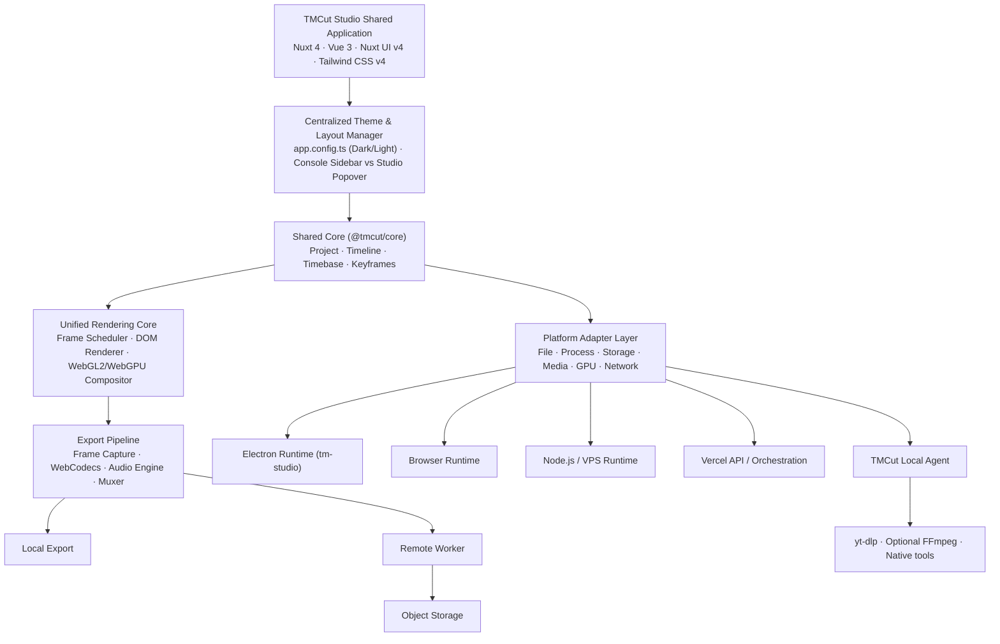

# TMCut V4 – Universal HTML/GPU Video Rendering, Multi-Platform Architecture & Spatial Glass 3D UI (Nuxt UI v4 Dual-Theme)

> **Tài liệu định hướng kiến trúc và roadmap triển khai toàn diện**
>
> **Trạng thái:** Architecture Blueprint (Bản đầy đủ v2.1 — Thay thế toàn bộ bản cũ)
> **Phiên bản tài liệu:** 2.1 (Cập nhật ngày 2026-10-31)
> **Nền tảng hiện tại:** `tm-studio` (Nuxt 4 + Vue 3 + **Nuxt UI v4** + **Tailwind CSS v4** + Three.js + Electron, port 4003)
> **Mục tiêu:** Xây dựng TMCut Studio thành nền tảng biên tập và sản xuất video bằng AI đa nền tảng, dùng chung Project Core, Timeline Core, Unified HTML/GPU Rendering Core và giao diện Spatial 3D Glassmorphism hỗ trợ đồng bộ Dark/Light Mode thông qua cấu hình tập trung `app.config.ts`.

---

## 1. Tóm tắt định hướng

TMCut V4 chuyển đổi từ mô hình truyền thống:

**HTML Preview → chuyển đổi thành FFmpeg Filter Graph → FFmpeg Export**

sang mô hình thống nhất:

**Shared Project/Timeline Core → Unified HTML/GPU Rendering Engine → Deterministic Frame Pipeline → WebCodecs/Muxer**

Trong kiến trúc mới, **FFmpeg không còn là thành phần bắt buộc của đường render chính**. Nó trở thành **Native Media Backend tùy chọn**, chỉ được gọi khi cần xử lý codec đặc thù, remux nhanh, hoặc fallback trên môi trường native.

### 1.1. Các nguyên tắc cốt lõi

1. **HTML-first, GPU-accelerated:** HTML/CSS/SVG đảm nhiệm typography, subtitle, template, vector và motion graphics; GPU compositor (WebGL2/WebGPU) xử lý video/image layers, 3D transforms, compositing và shader effects.
2. **Preview/Export dùng chung logic:** Cùng Project Core, Timeline Core, effect definitions, transform model và deterministic timestamp evaluation.
3. **Deterministic rendering:** Render theo timestamp/frame index xác định (`renderAt(timestamp)`), tuyệt đối không phụ thuộc đồng hồ thực (wall-clock) hoặc tốc độ playback.
4. **Platform-independent project:** Project JSON không phụ thuộc Electron, browser, VPS hay Vercel.
5. **Runtime adapters:** Native APIs, filesystem, process, downloader, storage và remote jobs được trừu tượng hóa qua lớp Adapter.
6. **Progressive enhancement:** Ưu tiên WebGPU/WebCodecs khi thiết bị hỗ trợ; tự động fallback về WebGL2, Canvas2D hoặc native backend.
7. **Centralized Nuxt UI v4 Design System & Dual-Layout UX:**
   - Quản lý màu sắc tập trung tuyệt đối tại `app/app.config.ts` với 7 semantic tokens (`primary: 'violet'`, `secondary: 'indigo'`, `neutral: 'zinc'`, `info: 'cyan'`, `success: 'teal'`, `warning: 'yellow'`, `error: 'red'`), hỗ trợ liền mạch cả **Dark Mode** và **Light Mode**.
   - Phân tách rõ ràng giữa **Console Layout** (có Sidebar + hiệu ứng nền Three.js) và **Studio Full-Bleed Layout** (không Sidebar, mở menu qua Glass Popover, nhường 100% tài nguyên màn hình và GPU cho bàn dựng video).
8. **FFmpeg optional:** Không khóa chặt renderer vào cú pháp FFmpeg filter graph.

### 1.2. Phạm vi mục tiêu (Runtimes)

- **TMCut Desktop (`tm-studio`):** Ứng dụng Electron trên Windows, macOS, Linux (Port 4003, kết nối vệ tinh với `tm-hub`).
- **TMCut Web Local:** Web app chạy trực tiếp trên trình duyệt, xử lý file nội bộ bằng WebCodecs/WebGPU của máy người dùng.
- **TMCut Web Cloud:** Giao diện và điều phối job deploy trên Vercel hoặc VPS.
- **TMCut Remote Worker:** Dịch vụ render và xử lý media nặng trên VPS/Server.
- **TMCut Local Agent:** Native helper chạy ngầm trên máy người dùng (`127.0.0.1`), cung cấp `yt-dlp` và quyền truy cập phần cứng có kiểm soát cho bản Web.

---

## 2. Kiến trúc tổng thể



---

## 3. Kiến trúc Giao diện Spatial 3D Glassmorphism, Hệ Màu `app.config.ts` & Dual-Layout

### 3.1. Hệ thống 7 Semantic Colors Tập trung (`app/app.config.ts`)

Mọi component Vue và cảnh 3D Three.js trong `tm-studio` tuân thủ nghiêm ngặt cấu hình màu sắc tại `app/app.config.ts`:

```ts
export default defineAppConfig({
  ui: {
    colors: {
      primary: 'violet',
      secondary: 'indigo',
      neutral: 'zinc',
      info: 'cyan',
      success: 'teal',
      warning: 'yellow',
      error: 'red'
    }
  }
})
```

- **Chế độ Tối (`Dark Mode`):** Bề mặt kính mờ tối (`zinc-950` / `zinc-900/65`), viền phản quang mảnh, chữ trắng sáng, vật thể 3D khúc xạ ánh sáng tím `violet` và xanh `teal`.
- **Chế độ Sáng (`Light Mode`):** Bề mặt kính pha lê trắng (`zinc-50` / `white/80`), viền `zinc-200`, bóng đổ nhẹ, các điểm nhấn `primary` (`violet`) hiển thị trên nền pastel `bg-primary/10` giúp giao diện trong trẻo, sắc nét mà không gây chói mắt.

### 3.2. Phân tách Bố cục: Console Layout vs Studio Full-Bleed Layout

| Đặc điểm | Console Layout (`layouts/default.vue`) | Studio Full-Bleed Layout (`layouts/studio.vue`) |
|---|---|---|
| **Các trang áp dụng** | Trang chủ (`/`), Tài nguyên (`/resources/*`), Hệ thống (`/system/*`) | Toàn bộ 8 phân hệ TMCut (`/tmcut`, `/tmcut/editor`, `/tmcut/templates`, `/tmcut/autocut`, `/tmcut/html-video`, `/tmcut/voice`, `/tmcut/process`, `/tmcut/factory`) |
| **Thanh Sidebar trái (`260px`)** | **Hiển thị cố định** (có thể thu gọn), chứa đầy đủ cây 17 mục điều hướng | **Loại bỏ hoàn toàn** để giải phóng 100% chiều ngang cho Preview Stage và Multi-track Timeline |
| **Cơ chế điều hướng** | Click trực tiếp trên cây Sidebar trái hoặc phím tắt `CTRL K` | Click vào nút **App Launcher / Glass Popover (`TmcutNavPopover.vue`)** ở góc trên cùng bên trái để mở Mega-Menu kính mờ 2 cột (kèm nút đổi nhanh Sáng/Tối) |
| **Hiệu ứng 3D Three.js** | **Bật (Active):** Render dải kính khúc xạ nền và vật thể 3D trên 3 thẻ Bento (đồng bộ màu từ `useStudioThemeColors()`) | **Tắt / Giải phóng (`Dispose`):** Ngắt hoàn toàn canvas Three.js trang trí để dành 100% GPU cho Video Compositor |

### 3.3. Cấu trúc Bàn dựng 4 Dock Có thể Kéo giãn (Resizable Studio Workspace)

Trong `studio.vue`, màn hình `/tmcut/editor` được chia thành 1 thanh Top Bar mảnh (`48px`) và 4 vùng Dock kính mờ có thanh phân cách (`role="separator"`) hỗ trợ kéo chuột, điều chỉnh bằng bàn phím và lưu kích thước vào `localStorage`:

1. **Top Action Bar (`48px`):** Góc trái là nút `TmcutNavPopover` + tên dự án; ở giữa/phải là cụm 4 công cụ trí tuệ nhân tạo (*AI Script*, *Edit Plan*, *Agent*, *Audio Sync*) đồng nhất tông `primary/soft` (`violet`), ngăn cách dọc với nút *Save* (`neutral/soft`) và nút CTA chính duy nhất **Export** (`primary/solid`).
2. **Left Dock — Media & Asset Bin (`264px – 560px`):** Quản lý Media nội bộ, Kho Stock (Pexels/Pixabay), Mẫu HTML/CSS và Hiệu ứng FX.
3. **Center Stage — GPU Preview Viewport:** Khung nhìn 16:9 / 9:16 hiển thị kết quả từ WebGL2/WebGPU Compositor, kèm bộ điều khiển phát và đồng hồ Timecode hiển thị bằng font `JetBrains Mono`.
4. **Right Dock — Inspector (`264px – 480px`):** Điều chỉnh thông số 3D Transform (Position, Scale, Rotation, Anchor, Crop), Opacity, Blend Mode và đồ thị Bezier Keyframe.
5. **Bottom Dock — Multi-track Timeline (`200px – 560px`, tối đa `55vh`):** Các rãnh Video/Audio/HTML/Subtitle dạng kính bán trong suốt, hiển thị sóng âm (waveform), node keyframe và kim chỉ thời gian (Playhead) mang màu `success` (`teal`).

---

## 4. Project Core và Timeline Core (`packages/core`)

Project JSON hoàn toàn độc lập với FFmpeg, Electron hay một trình duyệt cụ thể.

### 4.1. Project Schema
- Project ID, schema version, project name.
- Canvas/composition width, height, rational frame rate (`numerator` / `denominator`).
- Timebase (`ticksPerSecond = 120000`) và tổng thời lượng (`duration`).
- Danh mục Media Assets (`assetId`, `sourceUri`, `relativePath`, `storageKey` và cơ chế relink).
- Tracks, clips, layers, thứ tự compositing.
- Transform, crop, opacity, blend mode, effects, transitions, keyframes.
- Audio tracks, gain, pan, fades và Export profile.

### 4.2. Chuẩn hóa Timebase & Rational Frame Rate

Sử dụng timebase độc lập với frame rate (`120,000 ticks/giây`) để triệt tiêu sai số dấu phẩy động khi làm việc với cả FPS nguyên (24, 30, 60) và FPS lẻ (23.976, 29.97, 59.94):

$$\text{ticks} = \text{round}\left(\frac{\text{frameIndex} \times \text{ticksPerSecond} \times \text{fps}_{\text{denominator}}}{\text{fps}_{\text{numerator}}}\right)$$

```ts
export interface Timebase {
  ticksPerSecond: number
}

export interface FrameRate {
  numerator: number
  denominator: number
}

export function frameToTicks(
  frameIndex: number,
  fps: FrameRate,
  ticksPerSecond: number
): number {
  return Math.round(
    (frameIndex * ticksPerSecond * fps.denominator) / fps.numerator
  )
}
```

### 4.3. Timeline Evaluation
Cả **UI Preview** và **Offline Export** đều gọi cùng một hàm thuần `evaluateAt(timestampSeconds)` để đảm bảo kết quả khớp nhau tuyệt đối từng khung hình.

---

## 5. Unified Rendering Engine (HTML/DOM + WebGL2/WebGPU)

### 5.1. Triết lý Render Xác định (Deterministic Rendering)
Tuyệt đối không dùng CSS animation chạy tự do theo đồng hồ thực rồi chụp màn hình bằng `sleep(33)`. Mọi trạng thái hình ảnh tại thời điểm $t$ được tính toán hàm số từ `timestamp`:

```ts
export interface RenderRequest {
  timestamp: number
  width: number
  height: number
  quality?: 'preview' | 'final'
}

export interface RenderResult {
  frame: VideoFrame | ImageBitmap
  timestamp: number
  width: number
  height: number
}

export interface Renderer {
  initialize(): Promise<void>
  renderAt(request: RenderRequest): Promise<RenderResult>
  dispose(): Promise<void>
}
```

### 5.2. Sự phối hợp giữa DOM Renderer và GPU Compositor
- **DOM / SVG Renderer:** Chuyên trách chữ viết (Typography), phụ đề (Subtitles), mẫu HTML/CSS động (`/tmcut/html-video`), biểu đồ vector và sticker. Sau khi cập nhật trạng thái DOM theo `timestamp`, layer này được rasterize thành GPU texture.
- **GPU Compositor (WebGL2 baseline → WebGPU progressive):** Nhận các texture từ Video Decoder, Image, cộng với texture từ DOM Renderer để thực hiện biến đổi ma trận (Transform), cắt cúp (Crop), hòa trộn (Blend Modes), mặt nạ (Masks) và chạy các bộ lọc màu/hiệu ứng GLSL/WGSL.

---

## 6. Quản lý Media Dài (15+ phút), Seek, Proxy & Export Pipeline

- **Import tức thì:** Đọc metadata, tạo bản ghi asset và đưa lên timeline ngay lập tức; quá trình tạo ảnh thu nhỏ (thumbnails) và sóng âm (waveform) chạy ngầm ở background.
- **Keyframe-Aware Decode:** Với các codec nén liên khung hình (H.264/H.265), bộ giải mã tìm keyframe gần nhất trước điểm seek và giải mã tiến tới frame mục tiêu, kết hợp **Frame Cache** và **Proxy Media** (cho nguồn 4K/8K).
- **WebCodecs Export Pipeline:** Sử dụng `VideoEncoder` + `AudioEncoder` kết hợp `Mediabunny` (MP4/WebM muxer), kiểm soát chặt chẽ hàng đợi backpressure và gọi `frame.close()` ngay sau khi encode xong để tránh tràn VRAM.

---

## 7. Lộ trình Triển khai (Master Roadmap) & ADR Summary

| ID | Quyết định kiến trúc (ADR) | Lý do cốt lõi |
|---|---|---|
| **ADR-001** | Tách `tm-studio` độc lập (port 4003) + Absorb `@tmcut/core` | Tách biệt hoàn toàn sản phẩm dựng phim khỏi công cụ quản trị `tm-tools` |
| **ADR-002** | Quản lý màu tập trung qua 7 Semantic Colors trong `app.config.ts` | Đồng nhất 100% giao diện và Three.js ở cả Dark Mode và Light Mode |
| **ADR-003** | Kiến trúc Dual-Layout (`default.vue` vs `studio.vue` Full-Bleed) | Giữ vẻ đẹp Spatial Glass 3D ở trang chủ nhưng tối đa hóa 100% diện tích ngang khi vào Studio |
| **ADR-004** | Điều hướng trong Studio bằng `TmcutNavPopover` (Glass Popover) | Chuyển đổi nhanh giữa 8 công cụ TMCut, Hệ thống và đổi Sáng/Tối chỉ bằng 1 click mà không tốn 260px của Sidebar |
| **ADR-005** | Cách ly WebGL Context giữa Three.js UI và Video Compositor | Ngăn chặn tranh chấp GPU và rò rỉ VRAM khi vừa hiển thị UI vừa giải mã/render nhiều lớp video |
| **ADR-006** | Deterministic Timestamp Renderer (`renderAt(t)`) + WebCodecs | Đảm bảo Preview và Export khớp nhau từng khung hình mà không phụ thuộc vào FFmpeg filter graph |