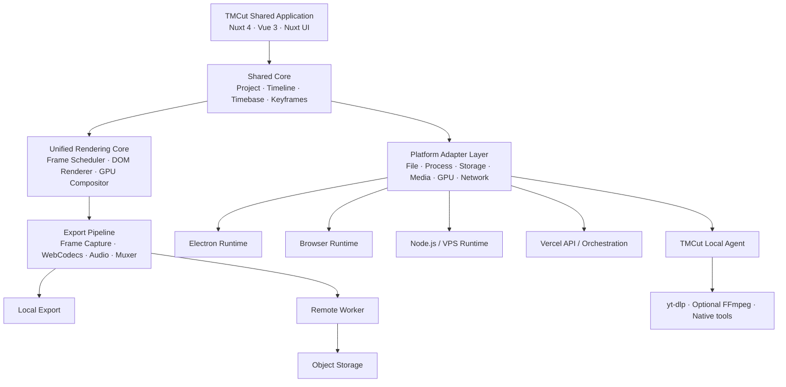
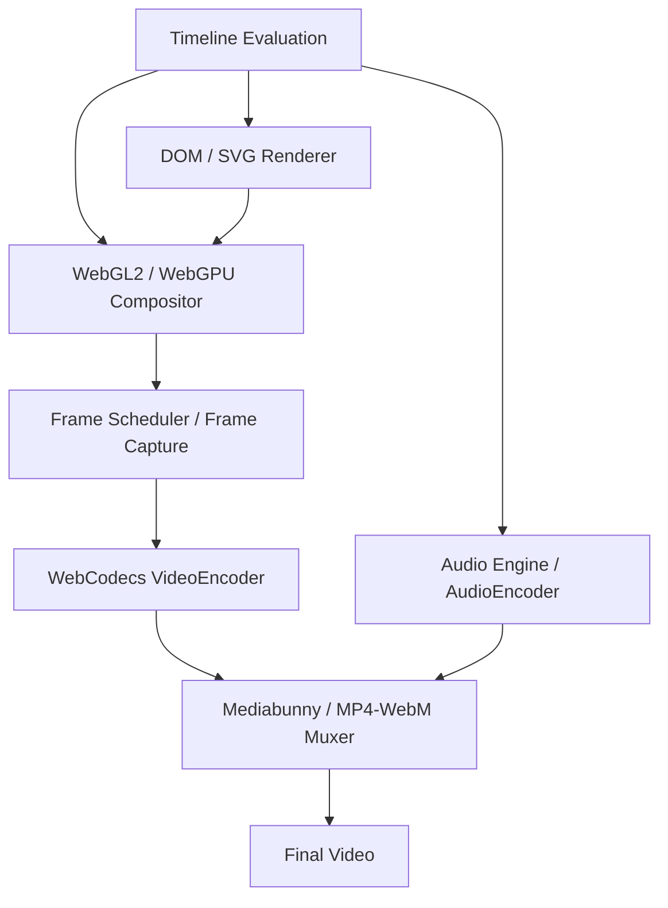
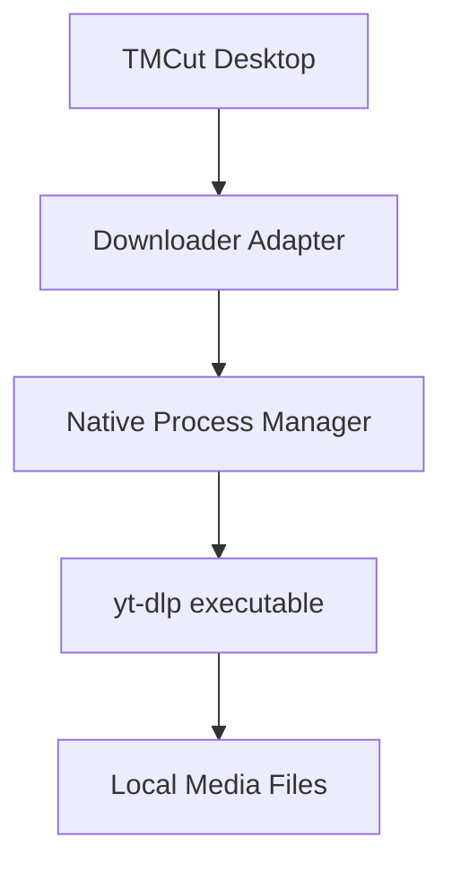
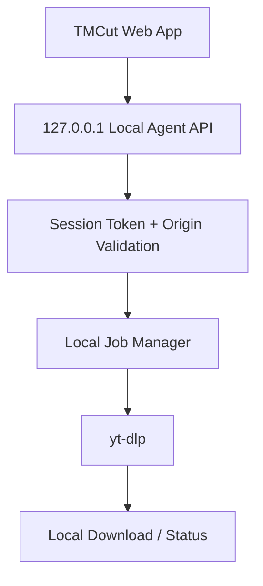
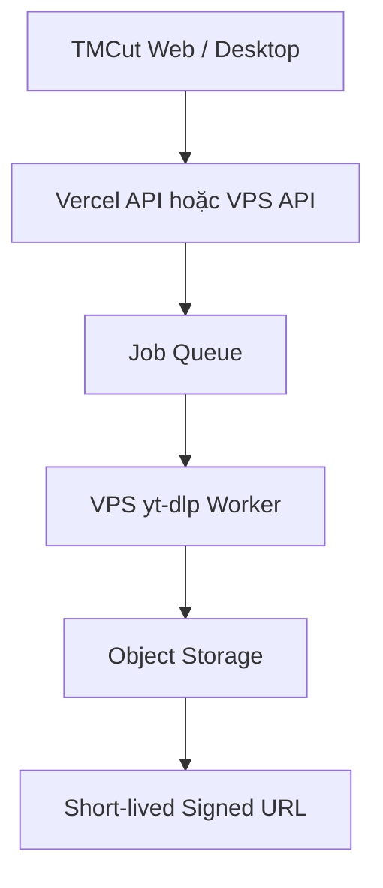

# TMCut V4 – Universal HTML/GPU Video Rendering & Multi-Platform Architecture

> **Tài liệu định hướng kiến trúc và roadmap triển khai**
>
> Trạng thái: Proposal / Architecture Blueprint  
> Phiên bản tài liệu: 1.0  
> Nền tảng hiện tại: Nuxt 4 + Vue 3 + Nuxt UI + Electron  
> Mục tiêu: Xây dựng TMCut thành nền tảng biên tập và xử lý video đa nền tảng, dùng chung Project Core, Timeline Core và Rendering Core.

---

## 1. Tóm tắt định hướng

TMCut V4 được định hướng chuyển từ mô hình:

**HTML Preview → chuyển đổi thành FFmpeg Filter Graph → FFmpeg Export**

sang mô hình:

**Shared Project/Timeline Core → Unified HTML/GPU Rendering Engine → Frame Pipeline → WebCodecs/Muxer**

FFmpeg không còn là thành phần bắt buộc của đường render chính. Nó trở thành **Native Media Backend tùy chọn**, dùng khi cần xử lý codec, remux, media operation chuyên biệt, fallback hoặc các tác vụ mà browser stack chưa đáp ứng tốt.

### 1.1 Các nguyên tắc cốt lõi

1. **HTML-first, GPU-accelerated:** HTML/CSS/SVG phù hợp với typography, subtitle, template, vector và motion graphics; GPU compositor xử lý video/image layers, transforms, compositing và effects.
2. **Preview/Export dùng chung logic:** Cùng Project Core, Timeline Core, effect definitions, transform model và timestamp evaluation.
3. **Deterministic rendering:** Render theo timestamp/frame index xác định, không phụ thuộc đồng hồ thực hoặc tốc độ playback.
4. **Platform-independent project:** Project JSON không phụ thuộc Electron, browser, VPS hay Vercel.
5. **Runtime adapters:** Native APIs, filesystem, process, downloader, storage và remote jobs được trừu tượng hóa qua adapter.
6. **Progressive enhancement:** WebGPU/WebCodecs được sử dụng khi hỗ trợ; có fallback phù hợp như WebGL2, Canvas2D hoặc native backend.
7. **Local-first, cloud-capable:** Người dùng có thể xử lý media tại máy; cloud worker là lựa chọn bổ sung, không bắt buộc.
8. **FFmpeg optional:** Không thiết kế renderer phụ thuộc FFmpeg filter graph; chỉ gọi FFmpeg qua adapter/backend khi thực sự cần.

### 1.2 Phạm vi mục tiêu

TMCut hướng tới các sản phẩm/runtime:

- TMCut Desktop: Electron trên Windows, macOS, Linux.
- TMCut Web Local: Web app chạy trên trình duyệt, dùng file do người dùng chọn và tài nguyên máy người dùng.
- TMCut Web Cloud: Web app deploy trên Vercel hoặc VPS.
- TMCut Remote Worker: Dịch vụ xử lý media trên VPS/server.
- TMCut Agent: Native helper chạy trên máy người dùng, cung cấp các khả năng mà browser không được phép truy cập trực tiếp.

---

## 2. Kiến trúc tổng thể



### 2.1 Các lớp kiến trúc

| Lớp | Trách nhiệm |
|---|---|
| Application/UI | Editor, timeline, inspector, media library, settings |
| Project Core | Project schema, serialization, migration, validation |
| Timeline Core | Track, clip, layer, timebase, keyframe, easing |
| Rendering Core | Đánh giá composition tại timestamp và tạo frame |
| DOM Renderer | Text, HTML templates, SVG, CSS-based elements |
| GPU Compositor | Video/image textures, transform, blend, mask, effects |
| Media Core | Media metadata, source, decode lifecycle, audio/video timing |
| Export Core | Frame scheduling, encoding, audio pipeline, muxing |
| Platform Adapter | Cầu nối với browser, Electron, Node.js và cloud |
| Agent/Worker | Native process, downloader, server-side render jobs |

---

## 3. Project Core và Timeline Core

Đây là nền móng quan trọng nhất. Không để Project JSON chứa các chi tiết riêng của FFmpeg, Electron hoặc một browser cụ thể.

### 3.1 Project schema

Project nên lưu các thông tin mang tính biên tập:

- Project ID, schema version, name.
- Canvas/composition width, height, frame rate.
- Timebase và duration.
- Media assets và metadata tham chiếu.
- Tracks, clips, layers.
- Transform, crop, opacity, blend mode.
- Effects và effect parameters.
- Keyframes, interpolation và easing.
- Audio tracks, gain, pan, fades.
- Export profile.
- Asset references/relative paths hoặc storage references.

Không lưu đường dẫn tuyệt đối của máy A như một định danh duy nhất. Nên có `assetId`, `sourceUri`, `relativePath`, `storageKey` và cơ chế relink asset.

### 3.2 Timebase

Sử dụng timebase độc lập với frame rate để tránh sai số tích lũy. Nếu project hiện tại đã dùng 120.000 ticks/giây, có thể tiếp tục dùng làm nền tảng, nhưng cần chuẩn hóa quy tắc chuyển đổi giữa:

- ticks
- microseconds
- frame index
- source media timestamp
- composition timestamp

Ví dụ:

```ts
interface Timebase {
  ticksPerSecond: number
}

interface FrameRate {
  numerator: number
  denominator: number
}

function frameToTicks(
  frameIndex: number,
  fps: FrameRate,
  ticksPerSecond: number
): number {
  return Math.round(
    frameIndex * ticksPerSecond * fps.denominator / fps.numerator
  )
}
```

Không giả định mọi FPS đều là số nguyên; cần hỗ trợ 23.976, 29.97, 59.94 dưới dạng rational numerator/denominator.

### 3.3 Timeline evaluation

Timeline Core cần có API thuần, không phụ thuộc UI:

```ts
interface TimelineEvaluator {
  evaluateAt(timestamp: number): EvaluatedComposition
}
```

Kết quả đánh giá phải xác định:

- Clip/layer nào đang active.
- Source timestamp tương ứng.
- Transform tại thời điểm đó.
- Effect parameters tại thời điểm đó.
- Opacity/blend/mask.
- Transition progress.
- Audio gain/pan/fade.
- Thứ tự compositing.

UI Preview và Export đều gọi cùng logic evaluation này.

---

## 4. Unified Rendering Engine

### 4.1 Triết lý

Không dùng CSS animation chạy theo thời gian thực làm nguồn sự thật của export. Mọi animation phải được tính từ timestamp của timeline.

Thay vì yêu cầu browser tự chạy animation 10 giây rồi chụp lại, engine cần có thể yêu cầu:

```ts
await renderer.renderAt(5.25)
```

và nhận được composition chính xác tại 5,25 giây.

### 4.2 Renderer abstraction

```ts
interface RenderRequest {
  timestamp: number
  width: number
  height: number
  quality?: 'preview' | 'final'
}

interface RenderResult {
  frame: VideoFrame | ImageBitmap
  timestamp: number
  width: number
  height: number
}

interface Renderer {
  initialize(): Promise<void>
  renderAt(request: RenderRequest): Promise<RenderResult>
  dispose(): Promise<void>
}
```

Đây là interface định hướng. Cần quản lý vòng đời `VideoFrame`, `ImageBitmap`, GPU texture và resource rõ ràng; giải phóng tài nguyên sau khi encoder tiêu thụ xong.

### 4.3 DOM Renderer

Dùng cho:

- Text và typography.
- Subtitle/caption.
- HTML template.
- SVG, icon, vector shapes.
- Sticker và lower-third.
- CSS layout, gradient, shadow.
- Một số animation và visual element.

Lưu ý: DOM không tự động trở thành texture GPU trong mọi browser. Cần thiết kế cơ chế capture/rasterize DOM thành texture hoặc render element qua surface riêng. Cần kiểm thử giới hạn của Chromium/browser, đặc biệt với font, filter, cross-origin media và CSS features.

### 4.4 GPU Compositor

Khuyến nghị hỗ trợ theo thứ tự:

1. WebGL2 làm baseline tương thích rộng.
2. WebGPU là backend nâng cao khi runtime hỗ trợ ổn định.
3. Canvas2D là fallback cho trường hợp đơn giản hoặc GPU không khả dụng.

GPU compositor xử lý:

- Video frames và image textures.
- Layer ordering.
- Transform matrix.
- Alpha blending.
- Blend modes.
- Crop/UV mapping.
- Masks.
- Color adjustments.
- Blur/glow/distortion.
- Transition shaders.
- Custom GLSL/WGSL effects.

Không nên giả định WebGPU luôn có mặt trên mọi máy hoặc mọi môi trường remote/headless. Cần capability detection và backend fallback.

### 4.5 Media Renderer

Media renderer quản lý:

- Video source decode.
- Audio source decode.
- Source timestamp và composition timestamp.
- Seek và keyframe behavior.
- Frame caching.
- Proxy media.
- Audio/video synchronization.
- Decode concurrency.

Không được coi video 15 phút là một ảnh lớn hoặc yêu cầu phát liên tục từ đầu đến cuối để có thể truy cập một timestamp.

---

## 5. Video Transform Engine

Các thao tác zoom, flip, pan, rotate, crop không bắt buộc phải dùng FFmpeg. Đây là các phép biến đổi hình học có thể xử lý trong DOM hoặc GPU. Với video editor, GPU compositor thường là lựa chọn phù hợp hơn để giữ hiệu năng và đảm bảo cùng logic cho nhiều layer.

### 5.1 Transform model

```ts
interface VideoTransform {
  position: {
    x: number
    y: number
  }

  scale: {
    x: number
    y: number
  }

  rotation: number

  anchor: {
    x: number
    y: number
  }

  crop: {
    top: number
    bottom: number
    left: number
    right: number
  }

  opacity: number
  fit: 'contain' | 'cover' | 'fill'
}
```

Ví dụ:

- Zoom: thay đổi scale.
- Flip horizontal: scale.x âm hoặc cờ flip riêng.
- Flip vertical: scale.y âm hoặc cờ flip riêng.
- Pan: thay đổi position.
- Rotate: thay đổi rotation.
- Crop: thay đổi vùng UV hoặc clip region.
- Opacity: alpha.
- Anchor: điểm neo để xoay/scale.

### 5.2 Tọa độ

Quy tắc bắt buộc:

- Lưu transform trong composition coordinate system.
- Không lưu tọa độ CSS pixel phụ thuộc kích thước cửa sổ.
- Preview chỉ chuyển đổi composition coordinates sang viewport coordinates.
- Export dùng cùng transform values và cùng matrix calculation.
- Định nghĩa rõ thứ tự transform: translate, anchor, rotate, scale, crop hoặc một quy ước matrix thống nhất.

### 5.3 Keyframe

Transform và effect parameters phải hỗ trợ:

- Linear interpolation.
- Bezier/easing.
- Hold/constant.
- Motion path khi cần.
- Keyframe interpolation độc lập với FPS.
- Timestamp evaluation deterministic.

---

## 6. Effects, Transitions và Plugin API

### 6.1 Effect categories

- Geometry: transform, crop, perspective.
- Color: brightness, contrast, saturation, hue, temperature.
- Blur: gaussian blur, directional blur, motion blur.
- Stylize: glow, outline, pixelate, noise.
- Keying: chroma key, luma key.
- Mask: shape mask, image mask, animated mask.
- Distortion: wave, displacement, lens distortion.
- Compositing: blend modes, opacity.
- Motion: tracking, stabilization, optical flow (cần thuật toán chuyên biệt).

### 6.2 Transition engine

Transition được định nghĩa bằng progress từ 0 đến 1 và composition timestamp, không dựa vào CSS wall-clock animation.

Ví dụ:

```ts
interface TransitionContext {
  progress: number
  timestamp: number
  width: number
  height: number
}

interface TransitionRenderer {
  render(
    from: VideoFrame,
    to: VideoFrame,
    context: TransitionContext
  ): Promise<VideoFrame>
}
```

### 6.3 Plugin API

Cho phép đăng ký effect/transition mới:

```ts
interface EffectPlugin<TParams = unknown> {
  id: string
  version: string
  schema: unknown
  defaultParams: TParams

  render(
    input: VideoFrame,
    params: TParams,
    timestamp: number,
    context: GpuRenderContext
  ): Promise<VideoFrame>
}
```

Cần có versioning, parameter schema, validation, capability requirements và cơ chế sandbox phù hợp. Không chạy plugin không đáng tin cậy với quyền truy cập tùy ý vào filesystem/process.

---

## 7. Preview và Export: cùng lõi, khác chính sách chất lượng

### 7.1 Preview

Preview ưu tiên phản hồi nhanh:

- Resolution thấp hơn final khi cần.
- Cache frame.
- Decode theo nhu cầu.
- Proxy media.
- Giảm chất lượng effect nặng trong lúc kéo timeline.
- Scrubbing và playback.
- Có thể bỏ frame khi playback realtime bị quá tải.

### 7.2 Export

Export ưu tiên độ chính xác:

- Render theo frame index/timestamp xác định.
- Không bỏ frame.
- Chờ decode và render hoàn tất.
- Kiểm soát encoder backpressure.
- Đồng bộ audio/video.
- Có thể render offline nhanh hơn hoặc chậm hơn realtime.
- Có checkpoint và retry theo segment nếu thiết kế hỗ trợ.

### 7.3 Deterministic Frame Scheduler

Không sử dụng cách `sleep(33)` giữa các lần screenshot. Cách này phụ thuộc tốc độ máy và thời gian xử lý.

Ví dụ logic:

```ts
const fps = { numerator: 30, denominator: 1 }
const durationSeconds = 10
const totalFrames = Math.ceil(
  durationSeconds * fps.numerator / fps.denominator
)

for (let frameIndex = 0; frameIndex < totalFrames; frameIndex++) {
  const timestampSeconds =
    frameIndex * fps.denominator / fps.numerator

  const result = await renderer.renderAt({
    timestamp: timestampSeconds,
    width: 1920,
    height: 1080,
    quality: 'final'
  })

  await encoder.encode(result.frame, {
    frameIndex,
    timestampSeconds
  })

  result.frame.close()
}
```

Đây là pseudocode. Implementation thực tế phải xử lý timestamp theo đơn vị mà WebCodecs yêu cầu, encoder queue/backpressure, frame duration, lỗi decode và giải phóng resource đúng thời điểm.

### 7.4 Preview/Export parity

Cùng dùng:

- Timeline evaluator.
- Transform model.
- Effect definitions.
- Transition definitions.
- Font/assets.
- Coordinate system.
- Timestamp semantics.

Có thể khác:

- Preview resolution.
- Preview quality.
- Cache policy.
- Decode strategy.
- Encoder settings.

Không thể cam kết pixel-perfect tuyệt đối giữa mọi GPU/driver/browser nếu shader, color management hoặc font rasterization khác nhau. Cần xây dựng visual regression test và tolerance hợp lý.

---

## 8. Import và xử lý video dài 15 phút

**Import video 15 phút không yêu cầu chờ 15 phút.** Import chủ yếu là đọc metadata, đăng ký asset và tạo các dữ liệu hỗ trợ như thumbnail/waveform. Preview playback phát theo thời gian thực; export là một quá trình riêng.

### 8.1 Import workflow

1. Người dùng chọn video.
2. Đọc metadata: duration, dimensions, FPS, codec, audio tracks.
3. Tạo asset record.
4. Đưa asset lên timeline.
5. Tạo thumbnail/waveform ở background nếu cần.
6. Cho phép seek tới timestamp khi media decoder sẵn sàng.

### 8.2 Seek video

Với codec inter-frame như H.264/H.265, seek có thể cần decode từ keyframe gần nhất rồi tiến đến frame mục tiêu. Không phải mọi timestamp đều là điểm seek trực tiếp.

Cần:

- Keyframe-aware seek.
- Decode queue.
- Frame cache.
- Proxy media.
- Pre-roll decode khi scrub.
- Giới hạn số decoder đồng thời.

### 8.3 Proxy và cache

Proxy media hữu ích khi:

- Source 4K/8K.
- Codec khó decode.
- Nhiều layer video.
- Máy có decoder hạn chế.
- Preview cần scrubbing mượt.

Proxy là bản media nhẹ để preview; export final vẫn có thể dùng source gốc.

### 8.4 Render nhanh hơn realtime

Video 15 phút ở 30 FPS có 27.000 frame. Export không nhất thiết phải mất 15 phút. Tốc độ phụ thuộc:

- Số layer và effects.
- Độ phân giải.
- Source codec và khả năng decode.
- GPU/CPU.
- Encoder và codec.
- Memory bandwidth.
- Audio processing.
- Có thể tận dụng stream copy hay không.

Không nên mặc định chia 15 phút thành 5 worker song song. Chia segment chỉ hiệu quả khi source decode, timestamp boundaries, transitions, audio continuity và encoder/muxing được quản lý đúng. Nhiều worker có thể làm chậm hệ thống do tranh chấp decoder/GPU/RAM.

### 8.5 Smart Export

Có thể tối ưu các trường hợp:

- Source không thay đổi và codec phù hợp: remux/copy khi điều kiện cho phép.
- Chỉ cắt: stream copy có thể dùng nếu điểm cắt tương thích keyframe; nếu không cần re-encode.
- Có overlay/effect: render các frame bị ảnh hưởng.
- Intro/outro thay đổi: có thể giữ nguyên đoạn giữa nếu codec, timestamps, audio và concat compatibility đáp ứng yêu cầu.

Smart Export là giai đoạn nâng cao; không nên hứa hẹn giữ nguyên bitstream cho mọi dự án.

---

## 9. Export pipeline không bắt buộc FFmpeg

### 9.1 Pipeline đề xuất



### 9.2 Công nghệ

| Chức năng | Công nghệ đề xuất |
|---|---|
| HTML composition | Chromium |
| GPU compositing | WebGL2 / WebGPU |
| Frame capture | VideoFrame / canvas / browser-specific capture |
| Video encoding | WebCodecs VideoEncoder |
| Audio processing | Web Audio API / AudioWorklet |
| Audio encoding | WebCodecs AudioEncoder khi hỗ trợ |
| MP4/WebM muxing | Mediabunny hoặc muxer tương thích |
| Metadata/probe | Browser APIs và/hoặc native helper |
| Native fallback | Optional FFmpeg backend |

### 9.3 Các giới hạn phải kiểm thử

- WebCodecs không có cùng codec/profile trên mọi thiết bị.
- Hardware acceleration là tùy chọn của browser/platform, không được đảm bảo.
- Một số browser/API không hỗ trợ đầy đủ audio/video codec mong muốn.
- Browser tab có thể bị throttling hoặc đóng.
- WebGPU có thể không khả dụng trong một số runtime/headless environment.
- MP4 muxing cần xử lý timestamps, codec configuration, keyframe và audio/video interleaving.
- Export dài cần quản lý memory, queue và file output streaming.

Không nên dùng MediaRecorder làm export offline chính nếu yêu cầu điều khiển frame/timestamp chính xác. MediaRecorder phù hợp hơn cho realtime capture.

---

## 10. Multi-platform: Electron, Web Local, VPS và Vercel

### 10.1 Runtime matrix

| Khả năng | Electron | Browser Local | VPS | Vercel |
|---|---|---|---|---|
| Shared UI | Có | Có | Có | Có |
| Project/Timeline Core | Có | Có | Có | Có |
| HTML Preview | Có | Có | Có | Có |
| WebGL/WebGPU | Theo runtime | Theo browser | Theo browser/headless runtime | Trên client browser |
| WebCodecs | Theo Chromium/runtime | Theo browser | Theo runtime | Trên client browser |
| Import file local | Native | File Picker/permission | Cần upload | Cần upload |
| Local filesystem | Có | Giới hạn browser | Server filesystem | Temporary filesystem giới hạn |
| Spawn native process | Có | Không trực tiếp | Có | Không phù hợp cho worker dài |
| yt-dlp | Có | Qua Local Agent | Có | Không nên làm downloader chính |
| Long-running render | Có | Tab có thể bị giới hạn | Có | Không nên dùng Functions làm worker chính |

Điểm quan trọng: Vercel host frontend/API, nhưng WebGL/WebCodecs khi chạy trên trang web vẫn chạy trên thiết bị của người dùng. Không có nghĩa Vercel server đang sử dụng GPU máy người dùng.

### 10.2 Monorepo gợi ý

```text
tmcut/
├── apps/
│   ├── desktop/                 # Electron shell
│   ├── web/                     # Nuxt web application
│   └── worker/                  # Node.js media worker
│
├── packages/
│   ├── core/                    # Project + timeline + timebase
│   ├── editor/                  # Shared Vue editor UI
│   ├── rendering/               # Rendering interfaces/core
│   ├── renderer-dom/            # DOM/SVG renderer
│   ├── renderer-webgl/          # WebGL2 backend
│   ├── renderer-webgpu/         # WebGPU backend
│   ├── media-core/              # Media abstraction/decode
│   ├── effects/                 # Effect definitions/plugins
│   ├── animation/               # Keyframes/easing
│   ├── export/                  # Frame scheduling/encoding
│   ├── muxing/                  # MP4/WebM muxing
│   ├── platform-contracts/      # Runtime interfaces
│   └── shared/                  # Types/utilities
│
├── adapters/
│   ├── browser/
│   ├── electron/
│   ├── node/
│   └── cloud/
│
├── services/
│   ├── agent/
│   ├── downloader/
│   ├── media-worker/
│   ├── job-api/
│   └── storage/
│
├── docs/
└── tests/
```

Không cần tách toàn bộ package ngay từ đầu. Trước tiên tạo boundaries và interfaces trong codebase hiện tại, sau đó tách package khi có nhu cầu build/test/deploy độc lập.

### 10.3 Platform Adapter

```ts
interface PlatformAdapter {
  files: FileAdapter
  process: ProcessAdapter
  storage: StorageAdapter
  media: MediaAdapter
  gpu: GpuAdapter
  network: NetworkAdapter
  downloader: DownloaderAdapter
}
```

Ví dụ:

- Electron: native filesystem, `child_process`, native binaries.
- Browser: File API, IndexedDB/OPFS khi phù hợp, WebCodecs, WebGPU.
- Node/VPS: filesystem, process, worker queue, object storage.
- Vercel: API/auth/job orchestration; không chạy media worker dài hạn.

Không để UI gọi thẳng `child_process`, `fs` hoặc API Electron. Mọi native operation phải đi qua adapter và IPC được kiểm soát.

---

## 11. yt-dlp và TMCut Downloader

### 11.1 Bản chất

yt-dlp là native command-line tool/Python package. Browser sandbox không cho phép JavaScript của website tự ý chạy `yt-dlp.exe` hoặc truy cập filesystem tùy ý.

Các môi trường:

| Môi trường | Cách chạy |
|---|---|
| Electron Desktop | Chạy native yt-dlp qua process adapter |
| Browser Web | Không chạy trực tiếp; cần Local Agent hoặc remote service |
| VPS | Chạy yt-dlp trong worker/service |
| Vercel | Không phù hợp làm downloader dài hạn; dùng remote worker |

Chỉ tải nội dung mà người dùng có quyền tải/sử dụng và tuân thủ điều khoản nền tảng cũng như pháp luật liên quan. Không thiết kế tính năng nhằm vượt DRM, paywall hoặc cơ chế kiểm soát truy cập.

### 11.2 Phương án 1: Native Downloader trong Electron



Chức năng:

- Download job.
- Progress parsing.
- Cancel.
- Retry.
- Output template.
- Format selection.
- Error mapping.
- Download history.
- Version/update management.

Không truyền shell command string ghép từ input người dùng. Dùng process spawn với executable path cố định và arguments dạng array để tránh command injection.

### 11.3 Phương án 2: TMCut Local Agent

Đây là phương án quan trọng để Web App sử dụng native capability trên máy người dùng.



Agent có thể cung cấp API:

```ts
interface LocalAgentClient {
  getCapabilities(): Promise<AgentCapabilities>

  createDownloadJob(
    request: DownloadRequest
  ): Promise<{ jobId: string }>

  getJob(jobId: string): Promise<DownloadJobStatus>

  cancelJob(jobId: string): Promise<void>
}
```

Yêu cầu bảo mật bắt buộc:

- Bind chỉ vào `127.0.0.1` hoặc loopback tương đương.
- Không mở API không xác thực.
- Kiểm tra Origin allowlist.
- Token phiên ngẫu nhiên, thời hạn ngắn.
- Chống CSRF và DNS rebinding.
- Validate URL, scheme và redirect.
- Chặn truy cập địa chỉ private/link-local/metadata IP không cần thiết.
- Không cho website bất kỳ gọi tùy ý process.
- Không nhận command line tùy ý từ client.
- Có consent rõ ràng trước khi tải.
- Log/audit các native jobs.

Cần kiểm tra kỹ mô hình bảo mật browser-to-localhost trên các browser/OS mục tiêu. Có thể cần onboarding, pairing code hoặc cơ chế xác thực riêng.

### 11.4 Phương án 3: Remote Downloader trên VPS



Chức năng:

- Nhận download request.
- Xác thực user/quota.
- Đưa job vào queue.
- Worker thực thi yt-dlp.
- Lưu output vào object storage.
- Cấp signed URL có thời hạn.
- Theo dõi trạng thái và dọn file hết hạn.

Phải giới hạn concurrency, dung lượng, thời gian chạy, URL được phép, network egress và chi phí storage/bandwidth.

### 11.5 So sánh downloader

| Tiêu chí | Electron native | Local Agent | VPS Worker |
|---|---|---|---|
| Không cần upload source | Có | Có | Không |
| Dùng trên Web | Không | Có | Có |
| Tải về máy người dùng | Có | Có | Cần tải từ storage |
| Phụ thuộc server | Không | Không | Có |
| Multi-user cloud | Không | Không | Có |
| Cần cài native helper | Electron đã có | Có | Không |
| Phù hợp | Desktop | Web Local | Cloud |

---

## 12. Google Colab có nên làm Remote Worker?

### 12.1 Có thể về kỹ thuật

Google Colab notebook có thể cài và chạy yt-dlp/FFmpeg trên Linux runtime, sau đó lưu output vào Google Drive hoặc tải xuống.

Tuy nhiên, Colab Free không phải môi trường production worker:

- Runtime có thể bị ngắt.
- Session và endpoint không ổn định.
- Tài nguyên GPU/CPU không được đảm bảo liên tục.
- Không phù hợp làm service API thường trực.
- Chính sách Colab hạn chế một số kiểu sử dụng như web service/remote control hoặc worker liên tục.

Không nên xây kiến trúc sản phẩm phụ thuộc vào một notebook Colab đang mở.

### 12.2 Hướng thay thế

- VPS Linux: phù hợp worker lâu dài.
- Google Compute Engine: khi muốn dùng hạ tầng Google Cloud.
- Cloud Run/Jobs: phù hợp job theo lô nếu thiết kế đúng giới hạn runtime/storage.
- Object Storage: lưu input/output.
- Redis/BullMQ hoặc queue managed: điều phối job.

Colab chỉ nên dùng để thử nghiệm, benchmark, prototype hoặc tác vụ cá nhân phù hợp chính sách.

---

## 13. Vercel và VPS: phân chia trách nhiệm

### Vercel phù hợp

- Nuxt frontend.
- Authentication.
- User/project APIs.
- Project metadata.
- Job creation/status APIs.
- Signed URL issuance.
- Webhook và orchestration nhẹ.

### VPS/Worker phù hợp

- yt-dlp.
- Native FFmpeg khi cần.
- Long-running render.
- Batch processing.
- Thumbnail/waveform generation.
- Media probing.
- Queue consumers.
- GPU/CPU workloads có kiểm soát.

### Storage

Không lưu file media lớn lâu dài trong filesystem tạm của Vercel Functions. Dùng object storage S3-compatible hoặc dịch vụ storage phù hợp.

### Job lifecycle

```ts
type JobStatus =
  | 'queued'
  | 'preparing'
  | 'processing'
  | 'uploading'
  | 'completed'
  | 'failed'
  | 'cancelled'
```

Mỗi job nên có:

- `jobId`
- `userId`
- `projectId` nếu có
- `jobType`
- `status`
- `progress`
- `stage`
- `inputAssets`
- `outputAssets`
- `createdAt`, `updatedAt`
- `errorCode`, `errorMessage`
- `retryCount`
- `workerId`

Không để API request chờ cho tới khi render/download hoàn tất. API tạo job và trả `jobId`; client subscribe/poll trạng thái.

---

## 14. Smart Export và backend selection

TMCut có thể lựa chọn backend dựa trên capability:

```ts
interface RuntimeCapabilities {
  webgl2: boolean
  webgpu: boolean
  webCodecsVideo: boolean
  webCodecsAudio: boolean
  supportedVideoCodecs: string[]
  supportedAudioCodecs: string[]
  hardwareAcceleration: 'available' | 'unavailable' | 'unknown'
  nativeAgent: boolean
  nativeFfmpeg: boolean
}
```

Ví dụ lựa chọn:

1. Browser có WebGPU + WebCodecs phù hợp → GPU renderer + WebCodecs.
2. Browser chỉ có WebGL2 + WebCodecs → WebGL2 renderer + WebCodecs.
3. Browser thiếu codec cần thiết → thông báo rõ và đề xuất backend khác.
4. Desktop có Agent/native backend → có thể dùng native media operation.
5. Cloud job → gửi VPS worker.
6. Optional FFmpeg chỉ được gọi khi job yêu cầu hoặc backend chính không đáp ứng.

Không tự động chuyển file riêng tư lên cloud mà không có sự đồng ý của người dùng.

---

## 15. Roadmap triển khai TMCut V4

Nên triển khai theo giai đoạn, giữ sản phẩm hiện tại hoạt động và tránh rewrite toàn bộ cùng lúc.

### Phase 0 – Audit và đóng băng contract

> **Trạng thái: PASS (2026-11-01).** Deliverable đầy đủ tại [v4-phase-0-audit.md](file:///D:/Applications/tm-studio/docs/v4-phase-0-audit.md): bản đồ kiến trúc, kiểm kê 20 tính năng theo runtime, đặc tả Project schema (app model vs DSL v3 + chuỗi migration v1→v3), 10 khoảng trống và 5 ADR cần chốt trước Phase 1.

- Audit repo hiện tại.
- Xác định Project JSON hiện tại.
- Xác định Timeline/Timebase hiện tại.
- Liệt kê feature đang dùng FFmpeg.
- Phân loại feature: editor, renderer, export, downloader, native tools.
- Viết architecture decision records (ADR).
- Xác định backward compatibility và migration strategy.

**Deliverables:**

- Current architecture map.
- Feature inventory.
- Project schema specification.
- V4 migration plan.

### Phase 1 – Shared Core và Platform Contracts

> **Trạng thái: IN PROGRESS.** M1 đã xong (2026-11-01): `evaluateTimeline(timeline, tick)` ([evaluate.mjs](file:///D:/Applications/tm-studio/packages/core/src/evaluate.mjs)), clock tick↔frame ([clock.mjs](file:///D:/Applications/tm-studio/packages/core/src/clock.mjs)), capability negotiation ([platform.mjs](file:///D:/Applications/tm-studio/packages/core/src/platform.mjs)) và contract type-only `TmcutPlatformAdapter` ([types/platform.ts](file:///D:/Applications/tm-studio/packages/core/types/platform.ts)); 34 test thuần Node. M2 đang mở (2026-11-01): preview đã đọc `evaluateClip` cho transform/opacity, `textAnimationAt` cho animation chữ in/out, và `evaluateTimeline` để chọn clip đang phát + cặp crossfade (`useTmcutPlayback`); evaluator ánh xạ speed ramp bằng tích phân và nhận cả shape phẳng của app store (`clipSpan`); core 449 test. Golden-frame test đầu tiên đã chạy (`tmcut_golden_frame.spec.ts`, canvas + FFmpeg thật + `compareFrames`); M2 bước 4 thêm `tmcut_render_parity.spec.ts` render clip thật rồi kiểm pixel theo geometry/source mà `evaluateTimeline` trả (scale/x/y/opacity và speed→source), đưa unit suite lên 73 spec. `/tmcut/editor` đã được QA trực quan qua CDP (0 console error). Còn lại của Phase 1: hiện thực host adapter browser/electron, `activeTextClips` qua evaluator, và golden chữ khi có font ghim.

- Tách Project Core khỏi UI.
- Tách Timeline evaluator.
- Chuẩn hóa timebase.
- Xây platform adapter interfaces.
- Tạo browser/electron/node adapters tối thiểu.
- Không thay đổi behavior người dùng ở giai đoạn này.

**Acceptance criteria:**

- Core chạy được trong browser và Node test.
- Project serialize/deserialize không phụ thuộc Electron.
- Timeline evaluation có unit tests.
- Project cũ có migration tests.

### Phase 2 – Deterministic Rendering MVP

- Xây `renderAt(timestamp)`.
- Xây DOM renderer.
- Xây frame scheduler.
- Render text, image, SVG, shape.
- Preview và export gọi cùng timeline evaluator.
- Tạo golden-frame tests.

**Acceptance criteria:**

- Render được composition mẫu ở timestamp tùy chọn.
- Kết quả không phụ thuộc wall-clock.
- Seek đến timestamp bất kỳ trong composition.
- Không dùng `sleep()` làm cơ chế frame timing.

### Phase 3 – GPU Compositor và Transform Engine

- WebGL2 baseline.
- WebGPU backend thử nghiệm.
- Video/image texture pipeline.
- Transform matrix.
- Crop/flip/rotate/scale/pan.
- Alpha/blend.
- Color effects cơ bản.
- Resource lifecycle và GPU context recovery.

**Acceptance criteria:**

- Preview transform và export transform dùng cùng model.
- Có fallback khi WebGPU không khả dụng.
- Không rò rỉ GPU resource trong test dài.
- Có benchmark nhiều layer và nhiều độ phân giải.

### Phase 4 – Media Decode, Proxy và Audio

- Media source abstraction.
- Video decode và timestamp mapping.
- Seek/keyframe-aware decode.
- Frame cache.
- Proxy generation.
- Audio decode/mix.
- AudioWorklet hoặc backend phù hợp.
- Audio/video synchronization.

**Acceptance criteria:**

- Import video dài không phải chờ phát hết.
- Seek tới timestamp và preview được khi media sẵn sàng.
- Đồng bộ audio/video qua các đoạn timeline.
- Có giới hạn decoder concurrency.

### Phase 5 – WebCodecs Export và Muxing

- VideoEncoder.
- AudioEncoder khi được hỗ trợ.
- Mediabunny hoặc muxer phù hợp.
- Encoder backpressure.
- Frame timestamp/duration.
- MP4/WebM output.
- Progress/cancel/error.
- Export capability detection.

**Acceptance criteria:**

- Export composition test thành file hợp lệ.
- Frame count và duration chính xác theo profile.
- Audio/video sync được kiểm tra.
- Có test codec không hỗ trợ.
- Không dùng MediaRecorder làm offline frame renderer chính.

### Phase 6 – Electron Runtime và TMCut Agent

- Electron adapter.
- IPC contract.
- Native process manager.
- TMCut Agent.
- yt-dlp integration.
- Optional FFmpeg adapter.
- Local download manager.
- Security hardening.

**Acceptance criteria:**

- Web UI có thể pairing với Agent.
- Không có arbitrary process execution.
- Agent chỉ bind loopback.
- Origin/token validation hoạt động.
- Download progress/cancel/retry hoạt động.

### Phase 7 – Web/Vercel/VPS Deployment

- Nuxt web build.
- Vercel frontend/API.
- VPS worker.
- Queue.
- Object storage.
- Signed URLs.
- Job status API.
- Quota/rate limiting.
- Worker monitoring.

**Acceptance criteria:**

- Vercel không phải giữ request mở trong suốt render.
- Worker restart không làm mất job state.
- Có retry/idempotency.
- Có giới hạn tài nguyên và chi phí.
- User có thể tải output an toàn.

### Phase 8 – Smart Export và Plugin Ecosystem

- Render cache.
- Segment rendering.
- Smart export.
- Effect plugin API.
- Transition plugin API.
- Template packages.
- Custom shader.
- Capability-based backend selection.
- Visual regression suite.

---

## 16. Testing và chất lượng

### 16.1 Unit tests

- Timebase conversion.
- Timeline evaluation.
- Keyframe interpolation.
- Transform matrix.
- Crop/UV mapping.
- Effect parameter evaluation.
- Project serialization/migration.

### 16.2 Rendering tests

- Text/font rendering.
- SVG.
- Alpha blending.
- Transform/crop.
- Color management.
- Transition.
- Frame determinism.
- DOM/GPU integration.

### 16.3 Export tests

- Frame count.
- Duration.
- FPS/rational frame rate.
- Audio/video sync.
- Codec support.
- Muxer validity.
- Cancel/retry.
- Large output/memory usage.

### 16.4 Cross-platform tests

- Electron Windows.
- Electron macOS.
- Electron Linux.
- Chrome/Edge.
- Firefox/Safari theo mức hỗ trợ API thực tế.
- VPS headless runtime.
- Vercel frontend + remote worker.

### 16.5 Performance benchmarks

Benchmark theo matrix:

- 720p / 1080p / 4K.
- 24 / 30 / 60 FPS.
- 1 / 3 / 5 / 10 layers.
- Text-only / image / video / mixed.
- No effects / simple effects / heavy shader.
- Source H.264 / H.265 / VP9 / AV1 khi thiết bị hỗ trợ.
- GPU backend và CPU fallback.

Đo:

- Preview FPS.
- Scrub latency.
- Decode latency.
- Render ms/frame.
- Encode throughput.
- Peak RAM.
- GPU memory.
- Export speed ratio so với realtime.
- Dropped frames trong preview.
- Output correctness.

Không đặt benchmark target trước khi đo trên phần cứng mục tiêu.

---

## 17. Rủi ro và quyết định cần tránh

1. **Không rewrite toàn bộ cùng lúc.** Tách Core và renderer theo giai đoạn.
2. **Không coi DOM là GPU compositor.** DOM capture/rasterization cần thiết kế riêng.
3. **Không phụ thuộc WebGPU tuyệt đối.** WebGL2/Canvas fallback và capability detection.
4. **Không phụ thuộc WebCodecs codec đồng nhất.** Mỗi runtime có codec support khác nhau.
5. **Không render bằng wall-clock animation.** Dùng timestamp evaluation.
6. **Không decode mọi video từ đầu.** Dùng keyframe-aware seek, cache và proxy.
7. **Không mở nhiều worker vô hạn.** Giới hạn theo decoder/GPU/RAM.
8. **Không dùng Vercel Functions làm long-running media worker chính.**
9. **Không dùng Colab Free làm production worker.**
10. **Không mở Local Agent thiếu xác thực.**
11. **Không tự ý upload media riêng tư lên cloud.**
12. **Không biến FFmpeg filter graph thành abstraction trung tâm mới.** Effects nên có model độc lập; backend chỉ là implementation.
13. **Không cam kết pixel-perfect tuyệt đối trên mọi GPU/browser.** Dùng visual regression và tolerance.
14. **Không coi stream copy là luôn khả thi.** Keyframe, codec và timestamp có thể yêu cầu re-encode.

---

## 18. Quyết định kiến trúc đề xuất (ADR Summary)

| ID | Quyết định | Lý do |
|---|---|---|
| ADR-001 | Shared Project/Timeline Core | Project dùng chung mọi platform |
| ADR-002 | HTML-first composition | Linh hoạt typography/template/animation |
| ADR-003 | WebGL2 baseline, WebGPU progressive | Cân bằng tương thích và hiệu năng |
| ADR-004 | Deterministic timestamp renderer | Preview/export cùng logic |
| ADR-005 | WebCodecs + muxer cho browser export | Không bắt buộc FFmpeg |
| ADR-006 | FFmpeg optional backend | Giữ khả năng tương thích native khi cần |
| ADR-007 | Electron + Browser + Node adapters | Đa nền tảng |
| ADR-008 | TMCut Local Agent | Cho Web truy cập native capabilities có kiểm soát |
| ADR-009 | Vercel orchestration, VPS worker | Tách API khỏi tác vụ dài |
| ADR-010 | Colab chỉ prototype | Không ổn định cho production |
| ADR-011 | Project format platform-independent | Dễ di chuyển Desktop/Web/Cloud |
| ADR-012 | Smart Export là phase nâng cao | Tránh tối ưu sớm và sai bitstream |

---

## 19. Kết luận

TMCut V4 nên được xây dựng như một **Universal Video Editing Platform**, không chỉ là một ứng dụng Electron hoặc một HTML-to-MP4 converter.

Kiến trúc đích:

- Nuxt 4 + Vue 3 + Nuxt UI cho shared application.
- Shared Project Core và Timeline Core.
- HTML/CSS/SVG cho composition elements.
- WebGL2/WebGPU cho GPU compositing.
- Deterministic Frame Scheduler cho Preview/Export.
- WebCodecs cho encoding khi runtime hỗ trợ.
- Mediabunny hoặc muxer tương đương để đóng gói.
- Audio engine riêng.
- Electron adapter cho native desktop.
- TMCut Agent cho browser-to-native capabilities.
- VPS worker cho cloud processing.
- Vercel cho frontend, API và job orchestration.
- yt-dlp chạy trên Electron, Local Agent hoặc VPS worker.
- FFmpeg là backend tùy chọn, không phải nền tảng bắt buộc của rendering architecture.

### Lộ trình ưu tiên

**Không nên bắt đầu bằng downloader, cloud queue hoặc plugin ecosystem.**

Thứ tự hợp lý nhất:

1. Audit codebase hiện tại.
2. Chuẩn hóa Project/Timeline Core.
3. Xây deterministic `renderAt(timestamp)`.
4. Xây DOM + WebGL2 renderer.
5. Làm transform/effects.
6. Tích hợp media decode/proxy.
7. Hoàn thiện WebCodecs + muxing.
8. Mở rộng Electron/Web runtime.
9. Xây Local Agent và downloader.
10. Xây VPS worker và cloud jobs.
11. Smart Export và plugin ecosystem.

> **Mục tiêu cuối cùng:** Một project TMCut có thể mở trên Desktop hoặc Web, preview và export bằng cùng một rendering logic, xử lý media local hoặc remote theo quyền của người dùng, và không bị khóa vào FFmpeg filter graph.

---

## 20. Tài liệu tham khảo

Các dự án và tài liệu nên nghiên cứu trước khi implementation:

- TMCut repository: https://github.com/tuanmjnh/tm-tools
- HyperFrames: https://github.com/hyperframes-org/hyperframes
- Remotion: https://www.remotion.dev/
- Motion Canvas: https://motioncanvas.io/
- timecut: https://github.com/tungs/timecut
- mcut: https://mcut.io/docs
- WebCodecs API: https://developer.mozilla.org/en-US/docs/Web/API/WebCodecs_API
- WebGPU API: https://developer.mozilla.org/en-US/docs/Web/API/WebGPU_API
- WebGL: https://developer.mozilla.org/en-US/docs/Web/API/WebGL_API
- Mediabunny: https://mediabunny.dev/
- yt-dlp: https://github.com/yt-dlp/yt-dlp
- Vercel Functions limits: https://vercel.com/docs/functions/limitations
- Google Colab FAQ: https://research.google.com/colaboratory/faq.html

**Lưu ý:** Trước khi implementation, kiểm tra lại API, license, browser support, codec support và giới hạn hosting theo phiên bản mới nhất. Tài liệu này là blueprint kiến trúc, không thay thế việc audit code thực tế trong repository.
