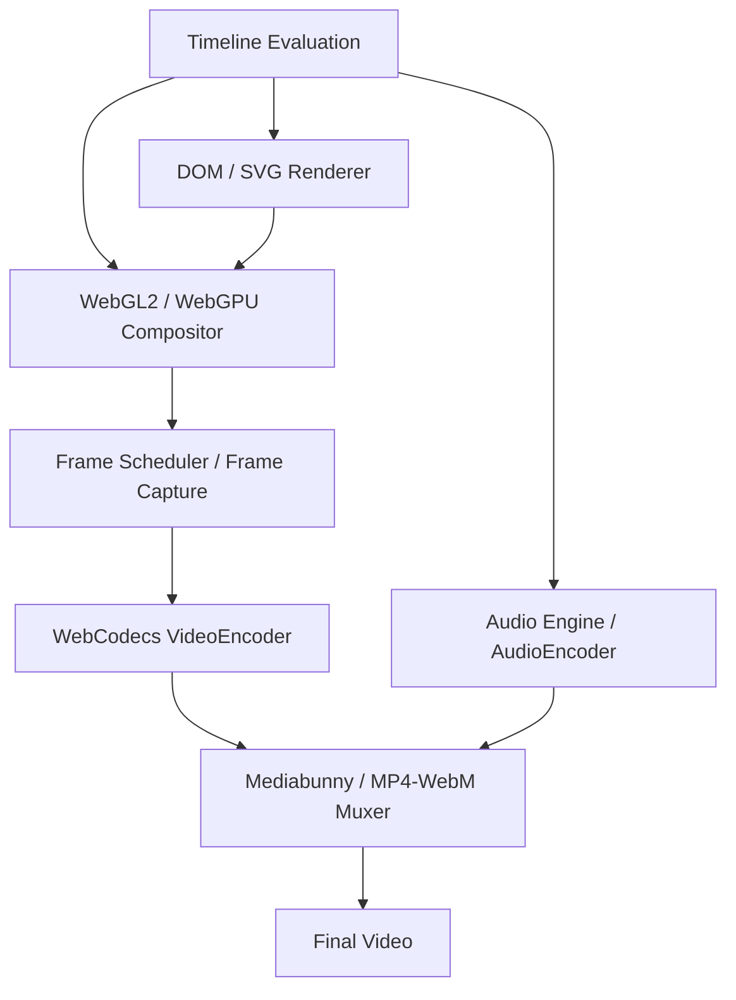
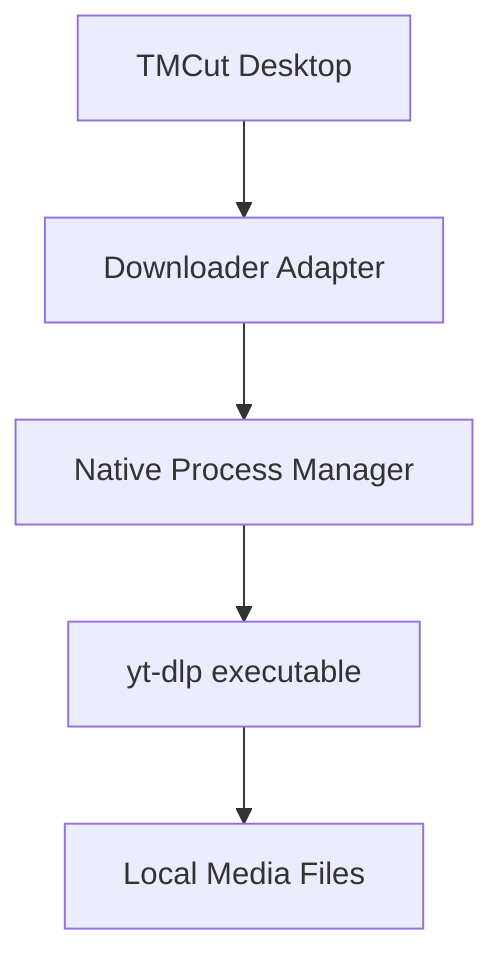
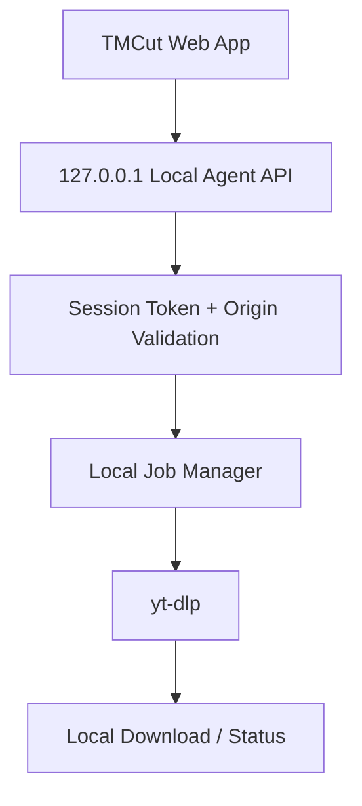
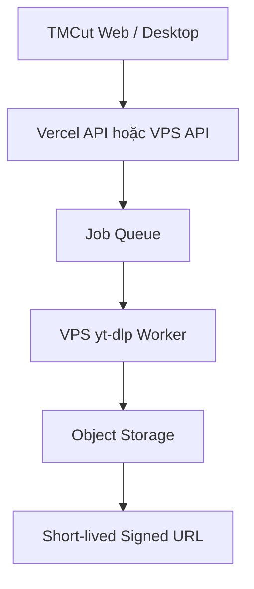

# TMCut V4 – Universal HTML/GPU Video Rendering & Multi-Platform Architecture

> **Tài liệu định hướng kiến trúc và roadmap triển khai**
>
> Trạng thái: Proposal / Architecture Blueprint  
> Phiên bản tài liệu: 1.0  
> Nền tảng hiện tại: Nuxt 4 + Vue 3 + Nuxt UI + Electron  
> Mục tiêu: Xây dựng TMCut thành nền tảng biên tập và xử lý video đa nền tảng, dùng chung Project Core, Timeline Core và Rendering Core.
>
> **Cập nhật 2026-11-03:** tài liệu này vẫn là blueprint kiến trúc, nhưng mọi chỗ nó cho phép FFmpeg ở lại đã bị [ADR-028](file:///D:/Applications/tm-studio/docs/adr/zero-ffmpeg-decisions.md) supersede; nguồn sự thật của media pipeline là plan browser-first và [docs/audit/zero-ffmpeg-audit.md](file:///D:/Applications/tm-studio/docs/audit/zero-ffmpeg-audit.md). Bản thân roadmap sẽ được archive ở slice K của kế hoạch đó.

---

## 1. Tóm tắt định hướng

TMCut V4 được định hướng chuyển từ mô hình:

**HTML Preview → chuyển đổi thành FFmpeg Filter Graph → FFmpeg Export**

sang mô hình:

**Shared Project/Timeline Core → Unified HTML/GPU Rendering Engine → Frame Pipeline → WebCodecs/Muxer**

FFmpeg **không còn là một phần của kiến trúc** (ADR-028, ghi ngày 2026-11-03): không backend tùy chọn, không fallback, không media operation chuyên biệt dành riêng cho nó. Năng lực media thuộc runtime — WebCodecs cho decode/encode, Mediabunny cho demux/mux, Web Audio cho audio, GPU compositor cho composition — và được khai bằng capability check của host, không bằng tên nền tảng.

### 1.1 Các nguyên tắc cốt lõi

1. **HTML-first, GPU-accelerated:** HTML/CSS/SVG phù hợp với typography, subtitle, template, vector và motion graphics; GPU compositor xử lý video/image layers, transforms, compositing và effects.
2. **Preview/Export dùng chung logic:** Cùng Project Core, Timeline Core, effect definitions, transform model và timestamp evaluation.
3. **Deterministic rendering:** Render theo timestamp/frame index xác định, không phụ thuộc đồng hồ thực hoặc tốc độ playback.
4. **Platform-independent project:** Project JSON không phụ thuộc Electron, browser, VPS hay Vercel.
5. **Runtime adapters:** Native APIs, filesystem, process, downloader, storage và remote jobs được trừu tượng hóa qua adapter.
6. **Progressive enhancement:** WebGPU/WebCodecs được sử dụng khi hỗ trợ; có fallback phù hợp như WebGL2, Canvas2D hoặc native backend.
7. **Local-first, cloud-capable:** Người dùng có thể xử lý media tại máy; cloud worker là lựa chọn bổ sung, không bắt buộc.
8. **Zero FFmpeg (ADR-028):** renderer không phụ thuộc FFmpeg filter graph, và cũng không còn một adapter FFmpeg để gọi "khi thực sự cần"; runtime thiếu capability nào thì báo thiếu capability đó.

### 1.2 Phạm vi mục tiêu

TMCut hướng tới các sản phẩm/runtime:

- TMCut Desktop: Electron trên Windows, macOS, Linux.
- TMCut Web Local: Web app chạy trên trình duyệt, dùng file do người dùng chọn và tài nguyên máy người dùng.
- TMCut Web Cloud: Web app deploy trên Vercel hoặc VPS.
- TMCut Remote Worker: Dịch vụ xử lý media trên VPS/server.
- TMCut Agent: Native helper chạy trên máy người dùng, cung cấp các khả năng mà browser không được phép truy cập trực tiếp.

---

## 2. Kiến trúc tổng thể


### 2.1 Các lớp kiến trúc

| Lớp | Trách nhiệm |
|---|---|
| Application/UI | Editor, timeline, inspector, media library, settings |
| Project Core | Project schema, serialization, migration, validation |
| Timeline Core | Track, clip, layer, timebase, keyframe, easing |
| Rendering Core | Đánh giá composition tại timestamp và tạo frame |
| DOM Renderer | Text, HTML templates, SVG, CSS-based elements |
| GPU Compositor | Video/image textures, transform, blend, mask, effects |
| Media Core | Media metadata, source, decode lifecycle, audio/video timing |
| Export Core | Frame scheduling, encoding, audio pipeline, muxing |
| Platform Adapter | Cầu nối với browser, Electron, Node.js và cloud |
| Agent/Worker | Native process, downloader, server-side render jobs |

---

## 3. Project Core và Timeline Core

Đây là nền móng quan trọng nhất. Không để Project JSON chứa các chi tiết riêng của FFmpeg, Electron hoặc một browser cụ thể.

### 3.1 Project schema

Project nên lưu các thông tin mang tính biên tập:

- Project ID, schema version, name.
- Canvas/composition width, height, frame rate.
- Timebase và duration.
- Media assets và metadata tham chiếu.
- Tracks, clips, layers.
- Transform, crop, opacity, blend mode.
- Effects và effect parameters.
- Keyframes, interpolation và easing.
- Audio tracks, gain, pan, fades.
- Export profile.
- Asset references/relative paths hoặc storage references.

Không lưu đường dẫn tuyệt đối của máy A như một định danh duy nhất. Nên có `assetId`, `sourceUri`, `relativePath`, `storageKey` và cơ chế relink asset.

### 3.2 Timebase

Sử dụng timebase độc lập với frame rate để tránh sai số tích lũy. Nếu project hiện tại đã dùng 120.000 ticks/giây, có thể tiếp tục dùng làm nền tảng, nhưng cần chuẩn hóa quy tắc chuyển đổi giữa:

- ticks
- microseconds
- frame index
- source media timestamp
- composition timestamp

Ví dụ:

```ts
interface Timebase {
  ticksPerSecond: number
}

interface FrameRate {
  numerator: number
  denominator: number
}

function frameToTicks(
  frameIndex: number,
  fps: FrameRate,
  ticksPerSecond: number
): number {
  return Math.round(
    frameIndex * ticksPerSecond * fps.denominator / fps.numerator
  )
}
```

Không giả định mọi FPS đều là số nguyên; cần hỗ trợ 23.976, 29.97, 59.94 dưới dạng rational numerator/denominator.

### 3.3 Timeline evaluation

Timeline Core cần có API thuần, không phụ thuộc UI:

```ts
interface TimelineEvaluator {
  evaluateAt(timestamp: number): EvaluatedComposition
}
```

Kết quả đánh giá phải xác định:

- Clip/layer nào đang active.
- Source timestamp tương ứng.
- Transform tại thời điểm đó.
- Effect parameters tại thời điểm đó.
- Opacity/blend/mask.
- Transition progress.
- Audio gain/pan/fade.
- Thứ tự compositing.

UI Preview và Export đều gọi cùng logic evaluation này.

---

## 4. Unified Rendering Engine

### 4.1 Triết lý

Không dùng CSS animation chạy theo thời gian thực làm nguồn sự thật của export. Mọi animation phải được tính từ timestamp của timeline.

Thay vì yêu cầu browser tự chạy animation 10 giây rồi chụp lại, engine cần có thể yêu cầu:

```ts
await renderer.renderAt(5.25)
```

và nhận được composition chính xác tại 5,25 giây.

### 4.2 Renderer abstraction

```ts
interface RenderRequest {
  timestamp: number
  width: number
  height: number
  quality?: 'preview' | 'final'
}

interface RenderResult {
  frame: VideoFrame | ImageBitmap
  timestamp: number
  width: number
  height: number
}

interface Renderer {
  initialize(): Promise<void>
  renderAt(request: RenderRequest): Promise<RenderResult>
  dispose(): Promise<void>
}
```

Đây là interface định hướng. Cần quản lý vòng đời `VideoFrame`, `ImageBitmap`, GPU texture và resource rõ ràng; giải phóng tài nguyên sau khi encoder tiêu thụ xong.

### 4.3 DOM Renderer

Dùng cho:

- Text và typography.
- Subtitle/caption.
- HTML template.
- SVG, icon, vector shapes.
- Sticker và lower-third.
- CSS layout, gradient, shadow.
- Một số animation và visual element.

Lưu ý: DOM không tự động trở thành texture GPU trong mọi browser. Cần thiết kế cơ chế capture/rasterize DOM thành texture hoặc render element qua surface riêng. Cần kiểm thử giới hạn của Chromium/browser, đặc biệt với font, filter, cross-origin media và CSS features.

### 4.4 GPU Compositor

Khuyến nghị hỗ trợ theo thứ tự:

1. WebGL2 làm baseline tương thích rộng.
2. WebGPU là backend nâng cao khi runtime hỗ trợ ổn định.
3. Canvas2D là fallback cho trường hợp đơn giản hoặc GPU không khả dụng.

GPU compositor xử lý:

- Video frames và image textures.
- Layer ordering.
- Transform matrix.
- Alpha blending.
- Blend modes.
- Crop/UV mapping.
- Masks.
- Color adjustments.
- Blur/glow/distortion.
- Transition shaders.
- Custom GLSL/WGSL effects.

Không nên giả định WebGPU luôn có mặt trên mọi máy hoặc mọi môi trường remote/headless. Cần capability detection và backend fallback.

### 4.5 Media Renderer

Media renderer quản lý:

- Video source decode.
- Audio source decode.
- Source timestamp và composition timestamp.
- Seek và keyframe behavior.
- Frame caching.
- Proxy media.
- Audio/video synchronization.
- Decode concurrency.

Không được coi video 15 phút là một ảnh lớn hoặc yêu cầu phát liên tục từ đầu đến cuối để có thể truy cập một timestamp.

---

## 5. Video Transform Engine

Các thao tác zoom, flip, pan, rotate, crop không bắt buộc phải dùng FFmpeg. Đây là các phép biến đổi hình học có thể xử lý trong DOM hoặc GPU. Với video editor, GPU compositor thường là lựa chọn phù hợp hơn để giữ hiệu năng và đảm bảo cùng logic cho nhiều layer.

### 5.1 Transform model

```ts
interface VideoTransform {
  position: {
    x: number
    y: number
  }

  scale: {
    x: number
    y: number
  }

  rotation: number

  anchor: {
    x: number
    y: number
  }

  crop: {
    top: number
    bottom: number
    left: number
    right: number
  }

  opacity: number
  fit: 'contain' | 'cover' | 'fill'
}
```

Ví dụ:

- Zoom: thay đổi scale.
- Flip horizontal: scale.x âm hoặc cờ flip riêng.
- Flip vertical: scale.y âm hoặc cờ flip riêng.
- Pan: thay đổi position.
- Rotate: thay đổi rotation.
- Crop: thay đổi vùng UV hoặc clip region.
- Opacity: alpha.
- Anchor: điểm neo để xoay/scale.

### 5.2 Tọa độ

Quy tắc bắt buộc:

- Lưu transform trong composition coordinate system.
- Không lưu tọa độ CSS pixel phụ thuộc kích thước cửa sổ.
- Preview chỉ chuyển đổi composition coordinates sang viewport coordinates.
- Export dùng cùng transform values và cùng matrix calculation.
- Định nghĩa rõ thứ tự transform: translate, anchor, rotate, scale, crop hoặc một quy ước matrix thống nhất.

### 5.3 Keyframe

Transform và effect parameters phải hỗ trợ:

- Linear interpolation.
- Bezier/easing.
- Hold/constant.
- Motion path khi cần.
- Keyframe interpolation độc lập với FPS.
- Timestamp evaluation deterministic.

---

## 6. Effects, Transitions và Plugin API

### 6.1 Effect categories

- Geometry: transform, crop, perspective.
- Color: brightness, contrast, saturation, hue, temperature.
- Blur: gaussian blur, directional blur, motion blur.
- Stylize: glow, outline, pixelate, noise.
- Keying: chroma key, luma key.
- Mask: shape mask, image mask, animated mask.
- Distortion: wave, displacement, lens distortion.
- Compositing: blend modes, opacity.
- Motion: tracking, stabilization, optical flow (cần thuật toán chuyên biệt).

### 6.2 Transition engine

Transition được định nghĩa bằng progress từ 0 đến 1 và composition timestamp, không dựa vào CSS wall-clock animation.

Ví dụ:

```ts
interface TransitionContext {
  progress: number
  timestamp: number
  width: number
  height: number
}

interface TransitionRenderer {
  render(
    from: VideoFrame,
    to: VideoFrame,
    context: TransitionContext
  ): Promise<VideoFrame>
}
```

### 6.3 Plugin API

Cho phép đăng ký effect/transition mới:

```ts
interface EffectPlugin<TParams = unknown> {
  id: string
  version: string
  schema: unknown
  defaultParams: TParams

  render(
    input: VideoFrame,
    params: TParams,
    timestamp: number,
    context: GpuRenderContext
  ): Promise<VideoFrame>
}
```

Cần có versioning, parameter schema, validation, capability requirements và cơ chế sandbox phù hợp. Không chạy plugin không đáng tin cậy với quyền truy cập tùy ý vào filesystem/process.

---

## 7. Preview và Export: cùng lõi, khác chính sách chất lượng

### 7.1 Preview

Preview ưu tiên phản hồi nhanh:

- Resolution thấp hơn final khi cần.
- Cache frame.
- Decode theo nhu cầu.
- Proxy media.
- Giảm chất lượng effect nặng trong lúc kéo timeline.
- Scrubbing và playback.
- Có thể bỏ frame khi playback realtime bị quá tải.

### 7.2 Export

Export ưu tiên độ chính xác:

- Render theo frame index/timestamp xác định.
- Không bỏ frame.
- Chờ decode và render hoàn tất.
- Kiểm soát encoder backpressure.
- Đồng bộ audio/video.
- Có thể render offline nhanh hơn hoặc chậm hơn realtime.
- Có checkpoint và retry theo segment nếu thiết kế hỗ trợ.

### 7.3 Deterministic Frame Scheduler

Không sử dụng cách `sleep(33)` giữa các lần screenshot. Cách này phụ thuộc tốc độ máy và thời gian xử lý.

Ví dụ logic:

```ts
const fps = { numerator: 30, denominator: 1 }
const durationSeconds = 10
const totalFrames = Math.ceil(
  durationSeconds * fps.numerator / fps.denominator
)

for (let frameIndex = 0; frameIndex < totalFrames; frameIndex++) {
  const timestampSeconds =
    frameIndex * fps.denominator / fps.numerator

  const result = await renderer.renderAt({
    timestamp: timestampSeconds,
    width: 1920,
    height: 1080,
    quality: 'final'
  })

  await encoder.encode(result.frame, {
    frameIndex,
    timestampSeconds
  })

  result.frame.close()
}
```

Đây là pseudocode. Implementation thực tế phải xử lý timestamp theo đơn vị mà WebCodecs yêu cầu, encoder queue/backpressure, frame duration, lỗi decode và giải phóng resource đúng thời điểm.

### 7.4 Preview/Export parity

Cùng dùng:

- Timeline evaluator.
- Transform model.
- Effect definitions.
- Transition definitions.
- Font/assets.
- Coordinate system.
- Timestamp semantics.

Có thể khác:

- Preview resolution.
- Preview quality.
- Cache policy.
- Decode strategy.
- Encoder settings.

Không thể cam kết pixel-perfect tuyệt đối giữa mọi GPU/driver/browser nếu shader, color management hoặc font rasterization khác nhau. Cần xây dựng visual regression test và tolerance hợp lý.

---

## 8. Import và xử lý video dài 15 phút

**Import video 15 phút không yêu cầu chờ 15 phút.** Import chủ yếu là đọc metadata, đăng ký asset và tạo các dữ liệu hỗ trợ như thumbnail/waveform. Preview playback phát theo thời gian thực; export là một quá trình riêng.

### 8.1 Import workflow

1. Người dùng chọn video.
2. Đọc metadata: duration, dimensions, FPS, codec, audio tracks.
3. Tạo asset record.
4. Đưa asset lên timeline.
5. Tạo thumbnail/waveform ở background nếu cần.
6. Cho phép seek tới timestamp khi media decoder sẵn sàng.

### 8.2 Seek video

Với codec inter-frame như H.264/H.265, seek có thể cần decode từ keyframe gần nhất rồi tiến đến frame mục tiêu. Không phải mọi timestamp đều là điểm seek trực tiếp.

Cần:

- Keyframe-aware seek.
- Decode queue.
- Frame cache.
- Proxy media.
- Pre-roll decode khi scrub.
- Giới hạn số decoder đồng thời.

### 8.3 Proxy và cache

Proxy media hữu ích khi:

- Source 4K/8K.
- Codec khó decode.
- Nhiều layer video.
- Máy có decoder hạn chế.
- Preview cần scrubbing mượt.

Proxy là bản media nhẹ để preview; export final vẫn có thể dùng source gốc.

### 8.4 Render nhanh hơn realtime

Video 15 phút ở 30 FPS có 27.000 frame. Export không nhất thiết phải mất 15 phút. Tốc độ phụ thuộc:

- Số layer và effects.
- Độ phân giải.
- Source codec và khả năng decode.
- GPU/CPU.
- Encoder và codec.
- Memory bandwidth.
- Audio processing.
- Có thể tận dụng stream copy hay không.

Không nên mặc định chia 15 phút thành 5 worker song song. Chia segment chỉ hiệu quả khi source decode, timestamp boundaries, transitions, audio continuity và encoder/muxing được quản lý đúng. Nhiều worker có thể làm chậm hệ thống do tranh chấp decoder/GPU/RAM.

### 8.5 Smart Export

Có thể tối ưu các trường hợp:

- Source không thay đổi và codec phù hợp: remux/copy khi điều kiện cho phép.
- Chỉ cắt: stream copy có thể dùng nếu điểm cắt tương thích keyframe; nếu không cần re-encode.
- Có overlay/effect: render các frame bị ảnh hưởng.
- Intro/outro thay đổi: có thể giữ nguyên đoạn giữa nếu codec, timestamps, audio và concat compatibility đáp ứng yêu cầu.

Smart Export là giai đoạn nâng cao; không nên hứa hẹn giữ nguyên bitstream cho mọi dự án.

---

## 9. Export pipeline: WebCodecs + muxer, không có FFmpeg

### 9.1 Pipeline đề xuất



### 9.2 Công nghệ

| Chức năng | Công nghệ đề xuất |
|---|---|
| HTML composition | Chromium |
| GPU compositing | WebGL2 / WebGPU |
| Frame capture | VideoFrame / canvas / browser-specific capture |
| Video encoding | WebCodecs VideoEncoder |
| Audio processing | Web Audio API / AudioWorklet |
| Audio encoding | WebCodecs AudioEncoder khi hỗ trợ |
| MP4/WebM muxing | Mediabunny hoặc muxer tương thích |
| Metadata/probe | Browser APIs và/hoặc native helper |
| Native fallback | Không có — một engine duy nhất, giới hạn khai bằng capability (ADR-028) |

### 9.3 Các giới hạn phải kiểm thử

- WebCodecs không có cùng codec/profile trên mọi thiết bị.
- Hardware acceleration là tùy chọn của browser/platform, không được đảm bảo.
- Một số browser/API không hỗ trợ đầy đủ audio/video codec mong muốn.
- Browser tab có thể bị throttling hoặc đóng.
- WebGPU có thể không khả dụng trong một số runtime/headless environment.
- MP4 muxing cần xử lý timestamps, codec configuration, keyframe và audio/video interleaving.
- Export dài cần quản lý memory, queue và file output streaming.

Không nên dùng MediaRecorder làm export offline chính nếu yêu cầu điều khiển frame/timestamp chính xác. MediaRecorder phù hợp hơn cho realtime capture.

---

## 10. Multi-platform: Electron, Web Local, VPS và Vercel

### 10.1 Runtime matrix

| Khả năng | Electron | Browser Local | VPS | Vercel |
|---|---|---|---|---|
| Shared UI | Có | Có | Có | Có |
| Project/Timeline Core | Có | Có | Có | Có |
| HTML Preview | Có | Có | Có | Có |
| WebGL/WebGPU | Theo runtime | Theo browser | Theo browser/headless runtime | Trên client browser |
| WebCodecs | Theo Chromium/runtime | Theo browser | Theo runtime | Trên client browser |
| Import file local | Native | File Picker/permission | Cần upload | Cần upload |
| Local filesystem | Có | Giới hạn browser | Server filesystem | Temporary filesystem giới hạn |
| Spawn native process | Có | Không trực tiếp | Có | Không phù hợp cho worker dài |
| yt-dlp | Có | Qua Local Agent | Có | Không nên làm downloader chính |
| Long-running render | Có | Tab có thể bị giới hạn | Có | Không nên dùng Functions làm worker chính |

Điểm quan trọng: Vercel host frontend/API, nhưng WebGL/WebCodecs khi chạy trên trang web vẫn chạy trên thiết bị của người dùng. Không có nghĩa Vercel server đang sử dụng GPU máy người dùng.

### 10.2 Monorepo gợi ý

```text
tmcut/
├── apps/
│   ├── desktop/                 # Electron shell
│   ├── web/                     # Nuxt web application
│   └── worker/                  # Node.js media worker
│
├── packages/
│   ├── core/                    # Project + timeline + timebase
│   ├── editor/                  # Shared Vue editor UI
│   ├── rendering/               # Rendering interfaces/core
│   ├── renderer-dom/            # DOM/SVG renderer
│   ├── renderer-webgl/          # WebGL2 backend
│   ├── renderer-webgpu/         # WebGPU backend
│   ├── media-core/              # Media abstraction/decode
│   ├── effects/                 # Effect definitions/plugins
│   ├── animation/               # Keyframes/easing
│   ├── export/                  # Frame scheduling/encoding
│   ├── muxing/                  # MP4/WebM muxing
│   ├── platform-contracts/      # Runtime interfaces
│   └── shared/                  # Types/utilities
│
├── adapters/
│   ├── browser/
│   ├── electron/
│   ├── node/
│   └── cloud/
│
├── services/
│   ├── agent/
│   ├── downloader/
│   ├── media-worker/
│   ├── job-api/
│   └── storage/
│
├── docs/
└── tests/
```

Không cần tách toàn bộ package ngay từ đầu. Trước tiên tạo boundaries và interfaces trong codebase hiện tại, sau đó tách package khi có nhu cầu build/test/deploy độc lập.

### 10.3 Platform Adapter

```ts
interface PlatformAdapter {
  files: FileAdapter
  process: ProcessAdapter
  storage: StorageAdapter
  media: MediaAdapter
  gpu: GpuAdapter
  network: NetworkAdapter
  downloader: DownloaderAdapter
}
```

Ví dụ:

- Electron: native filesystem, `child_process`, native binaries.
- Browser: File API, IndexedDB/OPFS khi phù hợp, WebCodecs, WebGPU.
- Node/VPS: filesystem, process, worker queue, object storage.
- Vercel: API/auth/job orchestration; không chạy media worker dài hạn.

Không để UI gọi thẳng `child_process`, `fs` hoặc API Electron. Mọi native operation phải đi qua adapter và IPC được kiểm soát.

---

## 11. yt-dlp và TMCut Downloader

### 11.1 Bản chất

yt-dlp là native command-line tool/Python package. Browser sandbox không cho phép JavaScript của website tự ý chạy `yt-dlp.exe` hoặc truy cập filesystem tùy ý.

Các môi trường:

| Môi trường | Cách chạy |
|---|---|
| Electron Desktop | Chạy native yt-dlp qua process adapter |
| Browser Web | Không chạy trực tiếp; cần Local Agent hoặc remote service |
| VPS | Chạy yt-dlp trong worker/service |
| Vercel | Không phù hợp làm downloader dài hạn; dùng remote worker |

Chỉ tải nội dung mà người dùng có quyền tải/sử dụng và tuân thủ điều khoản nền tảng cũng như pháp luật liên quan. Không thiết kế tính năng nhằm vượt DRM, paywall hoặc cơ chế kiểm soát truy cập.

### 11.2 Phương án 1: Native Downloader trong Electron



Chức năng:

- Download job.
- Progress parsing.
- Cancel.
- Retry.
- Output template.
- Format selection.
- Error mapping.
- Download history.
- Version/update management.

Không truyền shell command string ghép từ input người dùng. Dùng process spawn với executable path cố định và arguments dạng array để tránh command injection.

### 11.3 Phương án 2: TMCut Local Agent

Đây là phương án quan trọng để Web App sử dụng native capability trên máy người dùng.



Agent có thể cung cấp API:

```ts
interface LocalAgentClient {
  getCapabilities(): Promise<AgentCapabilities>

  createDownloadJob(
    request: DownloadRequest
  ): Promise<{ jobId: string }>

  getJob(jobId: string): Promise<DownloadJobStatus>

  cancelJob(jobId: string): Promise<void>
}
```

Yêu cầu bảo mật bắt buộc:

- Bind chỉ vào `127.0.0.1` hoặc loopback tương đương.
- Không mở API không xác thực.
- Kiểm tra Origin allowlist.
- Token phiên ngẫu nhiên, thời hạn ngắn.
- Chống CSRF và DNS rebinding.
- Validate URL, scheme và redirect.
- Chặn truy cập địa chỉ private/link-local/metadata IP không cần thiết.
- Không cho website bất kỳ gọi tùy ý process.
- Không nhận command line tùy ý từ client.
- Có consent rõ ràng trước khi tải.
- Log/audit các native jobs.

Cần kiểm tra kỹ mô hình bảo mật browser-to-localhost trên các browser/OS mục tiêu. Có thể cần onboarding, pairing code hoặc cơ chế xác thực riêng.

### 11.4 Phương án 3: Remote Downloader trên VPS



Chức năng:

- Nhận download request.
- Xác thực user/quota.
- Đưa job vào queue.
- Worker thực thi yt-dlp.
- Lưu output vào object storage.
- Cấp signed URL có thời hạn.
- Theo dõi trạng thái và dọn file hết hạn.

Phải giới hạn concurrency, dung lượng, thời gian chạy, URL được phép, network egress và chi phí storage/bandwidth.

### 11.5 So sánh downloader

| Tiêu chí | Electron native | Local Agent | VPS Worker |
|---|---|---|---|
| Không cần upload source | Có | Có | Không |
| Dùng trên Web | Không | Có | Có |
| Tải về máy người dùng | Có | Có | Cần tải từ storage |
| Phụ thuộc server | Không | Không | Có |
| Multi-user cloud | Không | Không | Có |
| Cần cài native helper | Electron đã có | Có | Không |
| Phù hợp | Desktop | Web Local | Cloud |

---

## 12. Google Colab có nên làm Remote Worker?

### 12.1 Có thể về kỹ thuật

Về mặt kỹ thuật, một Google Colab notebook cài được yt-dlp và chạy encode trên Linux runtime, rồi lưu output vào Drive hoặc tải xuống — nhưng đó **không** phải đường TMCut chọn: media pipeline là WebCodecs + muxer chạy trong runtime của app (ADR-028, ADR-030), Colab chỉ là prototype (ADR-010).

Tuy nhiên, Colab Free không phải môi trường production worker:

- Runtime có thể bị ngắt.
- Session và endpoint không ổn định.
- Tài nguyên GPU/CPU không được đảm bảo liên tục.
- Không phù hợp làm service API thường trực.
- Chính sách Colab hạn chế một số kiểu sử dụng như web service/remote control hoặc worker liên tục.

Không nên xây kiến trúc sản phẩm phụ thuộc vào một notebook Colab đang mở.

### 12.2 Hướng thay thế

- VPS Linux: phù hợp worker lâu dài.
- Google Compute Engine: khi muốn dùng hạ tầng Google Cloud.
- Cloud Run/Jobs: phù hợp job theo lô nếu thiết kế đúng giới hạn runtime/storage.
- Object Storage: lưu input/output.
- Redis/BullMQ hoặc queue managed: điều phối job.

Colab chỉ nên dùng để thử nghiệm, benchmark, prototype hoặc tác vụ cá nhân phù hợp chính sách.

---

## 13. Vercel và VPS: phân chia trách nhiệm

### Vercel phù hợp

- Nuxt frontend.
- Authentication.
- User/project APIs.
- Project metadata.
- Job creation/status APIs.
- Signed URL issuance.
- Webhook và orchestration nhẹ.

### VPS/Worker phù hợp

- yt-dlp.
- Không FFmpeg trên worker: worker chạy đúng stack WebCodecs + muxer của browser (ADR-028), khác biệt chỉ là headless runtime.
- Long-running render.
- Batch processing.
- Thumbnail/waveform generation.
- Media probing.
- Queue consumers.
- GPU/CPU workloads có kiểm soát.

### Storage

Không lưu file media lớn lâu dài trong filesystem tạm của Vercel Functions. Dùng object storage S3-compatible hoặc dịch vụ storage phù hợp.

### Job lifecycle

```ts
type JobStatus =
  | 'queued'
  | 'preparing'
  | 'processing'
  | 'uploading'
  | 'completed'
  | 'failed'
  | 'cancelled'
```

Mỗi job nên có:

- `jobId`
- `userId`
- `projectId` nếu có
- `jobType`
- `status`
- `progress`
- `stage`
- `inputAssets`
- `outputAssets`
- `createdAt`, `updatedAt`
- `errorCode`, `errorMessage`
- `retryCount`
- `workerId`

Không để API request chờ cho tới khi render/download hoàn tất. API tạo job và trả `jobId`; client subscribe/poll trạng thái.

---

## 14. Smart Export và backend selection

TMCut có thể lựa chọn backend dựa trên capability:

```ts
interface RuntimeCapabilities {
  webgl2: boolean
  webgpu: boolean
  webCodecsVideo: boolean
  webCodecsAudio: boolean
  supportedVideoCodecs: string[]
  supportedAudioCodecs: string[]
  hardwareAcceleration: 'available' | 'unavailable' | 'unknown'
  nativeAgent: boolean
  nativeFfmpeg: boolean
}
```

Ví dụ lựa chọn:

1. Browser có WebGPU + WebCodecs phù hợp → GPU renderer + WebCodecs.
2. Browser chỉ có WebGL2 + WebCodecs → WebGL2 renderer + WebCodecs.
3. Browser thiếu codec cần thiết → thông báo rõ và đề xuất backend khác.
4. Desktop dùng cùng engine với browser; phần riêng của nó là quyền đọc file hệ thống và cache đĩa, không phải một media engine (ADR-032).
5. Cloud job → gửi VPS worker.
6. Không có backend dự phòng: thiếu codec là báo thiếu và dừng ở đó, không âm thầm đổi engine (ADR-028, ADR-030).

Không tự động chuyển file riêng tư lên cloud mà không có sự đồng ý của người dùng.

---

## 15. Roadmap triển khai TMCut V4

Nên triển khai theo giai đoạn, giữ sản phẩm hiện tại hoạt động và tránh rewrite toàn bộ cùng lúc.

### Phase 0 – Audit và đóng băng contract

> **Trạng thái: PASS (2026-11-01).** Deliverable đầy đủ tại [v4-phase-0-audit.md](file:///D:/Applications/tm-studio/docs/v4-phase-0-audit.md): bản đồ kiến trúc, kiểm kê 20 tính năng theo runtime, đặc tả Project schema (app model vs DSL v3 + chuỗi migration v1→v3), 10 khoảng trống và 5 ADR cần chốt trước Phase 1.

- Audit repo hiện tại.
- Xác định Project JSON hiện tại.
- Xác định Timeline/Timebase hiện tại.
- Liệt kê feature đang dùng FFmpeg.
- Phân loại feature: editor, renderer, export, downloader, native tools.
- Viết architecture decision records (ADR).
- Xác định backward compatibility và migration strategy.

**Deliverables:**

- Current architecture map.
- Feature inventory.
- Project schema specification.
- V4 migration plan.

### Phase 1 – Shared Core và Platform Contracts

> **Trạng thái: IN PROGRESS.**

**Nhật ký tiến độ (mỗi bước một dòng):**

- M1 đã xong (2026-11-01): `evaluateTimeline(timeline, tick)` ([evaluate.mjs](file:///D:/Applications/tm-studio/packages/core/src/evaluate.mjs)), clock tick↔frame ([clock.mjs](file:///D:/Applications/tm-studio/packages/core/src/clock.mjs)), capability negotiation ([platform.mjs](file:///D:/Applications/tm-studio/packages/core/src/platform.mjs)) và contract type-only `TmcutPlatformAdapter` ([types/platform.ts](file:///D:/Applications/tm-studio/packages/core/types/platform.ts)); 34 test thuần Node.
- M2 đang mở (2026-11-01): preview đã đọc `evaluateClip` cho transform/opacity, `textAnimationAt` cho animation chữ in/out, và `evaluateTimeline` để chọn clip đang phát + cặp crossfade (`useTmcutPlayback`); evaluator ánh xạ speed ramp bằng tích phân và nhận cả shape phẳng của app store (`clipSpan`); core 449 test.
  - Golden-frame test đầu tiên đã chạy (`tmcut_golden_frame.spec.ts`, canvas + FFmpeg thật + `compareFrames`); M2 bước 4 thêm `tmcut_render_parity.spec.ts` render clip thật rồi kiểm pixel theo geometry/source mà `evaluateTimeline` trả (scale/x/y/opacity và speed→source), đưa unit suite lên 73 spec.
- M1c (2026-11-01) cho Electron cài đặt phần capture của contract: `openCaptureSession` (`html-video-renderer.cjs`) là `TmcutCaptureSession` thật và chính loop render `tmcut:renderHtmlVideo` dùng nó; `createElectronPlatformCapture` báo cùng biên fps mà validator từ chối. `/tmcut/editor` đã được QA trực quan qua CDP (0 console error).
- Adapter giờ có consumer thật (2026-11-01, khép nửa đầu G3): `useTmcutPlatform()` ([useTmcutPlatform.ts:227](file:///D:/Applications/tm-studio/app/composables/useTmcutPlatform.ts#L227)) dựng một adapter cho cả hai host — `info` qua `createPlatformInfo`, `media.resolveSrc` ủy quyền cho `useTmcutMedia`, `encoder` chọn queue desktop hay endpoint render Nitro — và preview engine ([useTmcutPreviewEngine.ts:49](file:///D:/Applications/tm-studio/app/composables/useTmcutPreviewEngine.ts#L49)) cùng modal export ([TmcutExportModal.vue:224](file:///D:/Applications/tm-studio/app/components/tmcut/TmcutExportModal.vue#L224)) đọc capability thay vì sniff `window.electronAPI`.
  - Contract đã bổ sung phần còn thiếu để nói được "job xong, file nằm ở đâu": `TmcutRenderJob.output`/`error` và `getJob` ([runtime.ts:38](file:///D:/Applications/tm-studio/packages/core/types/runtime.ts#L38)); `capture.open` vẫn từ chối kèm tên process thật sự sở hữu session.
  - Nửa sau G3 (2026-11-01, khép gap): renderer chỉ còn **một** chỗ chạm bridge — `tmcutHostBridge()`/`tmcutHostIpc()` ([hostBridge.ts:24](file:///D:/Applications/tm-studio/app/utils/tmcut/hostBridge.ts#L24)) — 30 file import nó, 5 helper `tmcutIpc()` cục bộ bị xoá, `useToolTaskManager` và `useTmcutPlatform` không còn crash/tham số hoá ngoài browser; 4 gate UI (`TmcutExportModal`, `TmcutMarketplace`, `TmcutVoiceStudioBody`, `VideoPreviewModal`) đọc `platform.info` thay vì tự sniff, và [tmcut_host_bridge.spec.ts](file:///D:/Applications/tm-studio/tests/unit/tmcut_host_bridge.spec.ts) biến quy tắc đó thành gate 8 check chứ không phải convention.
- Còn lại của Phase 1: một capture engine cho hai runtime (M4 — hết lệch **giới hạn** G6: fps/frame rồi canvas lẻ; **bước 2a đã đo xong 2026-11-01: chỉ một engine thật sự chạy trên cả hai host; bước 2b-i đã code 2026-11-02: transport desktop từ chối composition script-driven thay vì render ảnh tĩnh im lặng — xem ADR-021**), và golden chữ khi có font ghim.
- ADR-019 đã chốt và code xong (2026-11-01, **M4 bước 1**): `HTML_VIDEO_LIMITS` trong core là hợp đồng duy nhất cho một composition HTML-video — `html-video-renderer.cjs` `require` object đó từ `packages/core/src/htmlVideo.mjs` (leaf module, đã thêm vào `files` của [electron-builder.yml](file:///D:/Applications/tm-studio/electron-builder.yml)) thay vì giữ bản sao `MIN_FPS = 15`/`MAX_FRAMES = 1800`/fps-số-nguyên, và dùng luôn `frameCountFor` của core để đếm frame.
  - Lệch từng đo được (10 fps và 29,97 fps hợp lệ trên web, bị từ chối trên desktop) không còn; `useTmcutPlatform().capture.supportsFps` trả một cửa sổ cho cả hai host.
  - Follow-up cùng ngày khép nốt lệch thứ hai: `validateHtmlVideoSpec` nay từ chối width/height **lẻ**, vì phép đo với `resources/ffmpeg.exe` cho thấy `s=1001x100` + `libx264` + `yuv420p` hỏng trên **cả hai** host (`width not divisible by 2`, file ra 0 byte; `s=1000x100` chạy cùng lệnh → file 1750 byte) — desktop chỉ là bên báo sớm, còn web thì accepted rồi chết giữa encode; rule đó thuộc về hợp đồng render, không phải về một host.
  - Gate sau follow-up: core **450/450**, unit **76/76**, electron tools **71/71**.
- ADR-020 đã chốt và code xong (2026-11-01, khép mảnh cuối của adapter): `probe(src)` là method **bắt buộc** của `TmcutPlatformMedia` — một câu hỏi read-only cả hai host đều trả lời được.
  - Desktop đi qua handler `tmcut:probeMedia` mới ([tmcut.controller.cjs:1402](file:///D:/Applications/tm-studio/electron/tools/tmcut.controller.cjs#L1402)) trả raw ffprobe JSON rồi normalize bằng `normalizeProbe` của core; web đi qua `probeWebMetadata` ([webProbe.ts:21](file:///D:/Applications/tm-studio/app/utils/tmcut/webProbe.ts#L21)) báo đúng những gì media element thấy (duration/size thật, `fps` luôn 0, audio suy ra khi không có video track) và trả `null` thay vì số 0 khi không đọc được file. `analyzeAsset` vẫn sở hữu metadata đã persist + thumbnail/filmstrip/waveform.
  - Hai handler thêm file vào timeline bỏ hẳn đoán duration bằng element — trước đây container Chromium không decode được khiến mọi clip nhận 10 s/15 s phẳng.
  - Gate slice: unit **76/76** (adapter 12 check, ipc-policy 10 check), core **450/450**, electron tools **71/71**, typecheck 0 `error TS`; **chưa QA trên Electron runtime**.
- ADR-018 đã chốt và code xong (2026-11-01): mọi consumer của timeline dùng chung một quy tắc nửa mở `[start, end)` — export chữ `enable='gte(t,start)*lt(t,end)'` ([text.ts:128](file:///D:/Applications/tm-studio/app/utils/tmcut/render/text.ts#L128)), `activeTextClips` đọc layer từ `evaluateTimeline` thay vì tự tính cửa sổ, và playhead ở đúng cuối **nội dung** lùi về đầu frame cuối qua `renderAt` (`snapToFrame: false`) ([renderAt.mjs:51](file:///D:/Applications/tm-studio/packages/core/src/renderAt.mjs#L51)).
  - Trước đó preview và export **khớp nhau nhưng cùng sai một frame**: cả hai vẽ đè chữ của clip kết thúc lên frame đầu cửa sổ kế (đã đo bằng pixel); render-parity spec case 3 giờ khoá hành vi đúng.
- ADR-021 đã chốt **phần đo** (2026-11-01, **M4 bước 2a**, không đổi hành vi người dùng): phép đo bằng Chrome thật trên một starter có thật (`stat-counter`, 540×960 @10 fps, 1 s = 10 frame) cho thấy **chỉ một engine HTML-video thật sự chạy, và nó chạy trên cả hai host** — [TmcutHtmlVideoStudio.vue:217](file:///D:/Applications/tm-studio/app/components/tmcut/TmcutHtmlVideoStudio.vue#L217) POST `/api/v1/media/html-video` mà không có nhánh host nào, nên Nitro + playwright-core + Chrome/Edge hệ thống render cả web lẫn Electron; kênh `tmcut:renderHtmlVideo` vẫn được đăng ký ([main.cjs:585](file:///D:/Applications/tm-studio/electron/main.cjs#L585)) và có trong preload allow-list nhưng `grep` toàn bộ `app/` không có một dòng gọi nào.
  - Engine sống trả **10 hash frame khác nhau** và **giống hệt giữa hai browser context mới** (deterministic); transport WebContents của desktop trả **một hash lặp lại 10 lần** (`7aed8e5bf3bf`) vì `sanitizeCompositionHtml` xoá mọi `<script>`, mà mọi starter của app đều khai báo motion qua `window.__hf` — nghĩa là nó render ảnh tĩnh dựng thành video và **không báo lỗi**, nên tuyệt đối không được wire vào job.
  - Slice này khoá sự thật đó bằng 2 test characterisation (`html-video-renderer.test.mjs:352`) + doc comment trên `sanitizeCompositionHtml` và `registerHtmlVideoRenderer`, và ghi gap mới **G12** + ADR-021 vào audit.
  - Hệ quả đóng gói nêu thẳng: không tìm thấy Chrome thì endpoint trả 503 chứ không fallback, nên câu hỏi còn lại của M4 bước 2b là **protect desktop khỏi dependency đó** — hoặc cho composition giữ script đã nonce-hoá (quyết định bảo mật, cần QA Electron), hoặc retire transport WebContents.
  - Gate slice: electron tools **73/73** (71 + 2 test mới), unit **76/76**, core **450/450**, boundaries PASS, typecheck exit 0 với 0 `error TS`, eslint 2 file chạm exit 0 (hash `.nuxt/eslint.config.mjs` `2ae10dff` không đổi trước/sau); **chưa QA trên Electron runtime** vì shell này không spawn được Electron; phép đo desktop dùng document + `__tmcutSeek` **thật** của host render trong Chrome thật, chỉ bước `capturePage` thay bằng screenshot Playwright.
- **Follow-up 2026-11-02 (bước 2b-i):** quyết định "không được wire transport WebContents" không còn chỉ nằm ở comment — core xuất [htmlVideoSeekContract](file:///D:/Applications/tm-studio/packages/core/src/htmlVideo.mjs) và cho chính rule lint `missing-seek-contract` gọi nó (một định nghĩa duy nhất cho "composition này seek bằng script hay không", nên editor không thể bảo hợp lệ rồi host bảo không làm được), còn `validateRenderOptions` của desktop **từ chối** composition script-driven bằng token `composition-requires-script-seek` trước khi mở BrowserWindow hay spawn FFmpeg; composition thuần CSS/SVG/`<video>` vẫn nhận job như cũ.
  - Gate slice 2b-i: electron tools **75/75** (73 + 2), core **451/451**, unit **76/76**, boundaries PASS, typecheck exit 0 với 0 `error TS`, eslint **6 file chạm** exit 0 (hash `.nuxt/eslint.config.mjs` `2ae10dff` không đổi trước/sau), `tsc -p packages/core/tsconfig.check.json` exit 0; vẫn **chưa QA trên Electron runtime** (kênh này không có app caller, nên đường đổi hành vi chỉ đi tới người dùng khi bước 2b-ii wire nó).
- **2b-ii vẫn mở**: cho composition giữ script đã nonce-hoá (quyết định bảo mật + cần Electron QA) hoặc retire transport và khai báo `capture` là capability của host có Playwright.
- **Cùng ngày, hygiene (G10):** hai spec unit hoá ra đang import core bằng `'../../../tmcut-core/src/index.mjs'` — đường đó **thoát repo** và trỏ vào bản core standalone cũ nằm cạnh project, nên chúng kiểm một hợp đồng đã bị thay (bản cũ nhận canvas `1001×1000`, không có `htmlVideoSeekContract`); đã trỏ lại vào `packages/core/src/index.mjs` (11 + 11 check vẫn pass, **không** phải sửa assertion) và thêm [tmcut_core_source.spec.ts](file:///D:/Applications/tm-studio/tests/unit/tmcut_core_source.spec.ts) quét mọi specifier tương đối trong repo để loại lệch này không quay lại — guard đã được red-test bằng cách đặt lại đường cũ vào một spec: fail đúng 2 subtest.
  - **Cùng ngày, ADR-017 code xong:** alias `@tmcut-core` → `tmcut-core` (102 lần trong 79 file + 3 chỗ config), tên alias giờ **đúng bằng** tên package nên một specifier cho biết chính xác file nào được nạp; guard khoá ba bất biến (alias == tên package, không import nào dùng tên cũ, và alias chỉ được import trần vì Vite khớp alias theo tiền tố).
  - Đổi tên cũng lộ ra **G13**: `@tmcut/core` là tên thứ ba, trỏ vào `packages/core/dist` qua dependency `file:` — hai chỗ trong `electron/tools/video-generation/controller.mjs`, và `dist` đã build 2 ngày trước nên **không chứa** `htmlVideoSeekContract` mà `src` có; Electron main vì thế đọc hai bản core khác nhau trong cùng một process.
  - Guard khi đó mới chỉ **khoá nguyên trạng** (specifier scoped chỉ được phép xuất hiện dưới `electron/`), vì đóng một artifact cần một quyết định và QA bản đóng gói.
  - **Cùng ngày, ADR-022 code xong — đóng G13: `packages/core/src` là artifact duy nhất mọi host đọc.** `controller.mjs` import thẳng `../../../packages/core/src/generationAdapter.mjs` + `providerAdapter.mjs`; **9/9 tên** đo bằng Node thuần từ đúng thư mục của file (bắt buộc, vì `electron/tools/*.test.mjs` không load controller này); `file:packages/core` bị xoá khỏi `package.json` (lock −3 dòng, `@tmcut/core` trong lockfile = 0) và symlink `node_modules/@tmcut/core` đã gỡ, nên `require.resolve` tên scoped trả `MODULE_NOT_FOUND`; `electron-builder.yml` đóng gói **cả cây** `packages/core/src/**/*` — 51 file / 588 KB, **nhỏ hơn** `dist` (25 file / 1832 KB) — thay vì một leaf chọn tay cộng toàn bộ `dist`, và bao đóng thật mà main cần đo được **3 file**. `dist` còn đúng một vai trò: artifact của `npm publish`. Guard thay 1 test khoá-nguyên-trạng bằng 4 test (tổng 10 test, đỏ-test từng cái bằng 5 kịch bản: đặt lại import vào `dist`, đặt lại import scoped, khai lại `file:`, bỏ `src/**` khỏi `files:`, và thêm một import đặt tên core trong `electron/` — mỗi kịch bản làm fail đúng một subtest).
  - Gate slice ADR-022: typecheck exit 0 với 0 `error TS`, hash `.nuxt/eslint.config.mjs` `2ae10dff` không đổi trước/sau, unit **77/77**, core **451/451**, boundaries PASS, electron tools **75/75**, `tsc -p packages/core/tsconfig.check.json` exit 0; eslint spec mới exit 0, còn `controller.mjs` giữ **14 problem đã đo lại trên đúng nội dung HEAD** (giống hệt về số và rule — nợ cũ, không `--fix` repo-wide).
- **Chưa chứng minh được:** hành vi bản đóng gói thật (shell này không chạy `electron-builder` ra app), và phần prose từng để lại ("75 file") đã quét xong cùng ngày: **99 lần** tên đã nghỉ trong **94 file** tracked (`packages/core` 75 file banner+README, 19 file ở `app/ server/ shared/ electron/ tests/`) đổi sang `tmcut-core`, kèm 3 dòng `@tmcut/types` — một tên thứ tư chưa từng tồn tại trong `exports` — và `scripts/prepare-dist.mjs`, nơi sinh banner cho `dist`, đổi theo để bản build kế tiếp không mang tên cũ về lại; `git grep` giờ còn tên cũ ở **5 file**, toàn bộ là hồ sơ (4 file `docs/` + chính file guard), và [tmcut_core_source.spec.ts](file:///D:/Applications/tm-studio/tests/unit/tmcut_core_source.spec.ts) thêm test thứ 11 cấm cả ba tên trong mã nguồn/README ngoài `docs/` (đỏ-test 5 kịch bản, mỗi kịch bản fail đúng một subtest).
  - Gate slice prose: typecheck exit 0 / 0 `error TS`, hash `2ae10dff` không đổi, unit **77/77**, core **451/451**, boundaries PASS, electron tools **75/75**, `tsc -p packages/core/tsconfig.check.json` + `tsc --noEmit` trong core đều exit 0; eslint 95 file chạm đo **trên cả HEAD lẫn tree đã quét**: cùng **86 problem ở 12 file**, cùng tập rule, và **0** problem nằm trên dòng mà slice này đổi (nợ cũ, không `--fix` repo-wide).
- Slice 2026-11-02 (M4 bước 2b-ii, **ADR-023**): **retire** transport HTML-video của desktop — xoá engine WebContents (288 dòng) cùng test của nó (422 dòng), chỗ `require`/`register` trong `main.cjs`, 3 mục ở preload và 1 mục ở ipcPolicy, 2 khai báo type; repo còn **một** engine HTML-video (playwright-core + Chrome/Edge hệ thống trong server Nitro), và cả hai host tới nó bằng cùng một endpoint vì app desktop do chính server đó phục vụ. `capture.open()` vì thế trả **một message cho cả hai host** thay vì hai message lệch nhau, và guard mới đi hết cây `electron/` tìm dấu vết engine (`__tmcutSeek` / `image2pipe` / `capturePage`) — **0 hit**.
  - Cùng slice khép hai gap lộ ra khi đo: **G14** — hai kênh output-watch đặt tên theo một quy ước kebab-case thứ hai nên không lời gọi nào tới được handler đã cài sẵn, `.catch(() => {})` che mất; đổi sang camelCase khớp quy ước `${moduleName}:name` và guard khoá **cả hai chiều** ghép kênh.
  - **G15** — engine không tạo thư mục output (git-ignored) nên render đầu tiên trên checkout mới chết `ENOENT`; thêm `mkdir` recursive, đỏ/xanh đo bằng `TOOLS_UPLOADS_DIR` trỏ vào một đường chưa tồn tại.
  - Gate: typecheck exit 0 / 0 `error TS`, eslint exit 0 trên các file chạm, unit **77/77**, core **451/451**, boundaries PASS, electron tools **59/59** (4 file — trước ADR-023 là 75/5 file), `tsc` của core exit 0; smoke HTML-video thật **6 check** pass và md5 `0c85cf99ba9618929f33a0fe5d474500` lặp lại đúng 3 lần trên 3 render.
- **Đã có bằng chứng Electron runtime (2026-11-02, app `dev:electron` + CDP :9222):** app khởi động bình thường với engine đã bị xoá (`getPaths()` trả 8 khoá), cầu preload đúng như ADR-023 khai (`renderHtmlVideo` / `onHtmlVideoProgress` = `undefined`), `watchOutput` / `unwatchOutput` resolve `true` (G14 đã sửa, đo được chứ không chỉ là guard), và HTML-video **render thật từ trong cửa sổ app desktop** — `POST /api/v1/media/html-video` trả 120 frame, job `done`, file ra `200 video/mp4` 123 980 byte (G15 chạy trên host desktop); quét 22 route trong shell desktop cho **0** dòng `error` (đo sau khi `.spa-loading-overlay` detach hẳn — sleep cố định chỉ chụp được shell pre-hydrate).
  - **Chưa chứng minh được:** bản **đóng gói** (asar + `startServer()` thật) và một lần `renderDone` thật từ export modal — watcher mới chứng minh kênh resolve, chưa chứng minh bắt được file.
- M2 bước 7 (2026-11-02), gate pixel cho **chữ**: [tmcut_text_pixel.spec.ts](file:///D:/Applications/tm-studio/tests/unit/tmcut_text_pixel.spec.ts) render FFmpeg thật rồi đọc từng frame rawvideo — 8 check (font ghim có mực, caption bắt đầu sau t=0, mực chỉ trong cửa half-open, caption vượt footage, fontsize lớn hơn cao hơn, align trái/giữa/phải, biên dịch deterministic, và WOFF2 bị drawtext từ chối).
  - Gate này bắt được **hai** lệch preview↔export thật, cả hai đã sửa trong [render/index.ts](file:///D:/Applications/tm-studio/app/utils/tmcut/render/index.ts): (1) `totalDuration` bỏ qua track chữ, nên timeline chỉ-có-caption bị cắt ngắn — cửa sổ drawtext mở ra sau khi nguồn nền `color=` đã kết thúc, export trả nền trống đúng chỗ preview đang hiện chữ; (2) caption dài hơn frame cuối của footage thì không còn frame nào để vẽ — nay `tpad=stop_mode=add:color=<canvas>` nối đuôi bus **sau** LUT (màu canvas do tác giả chọn không được bị grade) và **trước** drawtext, chỉ bật khi thật sự có overflow nên không export nào khác đổi độ dài.
  - Đo bằng file thật: 1 s footage + 2 s caption trước sửa cho 30 frame, sau sửa cho 60 frame, frame 45 mang 298 px mực trên nền `#101018`.
  - Phát hiện về font: `resources/ffmpeg.exe` là bản N-126482 cấu hình fontconfig/harfbuzz/freetype nhưng **không** có woff2; `drawtext fontfile=` mở được TTF và từ chối WOFF2 (`could not parse fontconfig pattern`), còn app chỉ đóng gói WOFF2 (`@fontsource-variable/inter`) → **font trong preview không bao giờ là font trong export**; một golden pixel ghim đúng font cần một TTF/OTF nằm trong repo, và vendoring một face là quyết định của owner (ADR-025 còn mở, ghi ở [v4-phase-0-audit.md](file:///D:/Applications/tm-studio/docs/v4-phase-0-audit.md) §7).
- Docs hygiene (2026-11-02), trích dẫn `§N` tới tài liệu **ngoài** repo: guard link chỉ đi theo `file:///…` trong `docs/`, còn `§N` nằm trong comment mã nguồn thì không cơ chế nào nhìn thấy — [tmcut_doc_citations.spec.ts](file:///D:/Applications/tm-studio/tests/unit/tmcut_doc_citations.spec.ts) nay khai báo 7 họ nhãn, mỗi họ trỏ đúng một tài liệu, và bắt mọi số mục là heading có thật của tài liệu mà nhãn gọi tên.
  - Đo: 172 trích dẫn trên 543 file; 32 chỗ được gắn tên tài liệu theo ba tiêu chí máy kiểm được (số mục chỉ tồn tại ở một tài liệu đã đăng ký / comment trích nguyên văn mục đó / prose đã tự tên tài liệu), 2 chỗ `TmcutAssetCenter.vue §14` **để trần có chủ đích** vì v3 và v1 đều có mục 14 — đóng băng thành `BARE_CEILING = 2`, chỉ đi xuống.
  - Hai file `…-roadmap-v1.md` trùng cách đánh số là lý do nhãn phải tên tài liệu, không tên version.
  - Guard kiểm **số mục có thật**, chưa kiểm **nội dung trích dẫn nói đúng mục đó** (ADR-026, [v4-phase-0-audit.md](file:///D:/Applications/tm-studio/docs/v4-phase-0-audit.md) §7).
- Docs hygiene (2026-11-02), **độ dài dòng**: các bước Phase 1 được append vào **cùng một dòng** blockquote cho tới khi dòng đó mang 19037 ký tự — diff của nó chỉ là `-1/+1` bất kể prose thêm bao nhiêu, nên reviewer không thấy slice claims gì; và "câu về ADR-022" nằm ở đâu trong blob 19k thì không chỉ được. Nay log là 48 bullet (dài nhất 1101), và [tmcut_doc_line_length.spec.ts](file:///D:/Applications/tm-studio/tests/unit/tmcut_doc_line_length.spec.ts) đóng băng trần 1356 ký tự cho dòng prose: đo ngày 2026-11-02 được 10 file md, 2070 dòng prose ngoài bảng/fence, 451 dòng bảng với 21 dòng dài hơn trần. Bảng được miễn vì GFM không cắt được cell, và test 3 bắt chính sự miễn trừ đó phải còn có tác dụng.
- **M3 (2026-11-02), một nguồn nghĩa cho mask + crop + transition**: mỗi layer của `evaluateTimeline` nay mang **geometry đã sanitize** (`mask` = `normalizeMask(clip.mask)`) và **layout** (`layout` = `resolveClipLayout(clip)`, tức `fit`/`focusX`/`focusY`/`cropRect`) — đúng hai hàm mà `maskAlphaExpr`, `maskCssMaskImage` và các fit builder vẫn gọi nội bộ, nên một host chỉ đọc layer (M5 WebCodecs, M8 WASM) xếp được frame mà không cần biết model của app.
  - Vì sao công khai kết quả này **không thể** làm lệch ảnh đang render: `normalizeMask` idempotent và nằm ở cả hai builder nên `maskAlphaExpr(layer.mask) === maskAlphaExpr(stored)` (test), và `resolveClipLayout` đi qua `clamp01` — cùng hàm mà 'smart' fit vẫn áp; `cropRect` truyền nguyên trạng vì mỗi builder tự clamp, thêm một rule thứ ba chỉ có thể **lệch** với chúng. Một shape lạ thành `null` thay vì dữ liệu truthy — hết cảnh "có mask trên giấy, không mask trên màn hình". `evaluateClip` **không** đổi shape vì [evaluate.test.mjs:434](file:///D:/Applications/tm-studio/packages/core/test/evaluate.test.mjs#L434) đã `deepEqual` pin nó, nên field mới nằm ở layer.
  - Export ngừng chọn field từ `raw`: `toRenderClip` tự gọi `resolveClipLayout(item)` + `normalizeMask(item.mask)` ([clip.ts](file:///D:/Applications/tm-studio/app/utils/tmcut/render/clip.ts)) và [video.ts](file:///D:/Applications/tm-studio/app/utils/tmcut/render/video.ts) hết `raw.mask` / `raw.cropRect`; preview bỏ bộ default thứ tư — `fitStyle()` trong [TmcutPreviewPlayer.vue](file:///D:/Applications/tm-studio/app/components/tmcut/TmcutPreviewPlayer.vue) gọi resolver của core thay vì `clip.fit || 'fit'` / `focusX ?? 0.5` (nên `focusX = NaN` không còn sinh `objectPosition: NaN%`).
  - Parity từ **giả định** thành **assertion**: [tmcut_shared_model.spec.ts](file:///D:/Applications/tm-studio/tests/unit/tmcut_shared_model.spec.ts) 12 check — 8 assert graph FFmpeg (`xfade=duration/offset` bằng `transition.duration` / `startTicks` của layer, `geq` alpha bằng expression của model **byte-for-byte**, `crop=w='iw*…'` bằng `layout.cropRect`) + 4 guard nguồn; [tmcut_render_parity.spec.ts](file:///D:/Applications/tm-studio/tests/unit/tmcut_render_parity.spec.ts) lên **14** check pixel thật, lần đầu có **mask** (3 probe trong vùng + 3 probe ngoài vùng so với **màu canvas**, oracle `maskCoverage()` viết theo đúng quy ước mẫu của `geq`, thêm một render `invert`) và **transition ramp** (5 frame giữa cửa sổ overlap đo `64 + 191 × progress` ±8 trên nguồn xám/trắng — pha trộn affine nên so được bằng số học của model, cộng membership cửa sổ tại `1.6T-1` / `1.6T` / `2T`).
  - Red-test: **4** mutation (core trả `clip.mask` thô / evaluator tự tính layout / SFC bỏ `resolveClipLayout` / export quay lại `raw.mask`), mỗi cái fail **đúng** subtest đã nêu tên, file restore byte-identical có md5. Bài học harness: `spawnSync('npx', …)` không spawn được `.cmd` nên **mọi** mutation ban đầu báo `exit=null` — đổi sang `process.execPath` + `node_modules/tsx/dist/cli.mjs` (và `node --test` cho core) như `run-all.mts`, thêm một lượt BASELINE để một lần đỏ chỉ được tính khi cùng lệnh đó xanh khi chưa mutation.
  - Gate: core **460/460** (62 suite / 39 file), boundaries PASS, `tsc -p packages/core/tsconfig.check.json` exit 0, typecheck exit 0 với 0 `error TS` (`.nuxt/eslint.config.mjs` md5 `63b66999`, eslint chạy **sau** typecheck), eslint **9 file chạm** exit 0, unit **82/82** spec. (Leg 2 cùng ngày nâng core lên **461** và shared-model lên **16** check — số liệu cuối ở các gạch đầu dòng dưới.)
  - **Chưa chứng minh được**, nói thẳng: gate live của chính slice này **BLOCKED** — đo lúc chốt slice, `tasklist` không có `electron.exe` và `netstat` không có listener nào ở :4002/:4003 (CDP cũng không nối), nên thay đổi `fitStyle` trong preview chưa có screenshot. Và **G16** ghi vào audit chứ không sửa: [TmcutPreviewPlayer.vue:694](file:///D:/Applications/tm-studio/app/components/tmcut/TmcutPreviewPlayer.vue#L694) `incomingRamp()` chỉ có hình học riêng cho 4/45 kiểu, `fade`/`dissolve` dùng crossfade là đúng, còn **39** kiểu vẫn preview như mờ dần trong khi export emit `xfade=<tên>` thật — cùng thời lượng, cùng biên, khác hình học. Không đổi trong slice này vì thêm 39 nhánh CSS mà không có app để QA là thay đổi render mù.
  - **Leg 2 (cùng ngày): cửa sổ overlap cũng về một nguồn.** Đo được một lệch thật giữa preview và file: một cặp cắt **lệch 20 ms** thì `transitionWindows`/`evaluateTimeline` báo **không có** transition (preview chạy thẳng), còn export vẫn emit `xfade=transition=fade:duration=0.400:offset=1.600` + `acrossfade` — vì [video.ts](file:///D:/Applications/tm-studio/app/utils/tmcut/render/video.ts) tự kiểm adjacency bằng **giây** với dung sai `0.05`, tức lỏng hơn quy tắc của core **50 lần**. Nay [index.ts](file:///D:/Applications/tm-studio/app/utils/tmcut/render/index.ts) gọi `transitionWindows(videoTrack)` và đưa vào `VideoPipelineContext` như field **bắt buộc**; video.ts chỉ còn hỏi "cắt này có window `fromId→toId` không", nên một quy tắc (1 ms, `ADJACENCY_EPS`) quyết định cho cả hai.
  - Bằng chứng không đổi output: [tmcut_render_graph.spec.ts](file:///D:/Applications/tm-studio/tests/unit/tmcut_render_graph.spec.ts) **21/21 vẫn xanh không sửa một assertion nào** — file đó so chuỗi literally `xfade=transition=dissolve:duration=0.500:offset=3.500` và 5 biến thể tên, nên cặp hợp lệ compile **y hệt từng byte**; spec shared-model thêm **4** check (cặp 20 ms → `[]` window **và** graph hết `xfade`/`acrossfade`; cặp nguyên → đúng 1 window dài đúng `overlap`; guard cấm `0.05` và bắt `index.ts` gọi `transitionWindows(`) → tổng **16**.
  - **Cổng mới phát hiện khi red-test:** nới `ADJACENCY_EPS` ra 50 ms mà [transitions.test.mjs](file:///D:/Applications/tm-studio/packages/core/test/transitions.test.mjs) vẫn **10/10 xanh** — không test core nào chạm biên (chúng chỉ dùng lệch 0 và 1 s). Thêm test thứ **11**: drift `0 / ±12 / ±120` ticks (grid 1e-4 s = 12, dung sai 1 ms = 120) phải **có** window, `±121` và `6000` phải **không**, và `canApplyTransition` `ok` tại `EPS` / `reason: 'gap'` tại `EPS+1`. Sau khi thêm, **cả hai chiều** mutate đều đỏ (`pass 10 / fail 1`); core **461/461**.
  - `transitionWindows` phải **nới khai báo** (`track: TmcutTrack | { items?: readonly unknown[] } | null | undefined`) vì `TmcutTrack` của app không phải DSL `TmcutTrack` của core (TS2345 ở [index.ts:162](file:///D:/Applications/tm-studio/app/utils/tmcut/render/index.ts#L162)); nới ở `index.d.ts` chứ không cast `as never` tại chỗ gọi, vì runtime thật sự nhận cả hai shape nhờ `clipSpan`.
  - Gate leg 2: core **461/461**, boundaries PASS, core `tsc` exit 0, typecheck exit 0 / **0** `error TS`, eslint **5 file chạm** exit 0 (sau typecheck), unit **82/82**, electron **59/59**, shared-model **16/16**, parity **14/14**, render-graph **21/21**, 3 guard docs (line-length / link-integrity / citations) exit 0 sau khi sửa tài liệu.
  - **Gate live chạy được lần đầu** (`electron.exe` nghe `:9222`, `:4003` trả `200`): quét 8 route `/tmcut*` qua CDP = **0 exception, 0 console error**, chỉ còn cảnh báo CSP dev-only của Electron — và **một phát hiện ngoài phạm vi render** ghi thành **G17**: `POST /api/v1/auth/refresh` trả `401 (error.refreshTokenInvalid)` ngay sau `/tmcut/autocut`, và lần quét thứ hai thì mọi route đã bị đẩy về `/login` (mất phiên). Thủ phạm khớp hình dạng mã: `let refreshPromise` nằm **trong** `useAuth()` nên mỗi instance có khoá riêng, trái với hai biến module-level kế nó — nhưng **chưa repro được** hai request chồng nhau, nên đó là hypothesis, không phải kết luận.
  - **Slice đóng cơ chế G17 (ngay sau gate live):** promote `refreshPromise` từ trong `useAuth()` lên module scope ([useAuth.ts:57](file:///D:/Applications/tm-studio/app/composables/useAuth.ts#L57)) — `grep -rln "useAuth()" app/` = **25** file, nên bản cũ là 25 khoá song song chứ không phải một. Red-test trước khi sửa: `2 !== 1` request `/auth/refresh` khi instance của component và của plugin cùng refresh (check mới dựng đúng tình huống app: plugin kích hoạt bằng `$fetch` bị 401, `appStatuses = [401, 200]`); sau khi sửa **24/24** và `requests.me === 1`, tức bên đến sau **join** chứ không tự verify lần hai. Share được mà không rò phiên: [auth.global.ts:4](file:///D:/Applications/tm-studio/app/middleware/auth.global.ts#L4) return sớm khi `import.meta.server`, nên `refresh()` không chạy trong SSR. **Chưa kết luận được**: chính lần 401 hôm đó là do race (refresh token của phiên dev cũng có thể đã hết hạn từ trước); bằng chứng ngược chỉ là quét lại **5 route authenticated sau khi sửa** = **0** finding ngoài CSP và session còn nguyên. Slice không thêm chuỗi nào nên không đụng `i18n/`, và không tự nhập credentials.
  - **Slice đóng tên transition bằng phép đo (2026-11-02):** `FFMPEG_XFADE_NAMES` vốn là một bản chép tay từ bảng tài liệu FFmpeg, nên nó có thể lệch khỏi binary thật sự chạy graph mà không ai biết — và một tên sai không phải cảnh báo: `xfade` khởi tạo lỗi là **cả export chết**. [tmcut_fx_catalog.spec.ts](file:///D:/Applications/tm-studio/tests/unit/tmcut_fx_catalog.spec.ts) giờ hỏi thẳng `resources/ffmpeg.exe` (=`N-126482-g903325e279-20260909`, advertise **59** tên) và so **set equality** với danh sách **59** tên; **45** entry catalog quy về **44** tên distinct, **0** `custom`. Red-test 5 mutation: (A)/(B) thêm-xoá một tên **chỉ** đỏ ở check mới, (C)/(D) đỏ ở check cũ, (E) regex parse rỗng đỏ vì set equality (nên assertion `>= 50` chưa chứng minh được giá trị thực chiến). Binary được phân giải giống hệt hai host ([server/config/index.ts:36](file:///D:/Applications/tm-studio/server/config/index.ts#L36), [paths.cjs:37](file:///D:/Applications/tm-studio/electron/tools/paths.cjs#L37)); clone chưa có binary in `SKIPPED` thay vì xanh im lặng. Đây là bước đóng nợ "tên FFmpeg lấy từ bảng tài liệu" chứ chưa phải QA pixel của transition.
  - **Nợ phát hiện ngay khi viết tài liệu (đã đóng tại chỗ):** hai dòng audit thêm ở bullet trước **render sai** vì `|` nằm trong code span — GFM chia ô theo mọi `|` chưa escape, nên row 4 cột hoá 6 ô mà không một guard nào báo. Thêm [tmcut_doc_table_shape.spec.ts](file:///D:/Applications/tm-studio/tests/unit/tmcut_doc_table_shape.spec.ts) (**3** test: corpus thật, mọi dòng đúng số ô của header, escape được tôn trọng và corpus thật có dùng), unit lên **83/83**; hai dòng lỗi sửa bằng cách **bỏ pipe** chứ không escape nửa vời. Đỏ-test: chèn `a || b` vào row G17 cho `198 has 6 cells, header :180 has 4`, và bỏ bước strip escape làm test 3 đỏ; cả hai file restore byte-identical.
  - **Slice G5 — cầu nối flat↔v3 không được mất field (2026-11-02):** [v1compat.mjs](file:///D:/Applications/tm-studio/packages/core/src/v1compat.mjs) chở flat → DSL v3 rồi sync ngược, nhưng **im lặng bỏ** `mask`, `blend`, `speedPoints` và ba màu chữ của text. Không phải lỗi trình bày: core op nào *sinh clip mới* (paste/duplicate/ripple/split qua `applyV3Edit`) dựng flat item từ patch của bridge, nên clip đó **mất vĩnh viễn** mask + chế độ hoà + speed ramp trong store — và export đọc store. Đo trước khi sửa: view v3 trả `ABSENT` cả ba, paste trả `LOST` cả ba. Sau khi chở đủ 6 field + cho `matchesV3` so chúng thật ([sameMask](file:///D:/Applications/tm-studio/packages/core/src/v1compat.mjs#L299) / [sameRamp](file:///D:/Applications/tm-studio/packages/core/src/v1compat.mjs#L316)), cùng fixture clip 24 s ramp 0,5×→1,5× cho `evaluateTimeline` đổi từ `ramped=false` + `mask=null` + nguồn chạy dọc sang `ramped=true` + `mask=rectangle` + **9,000 s ở giây 12** (lệch −3,000 s ở giữa, −2,250 s ở 25/75%). Preview chưa từng sai vì mask/ramp: [useTmcutPlayback.ts:80](file:///D:/Applications/tm-studio/app/composables/useTmcutPlayback.ts#L80) đưa project phẳng thẳng vào evaluator, evaluator nhận cả hai shape.
  - **Kiểu mới chỉ là optional, nên không cần ADR** — đúng mục §4.6 của audit ("thêm trường optional với default = hành vi cũ", khai ở [dsl.ts:106](file:///D:/Applications/tm-studio/packages/core/types/dsl.ts#L106)); `speedPoints` cố ý **không** đi qua converter thời gian vì ramp ra đời cùng commit với store ticks (`c999a26`, tra bằng `git log -S`) nên file legacy không mang field này. Red-test **3** test mới ([v1compat.test.mjs:442](file:///D:/Applications/tm-studio/packages/core/test/v1compat.test.mjs#L442)/[:450](file:///D:/Applications/tm-studio/packages/core/test/v1compat.test.mjs#L450)/[:473](file:///D:/Applications/tm-studio/packages/core/test/v1compat.test.mjs#L473)): trước sửa `25 pass / 3 fail`, sau sửa core **461 → 464/464**, unit **83/83**, electron **59/59**, typecheck exit 0 / **0** `error TS`, eslint 3 file chạm exit 0 chạy sau typecheck, boundaries + core `tsc` PASS.
  - **Gap đo được từ G5:** split **không retime** `speedPoints`. Cắt clip ramp 24 s (mean 1,0×) tại giây 12: head khai báo nguồn 0–12 s nhưng chỉ đi hết **0–9,000 s**, tail khai báo 12–24 s và đi **12,000–21,000 s**, control point của tail **giống hệt** head nên nó phát lại ramp từ 0,5× thay vì tiếp tục ở 1,0× — **6 s nguồn không bao giờ được chiếu** (9–12 và 21–24). Lỗi có sẵn ở **cả hai** đường ([timeline.mjs:242](file:///D:/Applications/tm-studio/packages/core/src/timeline.mjs#L242) và handler riêng [useTmcutProject.ts:1249](file:///D:/Applications/tm-studio/app/composables/useTmcutProject.ts#L1249)); trước slice này triệu chứng là "tail mất ramp, chạy 1×", sau slice là "tail replay" — **cả hai đều sai**, chỉ khác hình dạng. Liên quan nhưng tách bạch: layer của `evaluateTimeline` publish `mask` mà **không** publish `blend`.
  - **Slice G5 follow-up — split phải retime `speedPoints` (2026-11-02, ĐÓNG gap ở bullet trên):** [splitSpeedPoints](file:///D:/Applications/tm-studio/packages/core/src/retime.mjs#L222) cắt curve theo vết cắt — head giữ các điểm `< cut` cộng **một điểm nội suy ngay tại cut**, tail lấy điểm tại cut làm `t = 0` rồi tịnh tiến `-cut` (nên cắt trúng một control point không nhân đôi điểm đó); [splitRamp](file:///D:/Applications/tm-studio/packages/core/src/retime.mjs#L255) trả `{ boundary, consumed, head, tail }`. Clip 24 s ramp 0,5×→1,5× cắt ở giây 12: boundary nay là **9,000 s** đúng bằng `rampIntegral`, head `speed 0,75` + curve `[{0, 0,5×}, {12s, 1,0×}]`, tail `speed 1,25` + `[{0, 1,0×}, {12s, 1,5×}]`, mỗi nửa **12 s** timeline và **0 s nguồn bị bỏ** (trước đây là **6 s**).
  - **Vì sao mỗi nửa phải có mean speed riêng:** flat model **không có field duration** — chiều dài suy ra `round((out − in) / speed)` ở [clipTime.ts:32](file:///D:/Applications/tm-studio/app/utils/tmcut/clipTime.ts#L32) và trong `clipDurationTicks`. Nếu head nhận đúng 9 s nguồn mà giữ `speed = 1,0` của cả clip thì nó thành **9 s** timeline chứ không phải 12 s, tức sửa ramp xong lại làm **lệch ngay vị trí user vừa cắt**. Hai đường split cùng gọi một helper: core [timeline.mjs:244](file:///D:/Applications/tm-studio/packages/core/src/timeline.mjs#L244) và handler riêng của app [useTmcutProject.ts:1276](file:///D:/Applications/tm-studio/app/composables/useTmcutProject.ts#L1276). Clip **không** ramp đi đường cũ y nguyên (`speed` user gõ + curve `null`), và `splitClip` **xóa** key chứ không gán `null` nên project đã lưu không nhận field lạ. `reverse` cũng được chia lại (head nhận nguồn muộn, tail nhận nguồn sớm) — trước slice này chưa test nào phủ đường reversed.
  - **Đỏ-test và gate của slice split-retime:** **10** test mới trong [retime.test.mjs:196](file:///D:/Applications/tm-studio/packages/core/test/retime.test.mjs#L196) (chạy lẻ trước khi sửa: `pass 0 / fail 1`), **3** trong [timeline.test.mjs:95](file:///D:/Applications/tm-studio/packages/core/test/timeline.test.mjs#L95) (`pass 11 / fail 3`), **1** check store [tmcut_store_behaviour.spec.ts:89](file:///D:/Applications/tm-studio/tests/unit/tmcut_store_behaviour.spec.ts#L89) (**15 → 16**). Assertion `deepEqual(speedPoints, RAMP)` của slice G5 phải viết lại thành "còn là curve ≥ 2 điểm" **và** pin sub-curve của từng nửa, vì nó **đỏ thật** khi split bắt đầu retime (`27 pass / 1 fail`) — tức nó đã đang bắt đúng hành vi. **5** mutation, mỗi cái giết ≥ 1 test, restore byte-identical. Core **464 → 477/477**, unit **83/83**, electron tools **59/59**, boundaries PASS, core `tsc` exit 0, typecheck exit 0 + **0** `error TS`, eslint **3** error nhưng **cả 3 có ở HEAD** trên dòng không chạm (`git show HEAD:` lint cùng file ra `171 no-useless-assignment` + `arrow-parens` bị dời 257 → 339; test file HEAD đã có `165 arrow-parens`).
  - **Bằng chứng live của slice split-retime (app `dev:electron` của user, đọc không):** URL module thật mà dev server serve là bản **có** `/_nuxt` tiền tố (`200`, `text/javascript`, **22 362** byte) và `typeof splitRamp` = **`function`** trong trang đang chạy; bundle composable **200 599** byte chứa `splitRamp(` **1** lần, `map.head.speed` **3** lần và **0** lần công thức cũ `elapsedOnTimeline * speed`. Quét 5 route `/tmcut*`: mỗi route **1** finding = cảnh báo CSP dev-only, **0** console error. Route `/tmcut/library` là do probe **tự bịa** mới sinh `VUE_ROUTER_R0004` + `NUXT_E1005` + MIME `text/html` — không phải lỗi app. **Chưa chứng minh được:** một cú cắt thật qua UI trên clip ramp thật, vì `localStorage` chỉ có **1** project (`tmcut_project_default`: 3 track, **0** item có `in`/`out`) — cần user mở project có clip ramp.
  - **Gap đo được từ slice split-retime (trim của clip ramp, ĐÓNG ở ADR-027 bên dưới):** [trimClip:288](file:///D:/Applications/tm-studio/packages/core/src/timeline.mjs#L288) không đụng `speedPoints`, nên kéo edge `in` tới nguồn 9 s cho clip **giữ nguyên curve** (mở màn bằng 0,5× trong khi clip đã bắt đầu ở nơi curve đang 1,0×): duration **15 s**, khai **15 s** nguồn, curve chỉ đi **12,187 s** ⇒ **2,813 s** không bao giờ chiếu; kéo edge `out` tới 12 s thì curve chỉ ăn **9 s** và đoạn 12–24 s **không bao giờ tới**. Không sửa luôn vì **tịnh tiến curve là chưa đủ**: đoạn còn lại có mean 1,25× nên 15 s timeline sẽ ăn **18,75 s** nguồn và tràn `out`; muốn đúng phải normalize lại mean theo cửa mới, mà đó là chính sách sản phẩm (CapCut giữ hình dạng curve rồi co theo duration), không phải một phép toán duy nhất đúng — cần owner chốt.
  - **Slice ADR-027 — trim của clip ramp phải re-phase `speedPoints` (2026-11-02, ĐÓNG gap ở bullet trước):** chính sách chốt là *trim = một phép split mà nửa bị bỏ bị vứt đi*, nên curve **neo theo nội dung nguồn** chứ không theo vị trí edge. [trimClip:296](file:///D:/Applications/tm-studio/packages/core/src/timeline.mjs#L296) gọi [trimRamp:340](file:///D:/Applications/tm-studio/packages/core/src/retime.mjs#L340) khi phép trim **co** một clip có curve; kết quả là nửa sống mang **curve con của chính nó** (re-anchor về `t = 0`, y như tail của một cú cắt) cộng **mean speed của chính nó** — vì store flat không có field duration, dài = `round(span/speed)`, nên dùng mean cũ sẽ dời vết cắt. Clip 24 s ease-in 0,5×→1,5× (mean 1,0×): out-trim tới nguồn 9 s cho `out` **9 s** + mean **0,75×** + curve `[{0, 0,5×}, {12s, 1,0×}]` và **vẫn 12 s timeline** ⇒ vết cắt nằm đúng playhead; in-trim cùng chỗ cho `in` **9 s**, offset dời tới **12 s**, mean **1,25×**, curve `[{0, 1,0×}, {12s, 1,5×}]`.
  - **Inverse của integral là mảnh còn thiếu:** [rampElapsedForConsumed:299](file:///D:/Applications/tm-studio/packages/core/src/retime.mjs#L299) trả lời "cần bao nhiêu giây timeline để chiếu hết N giây nguồn" — phương trình bậc hai giải từng đoạn curve, viết ở dạng ổn định số `2*rem / (a + sqrt(a*a + 2*k*rem))` nên không chia cho 0 khi độ dốc `k` tiến về 0 (nghiệm `-b ± sqrt` gốc bị triệt tiêu số học ở đó). Không có nó thì chỉ tịnh tiến curve theo edge, và phép thử nhanh cho thấy **tịnh tiến là chưa đủ**: đoạn 1,0×→1,5× có mean 1,25×, nên 15 s timeline sẽ ăn **18,75 s** nguồn và tràn khỏi `out`. Clip constant đi qua đường cũ và trả số **byte-identical**.
  - **Chiều chiếu quyết định edge nào dời clip (cùng ADR-027, áp cho cả clip constant):** gọt nội dung **chiếu trước** thì dời, gọt nội dung chiếu sau thì đứng yên. Đo trước khi sửa, trên clip constant 2× offset 4 s: in-trim `0 → 2 s` dời tới **5 s** (đúng ra phải giữ 4 s) còn out-trim `10 → 8 s` giữ 4 s (đúng ra phải dời tới **5 s**) — hai case reverse **đảo ngược nhau**, tức trim đang giả định chiều forward. Cùng error class ở chân trời app: [useTmcutProject.ts:1341](file:///D:/Applications/tm-studio/app/composables/useTmcutProject.ts#L1341) tự nhân đôi `clip.in + (timeTicks - start) * speed` thay vì dùng time map của core, nên playhead giây 12 thành nguồn 12 s thay vì 9 s; nay gọi `rampTimelineToSource` — **một** công thức cho constant + ramp + reverse.
  - **Đỏ-test và gate của slice trim-retime:** **6** test mới trong [timeline.test.mjs:255](file:///D:/Applications/tm-studio/packages/core/test/timeline.test.mjs#L255) (`trimClip honors the time map`), trong đó [check replay:313](file:///D:/Applications/tm-studio/packages/core/test/timeline.test.mjs#L313) pin bất biến "nguồn tại cùng một vị trí timeline" cho **cả 4** tổ hợp reverse × edge; **9** test trong [retime.test.mjs:324](file:///D:/Applications/tm-studio/packages/core/test/retime.test.mjs#L324); **3** check store từ [tmcut_store_behaviour.spec.ts:119](file:///D:/Applications/tm-studio/tests/unit/tmcut_store_behaviour.spec.ts#L119) (**16 → 19**). Red thật: thay lại công thức cũ ở composable thì `the trim follows the speed integral` fail; **6** mutation (`if (false)`, mean của clip, copy nguyên curve, `shiftTicks = 0`, bỏ rule reverse, inverse degenerate về `want / speed`) mỗi cái giết ≥ 1 test và hai file `src` restore `md5` khớp. Core **477 → 492/492** (**65** suite), unit **83/83**, electron tools **59/59**, boundaries PASS, core `tsc` exit 0, typecheck exit 0 + **0** `error TS`, eslint **3** error và **cả 3 có ở HEAD** trên dòng không chạm (**0** problem mới trên 6 file chạm).
  - **Bằng chứng live của slice trim-retime (app `dev:electron`, đọc không):** bundle serve của composable chứa `rampTimelineToSource` **2** lần và **0** lần công thức cũ; bundle `timeline.mjs` chứa `trimRamp` **3** + `isRamped(flat)` **1** + `if (clip.reverse) clip.timeline.start` **1**; instance core **sau** reload trả `typeof trimRamp = function` và đo thật `inverse(9 s) = 12 s`, out `0/9/0,75/shift 0`, in `9/24/1,25/shift 12`, reverse in `15/24/0,75/shift 0` — khớp unit test từng chữ. Console `/tmcut/editor` **8** dòng, **2** warning CSP dev-only, **0** error. **Chưa chứng minh được:** cú trim thật qua UI trên clip ramp thật — `localStorage` vẫn chỉ có `tmcut_project_default` (3 track, **0** item, **0** clip ramp, `indexedDB` rỗng); cần user mở project có clip. **Ghi thật:** probe đầu tiên attach nhầm target `devtools://` và sau đó app mất cả `:4003` lẫn `:9222`; không quy được cho sửa đổi nào (gate 1–3 đã xanh trước đó), đã khởi động lại `dev:electron` rồi đo lại — các số trên là của lần đo lại.
  - **Phát hiện live khi đóng gate G5:** `import(url)` bằng đúng URL document đã load trả **bản tiền-sửa**, trong khi `fetch` cùng URL cho thấy dev server **đã** serve bản mới và `import(url + '?b=…')` trả **carried** ⇒ trang đang chạy giữ instance cũ trong ESM module map, **phải reload** app mới nhận sửa trong `packages/core` (`Target.createTarget` trên CDP của Electron trả `-32000 Not supported` nên không mở được tab nền). Quét read-only `/tmcut/editor` = **0** console error/warning/exception.
  - **Vẫn chưa QA được bằng mắt:** preview của clip có mask/`fitStyle` — probe CDP trên `/tmcut/editor` (app đã đăng nhập lại) cho **530** element có `style`, **0** chứa `NaN`, nhưng **0** element `object-fit` vì project đang mở là `Untitled Project`; đây là bằng chứng phủ lỗi NaN, chưa phải bằng chứng thuận của layout.
- **Slice G16 — preview đọc hình học do core sở hữu (2026-11-02, ĐÓNG G16 ở phần hình học):** [transitions.mjs:242](file:///D:/Applications/tm-studio/packages/core/src/transitions.mjs#L242) khai `XFADE_PREVIEW` — đúng **một dòng cho mỗi trong 45** khoá của `KNOWN_TRANSITIONS`, mỗi dòng là `{shape, from, law, fidelity, note}` với `law` lấy từ [XFADE_POSITION_LAWS](file:///D:/Applications/tm-studio/packages/core/src/transitions.mjs#L253) (8 hàm `p → travel`) và hình học/CSS phát ra từ [previewTransitionRamp:470](file:///D:/Applications/tm-studio/packages/core/src/transitions.mjs#L470) dưới dạng **chuỗi CSS thuần** + một số `coverage`, nên [TmcutPreviewPlayer.vue:698](file:///D:/Applications/tm-studio/app/components/tmcut/TmcutPreviewPlayer.vue#L698) chỉ còn `xfadeRamp = previewTransitionRamp(cf.type, cf.progress)`; `incomingRamp()` (switch 4 nhánh, nguồn của gap) đã bị xoá và **0** tham chiếu còn lại. Khai báo kiểu ở `packages/core/src/index.d.ts` nên app đọc bảng này có type, không đọc comment.
- **Cách đo từng dòng số liệu:** hai plate đặc đen→trắng qua `xfade=transition=<name>:duration=0.4:offset=0.8` ở `320x180` (`0.8` = cửa hợp lệ `độ dài clip đầu − duration`; slice #82 quét lại toàn bộ **45** khoá trên đúng cửa đó và các con số dưới đây tái hiện không đổi), xuất `rawvideo -pix_fmt gray`, decode **hết** frame, luminance trung bình của 12 frame chuyển tiếp **chính là** phần box clip vào đã phủ (0 và 255 làm phép đo thành tuyệt đối, không cần oracle). Kết quả trên `resources/ffmpeg.exe` (`N-126482-g903325e279-20260909`): **17** khoá `exact` (lệch frame lớn nhất **1.6%**), **19** `shape` (lớn nhất **5.1%**), **9** `approximate`; **4** khoá `circle*`/`radial` trả `coverage = null` vì diện tích bị cắt theo tỉ lệ canvas mà core không biết. Bảng đầy đủ: [v4-phase-0-audit.md §8.1](file:///D:/Applications/tm-studio/docs/v4-phase-0-audit.md).
- **Hai bất biến preview rút ra được từ phép đo, ghi thành test chứ không thành comment:** (1) player vẽ clip **đến** đè lên clip đi, nên mọi phép reveal phải nằm trên lớp incoming — cắt/mask lớp outgoing chỉ làm lộ nền đen của canvas; bất biến này red-test được bằng cách mutate `corner`/`hole`/`squeeze` về lớp outgoing, và chỉ họ `slide` là được quyền dời cả hai lớp. (2) một mặt trước **mềm** rộng 37–70% trục không thể đạt alpha 0 tại `p=0` và alpha 1 tại `p=1` (CSS kẹp stop ngược thứ tự), nên các key soft-wipe/band vẽ biên cứng và tự khai `fidelity: 'shape'` + `note` nói rõ cái gì mất — thay vì để lộ một mảnh clip đến ở hai đầu mút như bản gradient.
- **Model sửa lại vì chính spec bắt được:** bản đầu của bảng coi `travel` của họ `diag*` là **diện tích** với law `quad` — phép đo 12 frame trả lệch tới **21.4%**, vượt trần `shape` 15%. Fit lại 9 ứng viên law × đường chéo (cả raw lẫn bình phương) trên **ba** canvas (`320x180`, `180x320`, `200x200`) cho thấy diện tích là `travel²` với `travel = inOutQuad(p)` (RMSE **2.3%**, lệch lớn nhất **5.1%**), và đường cong diện tích **không đổi** giữa ba canvas (trải **0.10%**) — vì mặt trước là đường 45° theo **tỉ lệ**, không theo pixel. Law `quad` vì thế bị bỏ khỏi `XFADE_POSITION_LAWS` (không còn khoá nào dùng), và spec giờ kiểm luôn tính bất biến aspect-free thay vì biện luận tay như với `circleopen`.
- **`squeezev` KHÔNG phải lỗi đặt tên — và slice #81 chỉ ra rằng nó cũng không phải "lỗi binary" vô điều kiện:** bản đo cũ (probe plate `d=1.2`, `duration=0.4`, `offset=0.6`) in ra **28/60** frame rồi chết `0xC0000005`, trong khi `squeezeh` đi hết 60 frame, nên registry ghi `unavailable` và cả preview lẫn export vẽ fade thường. Phép đo lại chỉ đổi **một** tham số: cửa hợp lệ của hai plate 1.2 s là `offset=0.8`, không phải `0.6`. Ở cửa hợp lệ, `squeezev` chạy **xong 60/60 frame, exit 0** — cả từ plate lavfi, cả từ file mp4, và cả từ filtergraph `compileTimelineToFfmpeg` sinh ra ở `320x180` lẫn `1920x1080`; ở cửa sai thì nó chết **4/4** lần và số frame nó kịp xuất ra thay đổi giữa các lần (22 / 23 / 27), đúng dáng của một lỗi đọc ngoài biên chứ không phải một quyết định từ chối của filter. Ba giả nhân khác bị đo và loại: `format=yuv420p`, `settb=AVTB`/`settb=1/30`+`fps=30`, nguồn lavfi-vs-mp4. Phần bỏ ngỏ — hình học thật của nó trên cửa hợp lệ — slice **#82** đã đo, và nó **không** vẽ fade: xem bullet #82. Con số 28/60 nói trên vẫn là probe sống trong [tmcut_transition_preview.spec.ts](file:///D:/Applications/tm-studio/tests/unit/tmcut_transition_preview.spec.ts), nhưng file đó giờ assert **cả hai phía** của đường ranh giới cửa (chết ở `0.6`, in đủ frame ở `0.8`) thay vì chỉ phía sai
- **Slice #80 đóng nốt phía export của G16 — và sửa luôn một giả định sai:** [video.ts:23](file:///D:/Applications/tm-studio/app/utils/tmcut/render/video.ts#L23) `mapXfadeTransition` đưa tên vừa giải ra qua [renderableXfadeName](file:///D:/Applications/tm-studio/packages/core/src/transitions.mjs#L511), nên một khoá bị đo `unavailable` phát `fade` với **đúng** duration và offset cũ — timeline không dịch chỗ nào, và graph không còn tự chọn một cái tên mà registry đã đo là không vẽ được — Ghi lại cả giả định sai: **không** cần chuỗi UI mới, vì cách xử lý đúng là vẽ đúng cái preview đã vẽ (fade), không phải báo lỗi bằng một câu chữ khác; guard mới chạy ở **cả ba** tầng — core (mọi khoá đều trả tên render được, và chỉ `squeezev->fade` bị degrade), compile graph (`xfade=transition=fade`, không còn chuỗi `squeezev`), và FFmpeg thật (chain sau khi degrade phải xuất đủ 12 frame trên đúng hai plate). Phép đo live: dev server standalone serve đúng module đã nối dây, và **5/5** route tmcut sạch console, **nhưng** cả năm route dừng ở `/login` vì không có phiên hub — wiring được xác nhận ở bundle đang chạy, chưa phải ở một transition thật. **Rút lại ở #82:** cả tầng degrade `unavailable -> fade` đó đã bị **xoá**, vì không khoá nào trong catalogue bị từ chối trên cửa hợp lệ
- **Và một câu của #80 phải rút lại, vì nó hóa ra là lỗi cửa transpose chứ không phải "binary từ chối tên":** probe G16 dùng `d=1.2` + `duration=0.4` + `offset=0.6`, trong khi cửa hợp lệ của xfade là `offset = độ dài clip đầu − duration = 0.8`. Đổi đúng một tham số đó: `squeezev` chạy **xong 60/60 frame, exit 0** — từ plate lavfi, từ file mp4 thật, và từ filtergraph mà `compileTimelineToFfmpeg` sinh ra ở cả `320x180` lẫn `1920x1080`. Ở cửa sai nó chết **4/4** lần chạy và số frame kịp xuất ra **không ổn định** (22 / 23 / 27), đúng dáng một phép đọc ngoài biên hơn là một quyết định từ chối. Ba giả nhân khác đã đo và loại: `format=yuv420p` trước xfade, `settb=AVTB`/`settb=1/30` + `fps=30`, và nguồn lavfi-vs-mp4. **#82 đã trả lời câu hỏi đó:** trên cửa hợp lệ `squeezev` là squeeze với mặt trước chạy dọc `x`, `fidelity: exact` (0.3% / 12-12 frame); `unavailable` và tầng degrade bị xoá — xem bullet #82 ngay dưới.
- **Slice #81 — parity pixel của một project thật, không chỉ của một chuỗi lọc (V4 G2, 2026-11-02):** [tmcut_render_smoke.spec.ts](file:///D:/Applications/tm-studio/tests/unit/tmcut_render_smoke.spec.ts) giờ dựng **hai plate đặc** (đen → trắng) thành **một project hai clip** rồi đưa qua `compileTimelineToFfmpeg`, tức thứ được chấm là pipeline mà export thật chạy (container, encoder, hai lane audio), không phải một `[0:v][1:v]xfade=…` nối tay. Số đo của `wipe-left`: diện tích lệch **0.3%** so với `coverage` của model, và vì diện tích của một cú wipe **trùng từng điểm** với của một cú crossfade, block này chấm thêm **vị trí** — cột trái/giữa/phải lệch **0.8% / 1.2% / 1.3%** trong trần **3%**, với đường bao kỳ vọng đọc từ chính `clipPath` mà [previewTransitionRamp](file:///D:/Applications/tm-studio/packages/core/src/transitions.mjs#L470) trả về chứ không viết tay trong test. Test cũng tự chứng minh nó phân biệt được: cùng project đó chạy `fade` rồi chấm theo model của wipe ra **74.9% / 33.3% / 75.3%**, và con số đó nằm trong một assert `> 15%` — nếu một ngày phép chấm cột không còn tách được wipe khỏi fade thì smoke đỏ thay vì âm thầm vô dụng.
- **`--smoke` xanh toàn bộ lần đầu trên máy này, và lý do nó từng đỏ:** [tmcut_detect_smoke.spec.ts](file:///D:/Applications/tm-studio/tests/unit/tmcut_detect_smoke.spec.ts) ghi media ra `%TEMP%`, mà binary bundled ở `resources/` **không mở được file ở đó** (`Error opening output …: Permission denied`, exit `-13`) — nên spec đó đỏ **từ trước** slice này, không phải do slice này làm hỏng. Work dir chuyển vào trong repo theo đúng quy ước `.golden-render-*/` (gitignore, cùng cách `tmcut_render_parity` và `tmcut_golden_frame` đang dùng) và thêm `try/finally` dọn dẹp; kết quả: `84/84` khi chạy thường, **`87/87`** khi bật `--smoke`, **0** dòng `FAIL`, và không còn dir rác nào sau run.
   - **Gate + đỏ-test + bằng chứng live của slice G16:** core **502/502** (`fail 0`, 66 suite / 39 file), unit **84/84** (87 file), electron tools **59/59**, `check-boundaries` PASS, core `tsc` exit 0, `nuxt typecheck` exit 0 / **0** `error TS`, eslint **0** problem trên 5 file touched chạy sau khi typecheck sinh lại config. Hai mutation thật đều bị bắt: đổi `coverage = area` về `travel` → guard diagonal đỏ (19/1), làm lệch polygon hàm trả về → guard `shapeArea()` đỏ (20/1). Live: module player đang serve tham chiếu `previewTransitionRamp` **2** lần và `incomingRamp` **0** lần, sweep 5 route tmcut không có error/warning nào; một lỗi HMR `SOFT_EDGE is not defined` thấy ở probe đầu **không** tái hiện sau reload sạch, nên nó là snapshot giữa lúc sửa chứ không phải code lỗi. Chưa chứng minh: transition trên clip thật (app hết phiên, `localStorage` vẫn 0 item) và packaged build.
- **Slice #82 — G16 đóng lại bằng hình học đo được, không bằng suy ra từ ký ức (2026-11-02):** câu hỏi #81 để ngỏ (`squeezev` trên cửa hợp lệ vẽ gì) đã có số đo, và câu trả lời đổi **cả họ** squeeze/band. Probe đọc **runs của hàng và cột** thay vì diện tích: ở frame giữa ramp `squeezeh` để lại hai dải trắng theo hàng (`0-44 + 136-179`) nên mặt trước ăn từ **trên/dưới** và chạy dọc trục `y`, còn `squeezev` để lại hai dải theo cột (`0-79 + 241-319`) nên là `x`. Registry thành `{squeezeh: squeeze/y, squeezev: squeeze/x}`, cả hai `law: linear`, `fidelity: exact`, diện tích khớp model **0.3%** trên **12/12** frame; bảng `fidelity` đi từ **16/19/10** sang **17 exact / 19 shape / 9 approximate**. Cùng phép đo sửa luôn bảng card preview: trước #82 nó nói `squeezeh` = `x`, `horzopen` = `x`, `vertopen` = `y` — tức **cả sáu** khoá squeeze/band đều đảo trục so với cái binary render ra.
- **Vì sao diện tích từng bỏ sót bug này, và guard mới chấm gì:** hai cú squeeze có **curve diện tích giống hệt nhau** (một band và một squeeze cũng che đúng `travel` của box), nên không con số area nào phân biệt được squeeze dọc với squeeze ngang — đó là cách lỗi đảo trục sống sót qua mọi bản ghi đo trước đây. Phép mutation chứng minh đúng điều đó: đổi `squeezeh.travel` sang `x` làm đỏ **đúng** guard trục (`'y' !== 'x'`) trong khi sweep diện tích **22** khoá vẫn xanh. Ba guard **vị trí** mới vì thế: [tmcut_transition_preview.spec.ts](file:///D:/Applications/tm-studio/tests/unit/tmcut_transition_preview.spec.ts) chấm runs hàng/cột cho **6** khoá, [tmcut_render_smoke.spec.ts](file:///D:/Applications/tm-studio/tests/unit/tmcut_render_smoke.spec.ts) chấm `bandFront()` trên frame của một **project thật** đã qua `compileTimelineToFfmpeg` (kèm một control `fade` phải **không** ra trục nào với decisiveness < 0.05), và [tmcut_fx_preview.spec.ts](file:///D:/Applications/tm-studio/tests/unit/tmcut_fx_preview.spec.ts) pin `axis` của bảng card với `XFADE_PREVIEW.travel`. Hệ quả vocabulary: `unavailable` không còn là một shape, `renderableXfadeName` bị xoá khỏi core, và [mapXfadeTransition:29](file:///D:/Applications/tm-studio/app/utils/tmcut/render/video.ts#L29) chỉ còn là `xfadeNameFor(type)` — export xin **đúng** tên preview vẽ.
- **Bất biến cửa thay cho danh sách tên bị cấm:** thứ làm encode chết chưa từng là cái tên, mà là **cửa**. `offset` phải đặt overlap sao cho nó **kết thúc** đúng chỗ clip đầu kết thúc; [tmcut_render_graph.spec.ts](file:///D:/Applications/tm-studio/tests/unit/tmcut_render_graph.spec.ts) giờ đọc từng chuỗi `xfade=` trong filtergraph đã biên dịch của một project **ba** clip và đòi `offset + duration` bằng đúng độ dài chain đã tiêu thụ ở **cả hai** cửa (và `offset > 0`, tức không cửa nào rơi vào nhánh clamp), cộng một check tên để `squeezev`/`squeezeh` phải tới graph **dưới tên của chính nó**. Mutation: dịch `offset` đi `-0.2 s` ở clip thứ ba → đỏ đúng bất biến cửa, các check tên vẫn xanh; restore byte-identical (md5 khớp). Chưa chứng minh: transition trên **footage thật** (plate đặc chỉ chấm được luminance và vị trí dải trắng), profile vị trí ngoài 6 khoá squeeze/band (và cột của `wipe-left` ở #81), 4 khoá `circle*`/`radial` vẫn trả `coverage = null` vì diện tích bị cắt theo tỉ lệ canvas, `distance`/`fadewhite`/`fadeblack` vẫn mù trên plate đặc, packaged build, và một cú bấm render thật trong UI.

- **Slice #83 — dọn nốt chữ `unavailable` mà #82 đã làm cho thành rỗng (2026-11-02):** sau khi #82 chứng minh **mọi** khoá trong catalogue render được trên cửa hợp lệ, `shape: 'unavailable'` là một giá trị không còn dòng nào trong registry dùng, và `renderableXfadeName` là một hàm luôn trả đúng tên nó nhận. Xoá cả hai khỏi [transitions.mjs](file:///D:/Applications/tm-studio/packages/core/src/transitions.mjs) + [index.d.ts](file:///D:/Applications/tm-studio/packages/core/src/index.d.ts) và gọi thẳng `xfadeNameFor(type)` ở [video.ts:29](file:///D:/Applications/tm-studio/app/utils/tmcut/render/video.ts#L29): **không** đổi hành vi export nào (guard chuỗi của `tmcut_render_graph.spec.ts` vẫn nguyên từng byte), chỉ bỏ một lớp ngả tên mà chính phép đo của #82 đã khai là vô nghĩa. Đây là kiểu dọn mà một registry do đo mà ra phải chịu được: khi dữ liệu nói "không khoá nào bị cấm", cái hàm "cấm theo dữ liệu" phải đi, vì để nó thì mọi đọc sau này lại tưởng có một danh sách cấm thật.
- **Slice #84 — preview được đọc bằng **pixel**, không chỉ bằng diện tích, và họ `*slice` bị bắt bug (2026-11-03):**
  [tmcut_transition_preview.spec.ts](file:///D:/Applications/tm-studio/tests/unit/tmcut_transition_preview.spec.ts) thêm **hai** phép đọc mới trên cùng bộ
  frame FFmpeg thật: chuỗi CSS của model được **raster hoá** ngay trong spec (`polygon`/`inset`/`circle`/ba loại
  gradient/`translate…%`, một mẫu cho mỗi tâm pixel của `320x180`) để chấm **diện tích sơn**, và **thành viên
  vùng từng pixel** (`≥128` = pixel đó thuộc clip vào) để chấm **hình dạng**. Trần mới theo grade — `coverage`
  **3% / 15%**, diện tích **3% / 8%**, vùng **3% / 12%** (exact/shape); dòng `approximate` rút khỏi **cả ba** phép
  chấm và ghi trong `ungradeable`, vì plate đặc không hiển thị được timing của tint/blur/dither.
  - **Bốn khoá `*slice` chuyển `shape` → `exact`**, và lý do là một giới hạn của phép chấm cũ: hai phép diện
    tích **không phân biệt được** mười răng lược đang đầy dần với một mặt front đơn — diện tích trùng từng điểm.
    Phép đọc vùng thì phân biệt, và source của binary nói hình thật: `smooth = smoothstep(-0.5f, 0.f,
    x/w - progress*1.5f)` và `ss = smooth <= fract(10.f*x/w)` = **10** răng chu kỳ **1/10** trên dải **0.5** trục,
    front chạy **linear** theo progress (trước đó bảng G16 ghi law `inOutQuad` + "một mặt front", và nó vẫn xanh
    vì chỉ có diện tích được chấm). Model mới trong core là bất động điểm của chính công thức đó
    (`combTooth`, `XFADE_COMB_PERIOD = 1/10`) và khớp render trong **0.9–1.7%** trên cả ba phép.
  - **Card preview phải cắt cùng chu kỳ với binary**, không chỉ cùng hướng: guard mới ở
    [tmcut_fx_preview.spec.ts](file:///D:/Applications/tm-studio/tests/unit/tmcut_fx_preview.spec.ts) đếm số răng từ
    `repeating-linear-gradient` + `maskSize` của card rồi so với `1/XFADE_COMB_PERIOD`, và vẫn so `axis` của card
    với `from` của core — nên một card vẽ lược ngang cho một họ cắt dọc, hoặc vẽ 20 răng cho một chu kỳ 10,
    đều đỏ tại chỗ.
  - `circlecrop` lên `exact` (law `iris` → `lateCube`), `radial` sang `radialLag` và lệch **1.2%** vùng — hai
    khoá này từng có `coverage = null` nên **không từng được chấm**, giờ được chấm bằng hai phép pixel.
    Census **17/19/9 → 21/15/9**, và ba con số đó bị **pin** bằng `deepEqual`; thêm guard "mỗi cặp
    `(shape, law)` khai trong `XFADE_PREVIEW` phải có ít nhất một probe vẽ nó", tức một họ hình học mới chưa đo
    là đỏ ngay chứ không im lặng đi qua sweep.
  - **Lưới mẫu là bài học riêng:** ở `80x45` họ comb báo **6.7%** lệch vùng, ở `320x180` cùng hình học báo
    **1.7%** — lưới thô tự sinh sai số trên một biên sắc, và đó là lý do mọi grade vùng chạy trên pixel của plate.
  - Đỏ-test **6/6** mutation trên bốn mặt (period `1/10→1/6`, law comb `linear→smoother`, grade
    `circlecrop exact→shape`, travel `squeezeh y→x`, axis card `hlslice x→y`, probe list bỏ `radial`), mỗi cái fail
    **đúng** guard được nêu tên, file restore byte-identical (md5).
- **Slice #85 — preview được đọc bằng **ảnh thật**, không chỉ bằng plate (2026-11-03):**
  Phép đọc thứ tư trong [tmcut_transition_preview.spec.ts](file:///D:/Applications/tm-studio/tests/unit/tmcut_transition_preview.spec.ts)
  so **từng pixel** của frame `xfade` trên `testsrc2`/`smptebars` (qua đúng chuỗi prep mà graph của app phát ra)
  với **bức ảnh mà model dự đoán** ở pixel đó: lớp nào ở trên và lớp đó chiếu pixel nguồn nào, lấy mẫu bilinear
  tại toạ độ nghịch đảo của transform lớp. Lý do phải có phép này: **plate đặc bị mù** — nó chấm được diện tích
  và biên vùng, nhưng không thấy được một ảnh bị nén/trượt, và với họ `*crop` thì plate đen của clip ra **chính
  là** trường đen mà file vẽ, nên `circlecrop` đạt **0.0%** trên plate dù vẽ sai ảnh.
  - **Law đo được của hai khoá crop:** `circlecrop` = **hai pha** trên nền đen — nửa đầu cửa clip **ra** co lại
    theo `|2p−1|³` (fractions **0.5824 / 0.300 / 0.128 / 0.0402 / 0.0039** tại p=1/12…5/12, đối xứng sau 0.5),
    nửa sau clip **vào** mở ra đúng law `lateCube` đã đo ở #84; `rectcrop` giống hệt với law `late` linear
    (**0.828 / 0.657 / 0.496 / 0.325 / 0.160**). Trong cửa hợp lệ, ảnh **không** bị dịch: source mapping là
    identity (lệch ≤1 trên 320 cột), và 100% pixel ở p=0.5 là **đen**. Hình học này **không phụ thuộc format**:
    `rgb24` prep, prep `gbrp` của app và footage thật cho cùng một con số.
  - **Họ squeeze:** ảnh ra bị **nén** quanh tâm với `slope = 1/(1−p)` (fit **1.088 / 1.329 / 1.981 / 3.963 /
    11.889** tại p=1/12…5/12); plate từng cho **17.2%** pixel sai khi bỏ quyền biến này.
  - Registry: `circlecrop` → `iris`/`lateCube`/**exact**, `rectcrop` → `rect`/`late`/**exact**, cả hai mang cờ mới
    `crop: true`; `previewTransitionRamp` phát `clipPath` cho **cả hai** lớp theo cùng một cửa, và player clip lớp
    ra trên nền đen của monitor. Census **không đổi** (**21/15/9**) — đây là sửa hình học, không phải hạ grade.
  - Trần mới **3% / 3%** (lệch dự đoán / off-model) và **hai** guard chống rỗng (≥50% pixel phân biệt được,
    ≤50% pixel hai nguồn giống nhau); **100** phép chấm trên 20 khoá, tệ nhất **1.7%** ở `vdslice`/`vuslice`,
    off-model tệ nhất **2.2%** ở `slidedown`, số pixel chấm được thấp nhất **48968/57600**.
- **Gate của #83–#84 và hai chỗ vẫn blocked (2026-11-03):** core **505/505** (`fail 0`), unit **83/84** — fail duy nhất là guard link docs, đỏ vì `docs/user-guide.md` bị xoá trong working tree của **owner** (HEAD vẫn có file, nên không phải lỗi slice này; slice không đụng `extraction-plan.md`), `nuxt typecheck` **BLOCKED** với **3** `error TS2321` nằm trọn ở `app/composables/useHub.ts:51` (WIP owner, **0** error ở mọi file khác — không sửa/stash để làm gate im lặng), ESLint **0** problem trên **6** file chạm chạy **sau** khi typecheck sinh lại `.nuxt/eslint.config.mjs`. Live bằng `dev:electron` của user (`:4003` HTTP 200): module core mà dev server đang serve chứa `XFADE_COMB_PERIOD` + `combTooth`, và khớp source từng dòng ở `SOFT_EDGE` (291) cùng `previewTransitionRamp` (454) — geometry mới nằm trong bundle thật, không chỉ trong file.
    Hai chi tiết probe đáng ghi: URL phải là `/_nuxt/@fs/D:/.../transitions.mjs`, vì `/@fs/...` không prefix trả về **200 kèm SPA shell** (thân HTML, 0 symbol) nên một probe quên prefix sẽ kết luận sai là geometry chưa được serve; và `renderableXfadeName` **0** lần trong module core đang serve, còn `render/video.ts` đang serve có `mapXfadeTransition` trả đúng `xfadeNameFor(type)` — tức cả phía #83 cũng nằm trong bundle chạy thật.
    CDP của chính app tm-studio là `:9223` (User-Agent `tm-studio/0.1.0 Electron/44.10.0`), **không phải** `:9222` (app đó là tm-tools, `tm-tools/1.0.0`); nhưng cửa sổ `:9223` đang mở dashboard tm-tools ở `:4002`, nên không đọc console renderer của tm-studio được — đọc console ở đó là bằng chứng của app khác, và điều hướng cửa sổ user đang dùng thì không phải đọc-không. **Chưa chứng minh ở #84:** DOM của card trong browser, cú bấm render thật, packaged build — còn **transition trên footage thật** đã có bằng chứng ở #85 (phép đọc thứ tư, 100 grade).
Của #85: core **506/506**, electron tools **59/59**, typecheck **exit 0 / 0 `error TS`** (TS2321 của owner ở `useHub.ts` đã biến mất), ESLint **0** problem trên **5** file chạm sau khi regenerate, unit **82/84** với **hai** fail đều là WIP owner — trong đó `app/pages/login.vue` bản working tree **quay lại ghi mật khẩu plaintext vào `localStorage`** mà HEAD đã gỡ; guard `tmcut_login_remember` bắt đúng và slice này không đụng file đó.

**Các bước của phase:**

- Tách Project Core khỏi UI.
- Tách Timeline evaluator.
- Chuẩn hóa timebase.
- Xây platform adapter interfaces.
- Tạo browser/electron/node adapters tối thiểu.
- Không thay đổi behavior người dùng ở giai đoạn này.

**Acceptance criteria:**

- Core chạy được trong browser và Node test.
- Project serialize/deserialize không phụ thuộc Electron.
- Timeline evaluation có unit tests.
- Project cũ có migration tests.

### Phase 2 – Deterministic Rendering MVP

- Xây `renderAt(timestamp)`. *(**xong — slice #89, 2026-11-03**: [renderAt.mjs:51](file:///D:/Applications/tm-studio/packages/core/src/renderAt.mjs#L51) là API công khai **tên** `renderAt`, và preview gọi nó ở chế độ scrub thay vì giữ luật boundary riêng — xem block "Trạng thái #89" ngay dưới acceptance criteria của phase này. Cái **chưa** làm là interface `Renderer.renderAt(request): Promise<RenderResult>` ở §4.2: nó quản lý vòng đời `VideoFrame`/texture và thuộc Phase 3.)*
- Xây DOM renderer. *(**xong một phần — slice #92, 2026-11-03**: DOM renderer đã tồn tại từ lâu (overlay CSS trong [TmcutPreviewPlayer.vue](file:///D:/Applications/tm-studio/app/components/tmcut/TmcutPreviewPlayer.vue)), và bản copy **cuối cùng** các số đo chữ của nó vừa bị lấy đi: stroke/shadow/plate padding cùng hai giá trị mặc định `36` / `#ffffff` giờ sống ở [textStyle.mjs](file:///D:/Applications/tm-studio/packages/core/src/textStyle.mjs), preview và export cùng đọc từ đó, và `addClip` + migration cũng seed từ đó — xem block "Trạng thái #92" cuối phase này. Cái **chưa** làm là phần khiến mục này mới thật sự là "renderer": chưa có cổng **pixel DOM ↔ export** cho cùng một project — `captureFrames()` ([htmlVideoRender.ts:97](file:///D:/Applications/tm-studio/server/utils/htmlVideoRender.ts#L97)) chỉ phục vụ HTML-video, và ảnh DOM của một caption chưa từng được so với khung mp4 render từ chính project đó.)*
- Xây frame scheduler. *(**xong — slice #86, 2026-11-03**: [scheduler.mjs](file:///D:/Applications/tm-studio/packages/core/src/scheduler.mjs) `createFrameScheduler(input, { rate })` → `frameCount` / `frameAt(index)` / `indexOf(ticks)` / `frames(from, to)`; xem block "Trạng thái #86" ngay dưới acceptance criteria của phase này)*
- Render text, image, SVG, shape. *(**xong 3/4 — slice #90, 2026-11-03**: text đã có cổng pixel riêng ở M2 bước 7, image từ lâu, và **SVG** nay đi chung một luật still với image — [media.mjs:13](file:///D:/Applications/tm-studio/packages/core/src/media.mjs#L13) phân loại `svg` là ảnh tĩnh, [canvas.mjs:45](file:///D:/Applications/tm-studio/packages/core/src/canvas.mjs#L45) `stillImageInputFlags` là nơi **duy nhất** đổi một file still thành input flags. Cái **chưa** làm là `shape`: nó cần một loại layer mới, chưa tồn tại ở đâu cả — xem block "Trạng thái #90" ngay dưới acceptance criteria của phase này.)*
- Preview và export gọi cùng timeline evaluator. *(**xong — slice #87, 2026-11-03**: export không còn tự chọn track và không còn tự suy lại cửa sổ clip; [tmcut_export_track_parity.spec.ts](file:///D:/Applications/tm-studio/tests/unit/tmcut_export_track_parity.spec.ts) đi **từng frame** của `createFrameScheduler` và so caption của evaluator với cửa sổ của file — xem block "Trạng thái #87" dưới acceptance criteria của phase này. Cái **chưa** xong là composite hai row footage: G18. **2026-11-03 (slice #93)** câu hỏi "hàng nào VẼ tại tick này" cũng về core — [paintStack.mjs:49](file:///D:/Applications/tm-studio/packages/core/src/paintStack.mjs#L49) `selectPaintRows` là luật duy nhất, preview đọc nó ở [useTmcutPlayback.ts:112](file:///D:/Applications/tm-studio/app/composables/useTmcutPlayback.ts#L112), và 121 cặp layout×tick chứng minh đường mới trả lời đúng như loop cũ. Nhưng **export vẫn trả lời per file** (`videoBase = videoRows[0]` ở [render/clip.ts:155](file:///D:/Applications/tm-studio/app/utils/tmcut/render/clip.ts#L155)) nên tại một ô trống hai surface từng lệch — độ lệch đó đã bị **pin** trong test cho tới **#95**: **mọi** row đang hiện giờ vào file thành chồng hình theo đúng thứ tự `rows` của core, còn preview vẫn vẽ row đáy. **#95** khép sau **#94** (export bỏ hẳn `offsetSec` — G19, xem "Trạng thái #94" và "Trạng thái #95").)*
- *(**F3, 2026-11-04**: vế "export vẫn trả lời per file" đã đóng. Câu hỏi per-file giờ là luật core — `selectFileRows` ([paintStack.mjs:140](file:///D:/Applications/tm-studio/packages/core/src/paintStack.mjs#L140)) — và [render/clip.ts:160](file:///D:/Applications/tm-studio/app/utils/tmcut/render/clip.ts#L160) chỉ còn **join** `{ trackId, trackIndex }` về track authored; bản `videoBase = videoRows[0]` + `paints(t, 'src')` bị xóa. Preview per-tick và file per-file là **hai scope của một luật**, không còn là hai câu trả lời — xem §30 của [zero-ffmpeg-audit.md](file:///D:/Applications/tm-studio/docs/audit/zero-ffmpeg-audit.md). Vế "preview vẫn vẽ row đáy" của dòng trên đã bị **F2b** (§29) đóng trước đó.)*
- *(**F4a, 2026-11-04**: "cùng một màn hình" còn một vế chưa đóng — **nhanh bao nhiêu**. Preview đặt `playbackRate` từ `shuttleRate` đơn thuần cho hàng stacked và partner crossfade, còn element chính chỉ đọc `speedAt` khi clip **có** ramp; trong khi target seek của chúng đến từ `layer.sourceTicks` **đã chia speed**, và file chia `setpts` cho **mọi** row ([render/video.ts:260](file:///D:/Applications/tm-studio/app/utils/tmcut/render/video.ts#L260)). Kết quả: hàng 2x tự chạy 1x và corrective seek bắn mọi frame. Luật mới `mediaRate(clip)` ở [useTmcutPlayback.ts:301](file:///D:/Applications/tm-studio/app/composables/useTmcutPlayback.ts#L301) là bản đọc trên màn hình của **đúng số đó** — `speedAt` một chỗ duy nhất, nhân `|shuttleRate|`, kẹp `[0.25, 16]`, `isRamped` không còn là cửa, reverse vẫn seek-driven. Pin nguồn ở [tmcut_speed_clock.spec.ts:178](file:///D:/Applications/tm-studio/tests/unit/tmcut_speed_clock.spec.ts#L178) không cho luật quay về từng element nữa. Xem §31 của [zero-ffmpeg-audit.md](file:///D:/Applications/tm-studio/docs/audit/zero-ffmpeg-audit.md).)*
- *(**F4b-1, 2026-11-05**: vế còn lại của "một đường composite" — **effect tint row nào**. Monitor từng phủ vignette lên **cả** khung hình (một div `z-10` con của monitor) trong khi file nung effect **vào layer**, sau fit ([render/video.ts:320](file:///D:/Applications/tm-studio/app/utils/tmcut/render/video.ts#L320)); và DOM chạy lại `evaluateClip` + `resolveClipLayout` cho đúng clip mà `surface.layer` đã mang số. Giờ mỗi row footage là một **group**: group mang `layer.transform` / `layer.opacity` / mask / filter / blend, element mang `object-fit`, còn plate là **con của group** — [player:736](file:///D:/Applications/tm-studio/app/components/tmcut/TmcutPreviewPlayer.vue#L736) và [:750](file:///D:/Applications/tm-studio/app/components/tmcut/TmcutPreviewPlayer.vue#L750), bốn site template.)*
- *(**F4b-2, 2026-11-05**: ai được plate live là cờ trung thực mới của registry, `preview.layerOverlay` ([effects.mjs:53](file:///D:/Applications/tm-studio/packages/core/src/effects.mjs#L53) / [:63](file:///D:/Applications/tm-studio/packages/core/src/effects.mjs#L63) / [:185](file:///D:/Applications/tm-studio/packages/core/src/effects.mjs#L185), đọc ở [fxPreview.ts:812](file:///D:/Applications/tm-studio/app/utils/tmcut/fxPreview.ts#L812)) — mnemonic của tile (dải key, lưới ô) không bao giờ tint màn hình. Đo live trên Chromium: plate nằm trong group của clip có effect, `rgba(0,0,0,0.41)` = `0.5 × 0.82` của registry chứ không phải `0.43` của công thức DOM cũ, và số plate phủ toàn khung = **0**.)*
- *(**F4b-3, 2026-11-05**: spec mới [tmcut_surface_plate.spec.ts](file:///D:/Applications/tm-studio/tests/unit/tmcut_surface_plate.spec.ts) RED **0/7** một lượt đo rồi GREEN 7/7; suite **110/110**, smoke **113/113**, core `tsc` 0. Contract cũ ở [tmcut_shared_model.spec.ts:307](file:///D:/Applications/tm-studio/tests/unit/tmcut_shared_model.spec.ts#L307) tiến hóa theo luật chứ không theo sự tiện: đòi `fitStyle(surface.layer.layout)` và phủ định `resolveClipLayout(`. Xem §32 của [zero-ffmpeg-audit.md](file:///D:/Applications/tm-studio/docs/audit/zero-ffmpeg-audit.md). Còn chờ F6: rAF riêng của html-video và `mediaTimeAt` fallback.)*
- *(**F5-1, 2026-11-05**: một element dùng một lần nay **trả lại** những gì nó mượn. `probeWebMetadata` và `captureVideoThumb` mỗi nơi tự mở `<video>` / `new Audio()`, tự arm `setTimeout(…, 15000)`, rồi bỏ đi: `src` vẫn chỉ vào blob hay `/uploads/…`, reader vẫn bám đúng byte đó, và watchdog vẫn chạy **sau khi câu trả lời đã giao** — 12 file import là 12 decoder và 12 timer sống thêm 15 giây. Giờ [mediaElement.ts:25](file:///D:/Applications/tm-studio/app/utils/tmcut/mediaElement.ts#L25) `withThrowawayMedia` là nơi **duy nhất** định nghĩa "xong": [settle :39](file:///D:/Applications/tm-studio/app/utils/tmcut/mediaElement.ts#L39) clear watchdog → release → resolve, và [release :61](file:///D:/Applications/tm-studio/app/utils/tmcut/mediaElement.ts#L61) detach bốn handler trước rồi `pause()` / `srcObject = null` / `removeAttribute('src')` / `load()`. Handler đi trước vì `load()` không nguồn có báo error. Đúng cái luật `openMedia` đã giữ với Mediabunny ở [frameDecode.ts:69](file:///D:/Applications/tm-studio/app/utils/tmcut/frameDecode.ts#L69), nay tới nhánh DOM.)*
- *(**F5-2, 2026-11-05**: số đo trên Chromium 156 với **file thiệt** (`h264.mp4` 4448 byte, `sample-sfx-sweep.wav` 132 344 byte, cả hai HTTP 200), route `/tmcut/voice`, hai lô 12 + 12 chạy đồng thời. Lô **law**: **0/12** element còn giữ `src`, `readyState` về **0**, **0/12** watchdog fire sau 15 giây. Lô **pre-F5**: **12/12** còn giữ `src`, `readyState` **4**, **12/12** watchdog fire — in ra 12 lần resolve `TIMEOUT`. Một element lẻ: law trả lời lúc **7 ms** (`duration 0.6`, `videoWidth 64`) rồi release, `networkState` về **3** (`NETWORK_EMPTY`); pre-F5 đọc xong vẫn `networkState` **1** + `readyState` **4**, và **detach handler không làm nó release** — đó là lý do luật phải là một hàm chứ không phải một lời dặn. Watchdog cũng release: `timeoutMs = 250` resolve `null` lúc **252 ms**. `probeWebMetadata` vẫn trả `{0.6, 64, 36, fps 0, hasAudio false}` trên mp4 và `{1.5, hasAudio true}` trên wav; jpg vẫn `null` như trước. Console tám route `/tmcut*`: không dòng nào thuộc F5.)*
- *(**F5-3, 2026-11-05**: spec mới [tmcut_media_element.spec.ts](file:///D:/Applications/tm-studio/tests/unit/tmcut_media_element.spec.ts) — 381 dòng, 9 check trên DOM giả, trong đó check "watchdog clear đúng id nó armed" đo bằng timer thật. RED **0/9** exit 1, đo bằng cách tạm dời helper sang `node_modules/.cache` rồi trả về **nguyên byte** (`md5sum -c` OK); GREEN **9/9** exit 0; suite **111/111**, smoke **114/114**, core `tsc` 0 (lượt này không chạm `packages/core`), lint **5** file exit 0 chạy sau gate types. `getMediaSize` ở [ffmpegHelper.ts:167](file:///D:/Applications/tm-studio/app/utils/ffmpegHelper.ts#L167) mang đúng hình dạng site thứ ba nhưng có **0** call site — không migrate hàm chết, ghi nợ slice I. Electron host chưa chạy lượt này. Xem §33 của [zero-ffmpeg-audit.md](file:///D:/Applications/tm-studio/docs/audit/zero-ffmpeg-audit.md).)*
- Tạo golden-frame tests. *(**xong — slice #91, 2026-11-03**: [tmcut_golden_frame.spec.ts](file:///D:/Applications/tm-studio/tests/unit/tmcut_golden_frame.spec.ts) giờ là cổng 4 chân bằng FFmpeg thật — nền màu, hai still tự tác giả giải mã **chính xác từng byte**, rồi hai still render ra mp4 so với khung mong đợi và với nhau; core [pixels.mjs:89](file:///D:/Applications/tm-studio/packages/core/src/pixels.mjs#L89) thêm `mask` để band quanh cạnh bị loại khỏi trung bình/đếm/tỉ lệ thay vì cả khung được nới. Chân **text** vẫn chờ pin font (ADR-025), chân **shape** chờ loại layer mới (gap (d) của #90) — xem block "Trạng thái #91" cuối phase này.)*

**Acceptance criteria:**

- Render được composition mẫu ở timestamp tùy chọn.
- Kết quả không phụ thuộc wall-clock.
- Seek đến timestamp bất kỳ trong composition.
- Không dùng `sleep()` làm cơ chế frame timing.

**Trạng thái #86 — frame scheduler đã xong, và tiêu chí "không phụ thuộc wall-clock" giờ có chỗ đo được (2026-11-03):**

- [scheduler.mjs](file:///D:/Applications/tm-studio/packages/core/src/scheduler.mjs) lật câu hỏi của một loop đếm thời gian: một **index** là một **vị trí** (`clock.frameStartAt(i)`), và nội dung ở vị trí đó là `evaluateTimeline(input, startTicks)`. `createFrameScheduler(input, { rate })` trả `{ clock, fps, ticksPerFrame, endTicks, frameCount, indexOf, frameAt, frames }`, tất cả `Object.freeze`; đếm, thứ tự và nội dung chỉ đến từ project + framerate, không từ đồng hồ hệ thống.
- Module này dùng được cả hai hình clip đang tồn tại (`timeline` DSL v3 và model phẳng `offset` + `in`/`out`/`speed` của store app), nên editor và project core-native schedule **giống nhau từng byte** — có một test riêng chứng minh điều đó, và đó cũng là lý do scheduler tự tính span thay gọi `totalDurationTicks` (hàm đó chỉ hiểu hình v3).
- Ba bất biến acceptance, mỗi cái một test: `frames` là **nửa mở** và **clamped** nên không index nào outside; `frameAt(last).startTicks` trùng `renderAt` (`snapToFrame: false`) của ADR-018 (frame cuối đậu đúng chỗ render, không phải một răng sau đó); `indexOf` của một vị trí giữa hai frame luôn trả frame chứa nó. Project rỗng → `frameCount = 0` → mọi index là `null`, tức transport không dịch playhead.
- App nối dây ở [useTmcutPlayback.ts](file:///D:/Applications/tm-studio/app/composables/useTmcutPlayback.ts): `seekToFrame(index)` lấy frame **từ plan** rồi `seek(ticksToSec(frame.startTicks))`, `stepFrame(delta)` là số học index. Alt+← / Alt+→ ở [TmcutPreviewPlayer.vue](file:///D:/Applications/tm-studio/app/components/tmcut/TmcutPreviewPlayer.vue) là đường frame; mũi tên thường vẫn lùi/tiến theo giây (giữ nguyên hành vi cũ, không đổi nút nào).
- [tmcut_frame_scheduler.spec.ts](file:///D:/Applications/tm-studio/tests/unit/tmcut_frame_scheduler.spec.ts) là **10** check trên store + composable **thật** (không phải đọc chuỗi nguồn thuần): 60 frame cho 2 s rồi 90 frame sau khi nối clip; index 37 đậu đúng `frameAt(37)`; cùng một index trả **giống hệt** khi replay sau các seek khác; `stepFrame` làm tròn lại một playhead đang giữa frame (+0.001 s bị bỏ); 29.97 step trên đúng **4004** ticks/frame; và một check rằng thân `seekToFrame` **không** tham chiếu `timestamp`/`delta`/`lastTimestamp`/`Date.now`.
- Đỏ-test: **2** mutation trên `scheduler.mjs` (jitter mỗi lần gọi `frameAt`, và offset của evaluation) — cái thứ nhất giết đúng hai assert determinism của core (`not ok 3`, `not ok 5`), cái thứ hai giết đúng assert parity của app spec; file restore **byte-identical** (md5 `141d6e4b7295a127cafa63d7ad11a8f5`).
- Số gate của slice: core **523/523** (`fail 0`), `check-boundaries` **PASS**, core `tsc` **exit 0**, unit **83/85** exit 1 với **đúng hai** fail WIP owner (`tmcut_docs_link_integrity` vì `docs/user-guide.md` bị xoá trong working tree, `tmcut_login_remember` vì `app/pages/login.vue` bản working tree lại ghi plaintext password — slice này không đụng hai file đó), `nuxt typecheck` **exit 0 / 0 `error TS`**, ESLint **0** problem trên **8** file chạm, chạy **sau** khi `.nuxt/eslint.config.mjs` sinh lại (mtime `09:41:07`, không regenerate sau đó).
- Live trên dev server `:4003` (bằng chứng bundle, không phải DOM): module scheduler đang serve, sau khi strip comment, chứa **0** token wall-clock (`Date.now`/`performance.now`/`setTimeout`/`setInterval`/`requestAnimationFrame`/`new Date`) — hai token mà grep thô thấy chỉ là chữ trong khối comment đầu file; composable đang serve gọi thật `frameScheduler.value.frameAt(index)` và khai báo `function stepFrame`; player đang serve có `altKey) stepFrame(-1)` **kèm** `else stepBackward(e.shiftKey ? 5 : 1)`; modal đang serve chứa `frameStep` **3** lần; `i18n/locales/vi.json` đang serve chứa "Lùi / Tiến 1 khung hình".
- **Chưa chứng minh:** một cú bấm Alt+Arrow trong browser thật và thời gian trên HUD nhảy đúng **1/30 s**. `/tmcut/editor` nằm sau [auth.global.ts](file:///D:/Applications/tm-studio/app/middleware/auth.global.ts) (chỉ `/login`, `/register` là public): trình duyệt MCP không có phiên nên redirect `/login?redirect=/tmcut/editor`, và cửa sổ Electron của user đang ở Home — không điều hướng cửa sổ user đang dùng, không mở cửa sổ editor thứ hai (hai instance `useTmcutProject` cùng ghi một key localStorage), và không đụng credentials của họ.
- **Rút lại một câu của #84:** cổng CDP **không** gắn với app. Đo hôm nay: `:9222` = "Home - TMCut Studio" ở `:4003`, `:9223` = dashboard tm-tools ở `:4002` — ngược với câu "CDP của chính app tm-studio là `:9223`". Hai cổng chia nhau theo **thứ tự khởi động** `dev:electron`, nên muốn đọc renderer của app nào phải đọc `/json/list` của **cả hai** cổng rồi so URL, đừng đoán từ số cổng.
- Item (1) vẫn mở theo **nghĩa tên gọi**: `evaluateTimeline` đã là "render tại một vị trí" và #87 đã lấy đi phần export **tự suy lại** cửa sổ chữ, nhưng chưa có API công khai nào **tên** `renderAt`. Item (5) đóng bằng slice ngay dưới. *(#89: item (1) cũng đóng — API công khai tên `renderAt` đã có và preview đọc từ nó; xem `Trạng thái #89` bên dưới.)*

**Trạng thái #87 — preview và export trả lời "cái gì trên màn hình" từ cùng một rule (2026-11-03):**

- Câu chuyện không phải "thêm API mới" mà là **hai chỗ cùng quyết định một việc**: preview hỏi `evaluateTimeline` (đi **mọi** track, `visible = track?.hidden !== true && opacity > 0`), còn export hỏi chính nó bằng `.find()` — row video **đầu**, row text **đầu**, và `hidden` **không** nằm trong từ điển. Nên project hai row chữ **im lặng mất** row thứ hai, và project một row đã tắt **vẫn vẽ** vào file thứ preview đang ẩn.
- `selectExportTracks(project)` ([render/clip.ts:160](file:///D:/Applications/tm-studio/app/utils/tmcut/render/clip.ts#L160)) là **join**, không còn là quyết định: từ **F3** luật "hàng nào vào file" sống ở core — `selectFileRows` ([paintStack.mjs:140](file:///D:/Applications/tm-studio/packages/core/src/paintStack.mjs#L140)) — và selector chỉ map `{ trackId, trackIndex }` của core về track mà app đã tác giả. `videoBase` = row footage **đầu tiên còn hiện** và **có clip span sống**, `textTracks` = **mọi** row chữ còn hiện, `extraVideoTracks` = những row footage cùng hiện **bên trên** `videoBase` — từ #95 graph composite chúng thành chồng hình, `videoBase` là **đáy**, `audioTracks` = **mọi** row audio. Compiler chỉ còn đọc selector ([render/index.ts:45](file:///D:/Applications/tm-studio/app/utils/tmcut/render/index.ts#L45)), không còn `.find()` nào nữa. *(Bản #88 ghi "và có nội dung" — từ F3 chữ đó là `clipSpan(clip).duration > 0` của core, không phải `!!item.src` của app; xem §30 của audit.)*
- **Audio giữ luật riêng, có chủ đích và có check:** `hidden` là quyết định **hình ảnh**, `muted` là quyết định **âm thanh**; một row audio không có hình để ẩn nên vẫn mix vào file. Đây là chỗ **không** "đồng bộ" theo nghĩa mù quáng, và nó được viết thành một check để lần sau không ai sửa thành mất tiếng.
- Lớp lệch thứ hai nằm trong **chính cửa sổ chữ**: [render/text.ts](file:///D:/Applications/tm-studio/app/utils/tmcut/render/text.ts) tự tính `(out - in) / speed` bằng float, trong khi core làm tròn span ra **ticks nguyên**. Caption 1 s ở **1.1x**: float **0.9090909090909091 s**, core **109091** ticks = **0.9090916666666666 s** — lệch **0.758 µs**, tức đúng lớp ADR-018 đã phải chốt bằng pixel, và nó còn chảy vào `d=` của plate mask lẫn `tpad`. Export giờ nhận `durationSec` từ canonical view; float chỉ còn là fallback cho overlay dựng tay.
- **Extent cũng là một phần của "cùng màn hình":** hai row footage cùng hiện từng cho file **dài bằng row đầu**, nên nửa sau timeline biến mất không lời giải thích. Nay row bên trên vừa **chặn độ dài file** ([render/index.ts:73](file:///D:/Applications/tm-studio/app/utils/tmcut/render/index.ts#L73)) vừa được **overlay** lên row đáy — bus nối đuôi tới hết row trên cùng rồi về đúng lưới frame (#95) — đo: row 2 s + row 8 s cho `duration` **8 s**, và `contentDuration` của store (thứ preview + estimate dùng) không còn là câu trả lời thứ hai.
- **Witness là chuỗi FFmpeg, không phải list nội bộ:** [tmcut_export_track_parity.spec.ts](file:///D:/Applications/tm-studio/tests/unit/tmcut_export_track_parity.spec.ts) **11** check parse `-filter_complex` để đọc cửa `enable` (cap `gte(t,X)` rồi `lt(t,Y)`) và danh sách input từ `args`, vì một hàm chọn track có thể tự khớp với chính nó và vẫn lệch command line. Check nặng nhất đi **từng frame** của `createFrameScheduler`: project 1 row video + 3 row chữ (0–2, 1–3, 3–4 s) lên kế hoạch **120** frame, file có **3** cửa, và **120/120** frame có tập caption của evaluator **bằng** tập cửa sổ của file.
- Đỏ-test bằng **2** mutation trên **2** lớp khác nhau (restore **byte-identical**, md5 `clip.ts` `26a47e380caf2c6899e20770276a6a8d`, `text.ts` `43774e3a00a65dddb1891ed1dd89d634`): bỏ qua `hidden` làm fail ngay check thứ hai với evidence `[["A",0,2],["B",1,3]]`; bỏ `durationSec` làm fail **đúng** check "tick for tick" với `+ 0.9090909090909091`.
- UI nói **đúng** cái còn thiếu: banner ở [TmcutExportModal.vue:407](file:///D:/Applications/tm-studio/app/components/tmcut/TmcutExportModal.vue#L407) đọc `extraVideoTracks.length` thay vì tự đếm lại, và copy `tmcut.export.parallelTracksWarning` được viết lại **trong cả hai locale** (en + vi, cùng slice) để chỉ còn nói về **row video song song** — vì từ slice này row chữ thứ hai **có** vào file, nên câu "chỉ render track đầu mỗi loại" đã thành nói sai. *(#88: câu đó sửa**một nửa** — copy mới của #87 vẫn hứa "hình row thứ hai chỉ có ở preview", và preview cũng không composite. Xem `Trạng thái #88` bên dưới.)*
- **Chưa composite hai row footage = G18** ([v4-phase-0-audit.md](file:///D:/Applications/tm-studio/docs/v4-phase-0-audit.md)), không phải việc dở của slice này: `compileVideoPipeline` dựng **một** concat chain, nên thêm row footage cần thiết kế overlay (thứ tự layer, blend, opacity giữa hai chain) rồi verify bằng FFmpeg thật + pixel. Slice này khép **rule chọn track**, vì đó là thứ khiến warning và file không nói cùng một chuyện.
- Số gate: `nuxt typecheck` **exit 0 / 0** `error TS`; ESLint chạy **sau** khi `.nuxt/eslint.config.mjs` sinh lại (mtime `10:23`) → **0** problem trên **6** file chạm; unit **84/86** với **đúng hai** fail WIP owner, tổng specs **85 → 86**; live `:4003` là **bằng chứng bundle** (`selectExportTracks`, `extraVideoClips`, `overlayDurationSec`, modal import selector, hai locale chứa copy mới) — **chưa** phải DOM, vì `/tmcut/*` vẫn sau `auth.global.ts` như ghi ở #86.

**Trạng thái #88 — một rule chọn row footage cho cả preview lẫn export, và copy nói đúng điều xảy ra (2026-11-03):**

- Slice này **mở** bằng một giả định sai: "còn lại là cho export composite hai row footage". Đo trước khi sửa: preview **cũng** chỉ có **một** phần tử `<video>` mang footage, nên row thứ hai không có hình ở **bất kỳ** đâu — G18 vì vậy là **thiếu compositor** (Phase 3), không phải thiếu rule. Ghi lại ở §5 G18 và §8.3 của [v4-phase-0-audit.md](file:///D:/Applications/tm-studio/docs/v4-phase-0-audit.md); câu #87 viết "row thứ hai còn có hình ở preview" bị **rút lại** ở đó và ở chính copy shipped.
- Chỗ lệch thật nằm ở **hai chỗ vẫn tự hỏi câu hỏi của riêng mình**: `transitionCrossfade` và `posterUrl` cùng dùng `.find(type === 'video')` — hàng **đầu tiên**, bất kể user đã tắt nó — trong khi `activeVideoClip` đã biết bỏ hàng ẩn. Hệ quả đo được: một row bị ẩn vẫn điều khiển phần tử `<video>` thứ hai, còn row **đang thực sự vẽ** thì **không crossfade được chút nào**.
- Fix: `footageRow` ([useTmcutPlayback.ts:112](file:///D:/Applications/tm-studio/app/composables/useTmcutPlayback.ts#L112)) là **câu trả lời duy nhất** cho "row nào đang vẽ" — hàng video **đang hiện** đầu tiên có layer sống ở vị trí render — và cả `transitionCrossfade` (:133) lẫn `activeVideoClip` (:158) đọc từ nó; poster của modal export đọc `selectExportTracks(...).videoBase` ([TmcutExportModal.vue:391](file:///D:/Applications/tm-studio/app/components/tmcut/TmcutExportModal.vue#L391)) đúng như compiler. Luật preview giờ **trùng** luật của file.
- Copy `tmcut.export.parallelTracksWarning` **được sửa cả hai locale**: bản #87 hứa "hình của row thứ hai chỉ có ở preview", user tin vào đó rồi nhận file không có hình. Câu mới nói thẳng **chỉ row footage đang hiện trên cùng có hình, cả ở preview lẫn khi xuất file**. Check 6 của guard chạy regex trên **cả hai** file locale, nên một bản dịch khác nhưng vẫn nói sai sẽ đỏ.
- Guard [tmcut_footage_row_rule.spec.ts](file:///D:/Applications/tm-studio/tests/unit/tmcut_footage_row_rule.spec.ts) **7** check đi qua **store + composable + compiler thật** (không phải đọc chuỗi nguồn): hai row footage, một cửa sổ transition 0,5 s đặt trên row **bị ẩn** thì không được tới canvas; đặt trên row **đang vẽ** thì crossfade đúng hai clip của row đó; và modal không được tự chọn row cho poster.
- Đỏ-test **3** mutation trên **3** lớp khác nhau (restore **byte-identical**, sha256/16: `useTmcutPlayback.ts` `cb2ff4903ec29b90`, `TmcutExportModal.vue` `577dd7d4a67abf9d`, `en.json` `8c1c25d8183eede9`): bỏ `evaluation.hidden` khỏi `footageRow` → còn **1/7** (`the preview follows the hide`); đưa `posterUrl` về `.find(...)` → **6/7** (`the modal must not pick a footage row by itself`); đổi copy về câu "preview-only" → **5/7** (`en: the second footage row is not in the preview either`).
- **7** chỗ trích dẫn line-number trong docs trỏ vào file mà slice này chạm tới đã được đánh lại số (**14** lần thay vì mỗi chỗ có cả dạng `:L` trong prose lẫn `#L` trong link; code shift ~20 dòng ở `useTmcutPlayback.ts`, ~5 ở `TmcutExportModal.vue`), kèm **hai** chỗ sửa vì **stale từ trước slice này**: `activeTextClips` từng ghi `:156` (đúng là `:191`) và citation "modal đọc capability" từng ghi `:650` (đúng là `:224`, `isDesktop`). Guard liên kết chỉ bắt neo **ngoài phạm vi** — một neo sai nhưng còn trong file thì nó im — nên đây là việc sửa tay có ghi lại, không phải việc test tự làm hộ.
- Số gate: `nuxt typecheck` **exit 0 / 0** `error TS`; ESLint chạy **sau** khi `.nuxt/eslint.config.mjs` sinh lại (mtime `12:11`) → **0** problem trên **3** file chạm (đúng một lỗi style ở spec mới, `--fix` riêng file đó); unit **85/87** exit 1 với **đúng hai** fail WIP owner: `tmcut_login_remember` (credential regression ở `app/pages/login.vue`) và `tmcut_docs_link_integrity` (`docs/extraction-plan.md:484 -> docs/user-guide.md`); FFmpeg smoke thật chạy riêng vì slice chạm modal export → **7/7** render thật pass, exit 0.
- Live trên dev server `:4003` (bằng chứng bundle, không phải DOM): module playback đang serve chứa `footageRow` **5** lần và **0** lần pattern cũ `tracks?.find(t => t.type === 'video')`; module modal chứa `selectExportTracks(currentProject.value).videoBase` **1** lần và **0** lần `tracks.find(tr => tr.type === 'video')`; **hai** file locale serve **đúng bằng số byte** với nguồn (en 136 712, vi 157 309) và mang copy mới. Một chỉnh nhỏ cho chính phép đo: `/@fs/...` **không** prefix `/_nuxt` trả về **SPA shell với status 200**, nên kết luận "file đã serve" phải dựa vào **nội dung**, không vào status code.
- **Chưa chứng minh:** DOM thật của `/tmcut/editor` (đằng sau [auth.global.ts](file:///D:/Applications/tm-studio/app/middleware/auth.global.ts), và không đụng phiên đăng nhập của user), một cú bấm crossfade thật trên canvas, và một file export thật có row footage thứ hai — vế cuối chờ **Phase 3**, vì hôm nay **không surface nào** composite hai row.

**Trạng thái #89 — `renderAt` là API công khai của core, và preview không còn giữ luật boundary riêng (2026-11-03):**

- Item (1) của Phase 2 đóng **theo đúng nghĩa tên gọi**: `renderAt(input, atTicks, options)` ([renderAt.mjs:51](file:///D:/Applications/tm-studio/packages/core/src/renderAt.mjs#L51)) trả lời "timestamp này render **ở đâu**, và **có gì** ở đó" bằng `{ requestedTicks, at, evaluation, index, frame, snapped, beyond, fps, ticksPerFrame, endTicks, frameCount }`, tất cả `Object.freeze`.
- **Lời giải thích "một phần" của #86 được rút lại bằng chính code:** trước slice này cái thiếu không phải khả năng đánh giá (evaluateTimeline đã có từ M1) mà là **một hợp đồng công khai** mà mọi renderer cùng gọi. `renderAt` là **composition** trên `createFrameScheduler` (#86) — span, rate và lưới frame lấy từ đúng plan trong cùng lời gọi — nên nó không thể trả một vị trí mà kế hoạch frame không có; một test so **từng frame** của `frames()` với `renderAt(..., { snapToFrame: true })` chốt điều đó.
- Hai chế độ, **một luật boundary**: mặc định frame mode collapse mọi timestamp trong một frame về **đầu frame** (đó là thứ làm một frame replay được); `{ snapToFrame: false }` là scrub mode, giữ đúng vị trí trỏ chuột nhưng **vẫn lùi về đầu frame cuối khi vị trí nằm ngoài content** (ADR-018). `beyond` tách hai chuyện: `at` là vị trí thật sự vẽ, còn `beyond` nói cho UI biết đó là clamp chứ không phải một frame có thật.
- Cái bị **xoá** đáng kể nhất là **hai bản copy của cùng một luật**: helper `lastRenderableTicks` trong [clipTime.ts](file:///D:/Applications/tm-studio/app/utils/tmcut/clipTime.ts) (file còn 101 dòng) và khối clamp riêng trong `useTmcutPlayback`. Preview chỉ còn **một** lời gọi ([useTmcutPlayback.ts:80](file:///D:/Applications/tm-studio/app/composables/useTmcutPlayback.ts#L80) `renderPosition`); `renderSeconds` (:85) và `playheadEvaluation` (:90) là hai chiếu của cùng câu trả lời — không còn khả năng một caption còn sống ở surface này mà chết ở surface kia vì hai chỗ tính khác nhau về frame cuối.
- **Không nhầm với interface ở §4.2:** `Renderer.renderAt(request): Promise<RenderResult>` vẫn **chưa** làm — nó quản lý vòng đời `VideoFrame`/`ImageBitmap`/texture và thuộc Phase 3. Cái vừa có là hàm **thuần, đồng bộ, theo tick**: phía "biết phải vẽ gì", chưa phải phía "dựng tài nguyên để vẽ".
- Test mới [render-at.test.mjs](file:///D:/Applications/tm-studio/packages/core/test/render-at.test.mjs) **12** check: frame collapse determinism; `evaluation` **trùng** `evaluateTimeline(project, at)`; đậu frame cuối khi vượt end; scrub step-back đúng `endTicks - ticksPerFrame` **và** caption trên frame cuối vẫn vẽ; identity fields; explicit `rate` thắng canvas của project, rate hỏng fallback 30 fps; project rỗng (`frameCount 0`, `index`/`frame` `null`, `at` = chính request); số âm clamp về 0; purity (`Object.isFrozen(result)` **true**, `evaluation` **không** freeze, gán `result.at` ném `TypeError`); hình **flat của store** trả lời giống hệt hình DSL trên 6 vị trí × 2 chế độ; và đồng ý với `frames()` trên **mọi** frame.
- Hai spec cũ import helper đã bị xoá nay hỏi core, **không hạ assertion**: [tmcut_frame_scheduler.spec.ts:150](file:///D:/Applications/tm-studio/tests/unit/tmcut_frame_scheduler.spec.ts#L150) so `plan.frameAt(last).startTicks` với `renderAt(project, plan.endTicks, { snapToFrame: false }).at` **và** pin thêm `beyond === true`; [tmcut_render_parity.spec.ts:296](file:///D:/Applications/tm-studio/tests/unit/tmcut_render_parity.spec.ts#L296) lấy `at` từ `renderAt(windowProject, 2 s, { snapToFrame: false })` thay vì tự làm arithmetic, vẫn giữ `endTicks - 4000` và "chữ vẫn còn trên frame cuối".
- Đỏ-test **5** mutation, mỗi lần sửa đúng một luật, file restore **byte-identical** (sha256/16 `43ce6bdceb7a0196`): bỏ step-back scrub → core **fail 5** **và** app spec fail `core parks the scrub on the last frame the plan carries`; frame mode hết collapse → **fail 4**; evaluate ở `requestedTicks` thay vì `at` → **fail 1** đúng test ADR-018; `beyond` luôn `false` → **fail 2** **và** app spec fail `a position at the span end is past the last frame, so it steps back`; bỏ `options.rate` → **fail 1** đúng test rate precedence.
- Docs phải đánh lại số vì code shift: **20** lần thay trên **3** file. `useTmcutPlayback.ts` mất **3** dòng dưới khối mới (`:114→:111`, `:168→:165`, `:191→:188`), và citation "preview đưa project phẳng thẳng vào evaluator" đổi từ `:90` (chỗ đó giờ chỉ còn đọc `.evaluation`) xuống `:80` (`renderPosition`, nơi lời gọi core thật sự nằm). **4** neo `clipTime.ts#L113` thành **out-of-range** vì file còn 101 dòng sau khi helper bị xoá — lần này chính guard `tmcut_docs_link_integrity` bắt được (khác những lần trước, khi một neo sai nhưng còn trong file thì nó im), nên tên helper trong prose được đổi theo và link trỏ sang [renderAt.mjs:51](file:///D:/Applications/tm-studio/packages/core/src/renderAt.mjs#L51). `extraction-plan.md` vẫn **pure CRLF** (`bareLf = 0`, `crlf = 919`), roadmap và audit vẫn LF, và **0** dòng prose vượt trần 1356.
- Số gate: core **523 → 535/535** (`fail 0`), `check-boundaries` **PASS**, core `tsc` **exit 0**; `nuxt typecheck` **exit 0 / 0** `error TS` (`.nuxt/eslint.config.mjs` sinh lại 28 510 byte lúc 12:37), ESLint **0** problem trên **8** file chạm chạy **sau** lần sinh config đó (đúng hai lỗi style trên file test mới, `--fix` riêng file đó rồi split thủ công `max-statements-per-line`); unit **85/87** exit 1 với **đúng hai** fail, cả hai **không** do slice này: `tmcut_login_remember` (`app/pages/login.vue` bản working tree ghi plaintext password — slice không đụng file đó) và `tmcut_docs_link_integrity`, mà assertion **#L anchor** đã quay lại xanh sau phép vá trích dẫn ở dưới, chỉ còn fail vì `docs/extraction-plan.md:484 -> docs/user-guide.md` — link dead có từ trước, vì owner đã chuyển bài đó sang `docs/content/` (still untracked, nên chưa thể trỏ vào đó).
- Live trên dev server `:4003` (bằng chứng bundle, không phải DOM): module `renderAt.mjs` đang serve **22 153** byte, **không** phải SPA shell, khai báo `function renderAt(` và thân hàm chứa đúng lời lùi `Math.min(requestedTicks, lastRenderable)`; sau khi strip comment, **0** token wall-clock. Barrel `packages/core/src/index.mjs` serve `export * from ".../src/renderAt.mjs?t=…"` — vừa chứng tỏ API đã public, vừa chứng tỏ app đọc core từ **src** (đúng một artifact như G13 đã chốt). Module `clipTime` đang serve chứa `lastRenderableTicks` **0** lần; module playback chứa `renderAt(` **1** lần kèm `snapToFrame: false` và pattern clamp cũ `Math.min(Math.round(playhead` **0** lần.
- **Chưa chứng minh:** DOM thật của `/tmcut/editor` (vẫn sau [auth.global.ts](file:///D:/Applications/tm-studio/app/middleware/auth.global.ts), và không đụng phiên đăng nhập của user), và một frame loop **thật** (WebCodecs / offline dump) gọi `renderAt` ở **frame mode** — hôm nay phía frame mode mới chỉ có test thuần của core; preview vẫn đi scrub mode, còn `stepFrame`/`seekToFrame` đi thẳng qua plan.

**Trạng thái #90 — SVG thành ảnh tĩnh thật sự, từ phân loại đến từng byte của command line (2026-11-03):**

- ba danh sách cùng trả lời "đây có phải ảnh tĩnh không" và **trả lời khác nhau**: core [media.mjs:13](file:///D:/Applications/tm-studio/packages/core/src/media.mjs#L13) `IMAGE_EXTS` **không** có `svg`, `isImageFile` của app ([ffmpegHelper.ts:133](file:///D:/Applications/tm-studio/app/utils/ffmpegHelper.ts#L133)) **có**, còn whitelist của server ([uploads.ts:18](file:///D:/Applications/tm-studio/server/utils/uploads.ts#L18)) tự nhận "mirrors core" mà không. Vì preview đọc danh sách app còn export đọc danh sách core, một clip `.svg` **vẽ được trên canvas và biến mất trong file**. Đây là lệch **tiềm ẩn**, chưa từng nổ: `classifyAssetKind` trả `null` cho svg nên [useTmcutMedia.ts:422](file:///D:/Applications/tm-studio/app/composables/useTmcutMedia.ts#L422) loại đường dẫn trước khi nó vào thư viện — tức từ slice này svg mới **vào được** editor.
- **một luật, một chỗ**: `stillImageInputFlags(path, { fps, width, height, duration })` ([canvas.mjs:45](file:///D:/Applications/tm-studio/packages/core/src/canvas.mjs#L45)) là nơi **duy nhất** đổi một file still thành input flags — luôn `-framerate` + `-loop 1`, `-width/-height` **chỉ** cho vector (`isVectorStillImage`, [media.mjs:52](file:///D:/Applications/tm-studio/packages/core/src/media.mjs#L52)), `-t` chốtท้าย. `buildBackgroundSource` gọi lại nó ([canvas.mjs:131](file:///D:/Applications/tm-studio/packages/core/src/canvas.mjs#L131)) thay vì tự viết mảng, nên flag của nền ảnh raster **giống hệt từng byte** như trước (test cũ `canvas.test.mjs:251` vẫn xanh mà không sửa assertion), và per-clip input của app ([render/video.ts:242](file:///D:/Applications/tm-studio/app/utils/tmcut/render/video.ts#L242)) cũng đi qua cùng hàm — không còn đường nào để "quên" `-loop 1`.
- **bốn phép đo trên binary vendored** (`N-126482-g903325e279-20260909`, build có `--enable-librsvg`) là toàn bộ lý do của luật này, không phải suy đoán: (1) `ffprobe` một file svg → codec `svg`, format `svg_pipe`, `nb_read_frames` **1**, `duration` `N/A` — một still là **một frame**, mọi cửa sổ dài bao nhiêu đi nữa; (2) cửa 3 s **không loop** trả đúng **1** frame (172 800 byte rgb24 cho 320×180), cũng cửa đó với `-loop 1 -framerate 30 -t 3.5` trả **90** frame — flag loop là thứ biến một tấm ảnh thành một đoạn phim; (3) `-width`/`-height` là **decoder option của librsvg**, `keep_ar` mặc định `true` nên box 1000×1000 cho file 320×180 ra **1000×562** (resize theo tỉ lệ, **không** pad), và không truyền box thì raster = kích thước nội tại, file không có kích thước nội tại là **100×100**; (4) truyền hai option đó vào một input **png** là lỗi **cứng** trước khi graph kịp dựng (`Codec AVOption width … has not been used for any stream` + `Error opening input file`) — đó là lý do `-width/-height` phải **gate theo extension**, và vì sao một check trong spec assert png **không** có hai flag đó rồi vẫn render thật.
- luật still của ảnh còn kéo theo **luật audio**: branch `anullsrc` ở [render/video.ts](file:///D:/Applications/tm-studio/app/utils/tmcut/render/video.ts) vốn keyed trên `clip.isImage`, nên svg tự được lane im lặng tổng hợp mà không cần code riêng — một still không có stream audio mà graph concat vẫn cần **một lane mỗi clip**.
- **security, vì svg là document chứ không chỉ là pixel**: `/uploads/**` là **origin của chính app**, nên một `.svg` tải lên và được điều hướng tới sẽ chạy script trong phiên đó. [uploads.ts:64](file:///D:/Applications/tm-studio/server/utils/uploads.ts#L64) `uploadsSecurityHeaders(contentType)` trả `content-security-policy: default-src 'none'; style-src 'unsafe-inline'; sandbox` + `x-content-type-options: nosniff` **riêng** cho `image/svg+xml`, và `{}` cho mọi media khác (`video/mp4` là dữ liệu, không phải document — gắn sandbox cho nó là vô nghĩa và dễ hỏng view). Route serve gắn header sau khi đặt content-type ([uploads/[...path].get.ts](file:///D:/Applications/tm-studio/server/routes/uploads/[...path].get.ts)). `style-src 'unsafe-inline'` là **bắt buộc** vì SVG style inline trong chính file.
- preview giờ hỏi **đúng một câu**: fallback của `isCurrentClipImage` ([TmcutPreviewPlayer.vue](file:///D:/Applications/tm-studio/app/components/tmcut/TmcutPreviewPlayer.vue)) dùng `classifyAssetKind(src)` của core thay vì `isImageFile`; danh sách legacy vẫn còn cho chính việc nó vẫn làm (sniff trong `ffmpegHelper.ts:170`) nhưng **không** quyết định media của canvas nữa. `tmcut_svg_still.spec.ts` có một source-guard chốt điều đó (bắt `classifyAssetKind(src) === 'image'` **có** mặt và `isImageFile(` **không** còn trong file) — vì đây là loại lệch mà một lần refactor sau có thể âm thầm dựng lại.
- test: [still-image.test.mjs](file:///D:/Applications/tm-studio/packages/core/test/still-image.test.mjs) **11** check thuần (phân loại, `isVectorStillImage`, từng mảng flag chính xác cho png/svg/hộp không hợp lệ/`-t` cuối/30 fps mặc định, và cả hai hình nền), còn [tmcut_svg_still.spec.ts](file:///D:/Applications/tm-studio/tests/unit/tmcut_svg_still.spec.ts) **7** check **bằng FFmpeg thật** — flags deep-equal `['-framerate','30','-loop','1','-width','320','-height','180','-t','2.500']` + `anullsrc`; png **không** có flag vector và vẫn render; clip svg 2 s ra **≥55** frame và duration **>1.9 s**; canvas 640×360 đúng hình học **và** đúng ảnh (pixel giữa sáng, pixel góc đỏ, và raster "as-fed" bởi chính flags mà compiler phát ra là **640×360**, tức librsvg raster ở độ phân giải canvas chứ không phải một postage stamp bị phóng); luật CSP; luật một-câu-hỏi của preview.
- **một bug của chính test, sửa bằng đo**: helper đọc pixel từng dùng `crop=1:1:x:y`, và FFmpeg **từ chối** frame 1×1 trên nguồn yuv420p (`Could not open encoder before EOF`, `Nothing was written into output file`) — exit `-22`, trông như lỗi render nhưng là lỗi decode-helper. Bài học ghi vào test: decode **cả frame** `-frames:v 1 -f rawvideo -pix_fmt rgb24` rồi index `(y*W+x)*3`, và assert độ dài buffer = `W*H*3` để không đọc pixel ngoài frame.
- **bốn điều chưa đóng, ghi lại thành văn** (khớp lời hứa "known gap" trong comment của `canvas.mjs`): (a) **svg động** — SMIL/CSS animation trình duyệt chạy, librsvg raster **một** frame, nên export là ảnh tĩnh của frame đó; (b) file **chỉ có `viewBox`** không có `width`/`height` raster **1:1** kể cả khi được xin một box, trong khi browser vẽ theo tỉ lệ viewBox — lệch hình học, không lệch pixel của chính file; (c) phóng **vượt** box đã raster thì **mờ đi** (vector ở preview, raster trong file) — muốn nét phải raster ở đúng kích thước canvas, và flag `-width/-height` đã làm điều đó cho **canvas**, không cho mọi transform lớn hơn canvas; (d) **`shape`** vẫn **chưa** làm: cần một loại layer mới từ đầu — `TmcutTrackType` ([dsl.ts:43](file:///D:/Applications/tm-studio/packages/core/types/dsl.ts#L43)) và `TmcutTrack['type']` ([useTmcutProject.ts:138](file:///D:/Applications/tm-studio/app/composables/useTmcutProject.ts#L138)) đang chốt ở `'video' | 'text' | 'audio'`, validator từ chối mọi loại khác ([timeline.mjs:347](file:///D:/Applications/tm-studio/packages/core/src/timeline.mjs#L347)), và cần thêm kind trong evaluator, cách vẽ preview lẫn filter export.
- **đỏ-test ba mutation**, mỗi lần sửa đúng một luật và file restore **byte-identical**: bỏ gate extension (`if (width && height && isVectorStillImage(path))` → `if (width && height)`) giết **đúng** check raster, message `raster input got -framerate 30 -loop 1 -width 320 -height 180 -t 2.500` (`canvas.mjs` sha256/16 `ebd5f40146d94d65` trước và sau); bỏ `'-loop', '1'` ra khỏi flags giết check deep-equal của vector flags — tức lớp mà mutation thứ nhất không chạm tới; và xoá `'svg'` khỏi `IMAGE_EXTS` giết check phân loại ở đầu spec (`media.mjs` sha `55424ba50de2fb8e`). Ba cái đó là bằng chứng ba lớp của luật — classification, loop, extension gate — mỗi lớp có người gác riêng.
- **số gate của slice**: core **546/546** (`fail 0`), `check-boundaries` **PASS**, core `tsc` **exit 0**; `nuxt typecheck` **exit 0 / 0** `error TS` (`.nuxt/eslint.config.mjs` sinh lại 28 535 byte lúc 13:20), ESLint **0** problem trên **9** file chạm chạy **sau** lần sinh config đó — hai lỗi `@stylistic/quotes` duy nhất nằm ở string CSP, `--fix` đúng hai file chứa nó rồi re-lint và mtime config không đổi nên kết quả còn hiệu lực; unit **89/91** exit 1 với **đúng hai** fail và cả hai **không** do slice này (`tmcut_login_remember`: `app/pages/login.vue` bản working tree lại ghi plaintext password, xem mục regression; `tmcut_docs_link_integrity`: link dead có từ trước `docs/extraction-plan.md:484 -> docs/user-guide.md`, bài đó owner đã chuyển sang `docs/content/` vẫn untracked). Chạy **kèm `--smoke`**: `tmcut_render_smoke` **7/7**, `tmcut_render_parity` **14/14**, `tmcut_svg_still` **7/7**, tất cả bằng FFmpeg thật. Sau khi sửa docs, ba spec docs chạy lại: `docs_link_integrity` chỉ còn fail vì đúng link pre-existing kia (mọi neo `#L…` mới đều **trong range**), `doc_line_length` và `doc_table_shape` **exit 0**. Slice này **không** thêm key i18n: không có string user-facing mới — header CSP là thứ máy đọc.
- live trên dev server `:4003` (bằng chứng bundle, không phải DOM): module đang serve — `packages/core/src/canvas.mjs` **131 703** byte `text/javascript` chứa `stillImageInputFlags` **3** lần, `isVectorStillImage` **2** lần, flag `'-loop'` và `'-width'` mỗi thứ **1**; `packages/core/src/media.mjs` **15 314** byte chứa `'svg'` **2** lần (danh sách still + danh sách vector) kèm định nghĩa `function isVectorStillImage`; `app/components/tmcut/TmcutPreviewPlayer.vue` **291 725** byte chứa `classifyAssetKind(src)` **1** lần và `isImageFile(` **0** lần — danh sách legacy thật sự đã rời khỏi module đang chạy, không chỉ khỏi file trên đĩa; `app/utils/tmcut/render/video.ts` **40 906** byte gọi `stillImageInputFlags(` **1** lần. Kích thước + content-type là bằng chứng, vì `/@fs/...` **không** có prefix `/_nuxt` trả về SPA shell **12 536** byte `text/html` với status **200**: status không bao giờ là bằng chứng.
- **chưa chứng minh**: một file `.svg` thật đi qua upload rồi xuất hiện trong thư viện trên DOM thật (`/tmcut/*` vẫn sau [auth.global.ts](file:///D:/Applications/tm-studio/app/middleware/auth.global.ts), và không điều hướng cửa sổ Electron user đang dùng, không đụng credentials của họ — bằng chứng phía server là unit spec trên `uploadKindForName` + `uploadsSecurityHeaders`, chưa phải một response thật); một cú bấm Export thật trong app đang chạy (spec gọi FFmpeg trực tiếp bằng project dựng tay); header CSP thật sự trên một response `/uploads/...` (cần một file svg có thật trong thư mục uploads của user, và không tạo file test vào data của họ); và chênh lệch ảnh browser-vs-export trên svg **động** hoặc `viewBox`-only — đúng ba gap vừa ghi thành văn ở trên.

**Trạng thái #91 — golden-frame thật sự gating, và một bug nằm trong chính file golden (2026-11-03):**

- **vì sao comparator cần `mask`**: mp4 là **4:2:0**, nên một cạnh cứng thật sự nhoè ra vài pixel sau khi encode. Nới tolerance cho **cả khung** để chịu được band đó cũng là nới cho một hình chữ nhật vẽ **lệch một pixel** — chính cái bug golden sinh ra để bắt. Nên [pixels.mjs:89](file:///D:/Applications/tm-studio/packages/core/src/pixels.mjs#L89) nhận `mask` một byte mỗi pixel, `0` = **không assert**, và pixel bị mask rời khỏi **cả** trung bình lẫn số lượng lẫn tỉ lệ (kết quả mới `assertedPixels`/`skippedPixels` ở [pixels.ts:28](file:///D:/Applications/tm-studio/packages/core/types/pixels.ts#L28)); không có mask thì số học **giống hệt** trước, nên chân PNG cũ không đổi assertion. Mask lỗi (sai độ dài, không phải byte array, hoặc mask rỗng) là `TypeError`, kể cả trường hợp mask **tắt mọi pixel** — một golden rỗng không phải một cổng.
- **`DEFAULT_FRAME_COMPARE` không có mask**: [index.d.ts:1800](file:///D:/Applications/tm-studio/packages/core/src/index.d.ts#L1800) đổi sang `Required<Omit<TmcutFrameCompareOptions, 'mask'>>`, vì "mask mặc định" là vô nghĩa — hoặc caller chủ động đánh dấu cạnh, hoặc không gì bị bỏ qua.
- **band rộng mấy pixel là do đo**, không do ước: với picture 64×36 plate + inset, `edgeBand(0)` (chỉ trừ cột/hàng **chính** cạnh chữ nhật và viền khung, assert **1920/2304**) lọt cho hai chân "một still → mp4" với **worst channel 9** (raster) và **15** (vector), `0` pixel vượt budget; nhưng **không** lọt cho chân so **hai decoder với nhau** — nó fail với **47** pixel over budget, worst **24**, vì librsvg và bmp decoder đặt cùng một cạnh lên hai pixel **láng giềng** sau round-trip. Kết luận: band thuộc về **từng chân**, nên spec giữ `renderMask = edgeBand(0)` cho hai chân nguồn và `crossMask = edgeBand(1)` cho chân chéo ([tmcut_golden_frame.spec.ts:234](file:///D:/Applications/tm-studio/tests/unit/tmcut_golden_frame.spec.ts#L234)).
- **budget = đo + headroom dưới 2×**: `meanTolerance 4` (worst đo được **2.076**), `channelTolerance 20` (worst **15**), `diffRatioTolerance 0.005` (đo được **0** pixel). Lần sau nới ba số đó nghĩa là **đo lại**, không phải nâng trần cho qua. Chạy lại nguyên lệnh ba lần cho **cùng một bộ số** — libx264 trên binary vendored là deterministic với input + args cố định, nên đây là gate so sánh được giữa các lần chạy chứ không phải gate may rủi.
- **bug thật, và nó nằm ở phía tác giả golden**: bản đầu của spec viết pixel BMP vào offset `54 + …` **bên trong** buffer dữ liệu ảnh (buffer đã nằm **sau** header), nên mỗi dòng lệch **18 pixel** và 18 pixel cuối rơi ra ngoài file. Triệu chứng trông hệt một lỗi pipeline: `mean 40.687 (max 6), worst channel 200, diffRatio 0.39583` — gấp nhiều lần mức nhoè chroma, và ảnh vẫn **đúng hình học** vì inset được đặt đối xứng trong khung nên flip/lật không lộ ra. Cách sửa: một buffer duy nhất `Buffer.alloc(54 + rowBytes*HEIGHT)` rồi ghi tại `54 + …` ([writeBmp, :117](file:///D:/Applications/tm-studio/tests/unit/tmcut_golden_frame.spec.ts#L117)). **Bài học được dựng thành chân test**: trước khi render, mỗi file still phải giải mã **chính xác từng byte** với khung mong đợi (`meanTolerance 0, channelTolerance 0, diffRatioTolerance 0`, không mask, [vòng :249](file:///D:/Applications/tm-studio/tests/unit/tmcut_golden_frame.spec.ts#L249)) — sai một kênh, lệch một dòng, vẽ thiếu một pixel là chết **ở đây**, chứ không phải để lại một con số khó hiểu ở tầng mp4.
- **đỏ-test bốn mutation, mỗi cái giết một lớp**: (1) đảo R/B trong `writeBmp` → chân raster-exact fail `mean 49.448`, **2304/2304** pixel khác; (2) khung mong đợi lệch **1 pixel** (`isInset(x + 1, y)` trong `expectedFrame`) → chân vector-exact fail `mean 30.913`, **2304/2304**, và khi tạm tắt chân đó thì **chân render ở band 0 cũng fail**: `mean 4.420 (max 4), worst channel 195, diffRatio 0.02396 (max 0.005)` — tức mask **không** xoá tội cho một cú lệch hình học; (3) đảo quy ước mask trong core (`mask[pixel] !== 0`) → `pixels.test.mjs` fail đúng hai test (test masked nhận `mean 67` thay vì `1`, test mask-âm ném `TypeError` sớm); (4) khôi phục cả bốn, file **green lại y nguyên** và số liệu tái hiện đúng.
- **số gate của slice**: core **546 → 549/549** (`fail 0`), `check-boundaries` **PASS**, core `tsc` **exit 0**; `nuxt typecheck` **exit 0 / 0** `error TS` (`.nuxt/eslint.config.mjs` sinh lại **28 535** byte lúc **13:49**), ESLint **0** problem trên **5** file chạm chạy **sau** lần sinh config đó (mtime config không đổi nên kết quả còn hiệu lực).
- unit **88/91** exit 1 với **ba** fail, **cả ba ngoài slice này**: `tmcut_login_remember` (owner WIP `app/pages/login.vue`), `tmcut_docs_link_integrity` (link dead có từ trước `docs/extraction-plan.md:484 -> docs/user-guide.md`), và **một fail mới do môi trường** — `tmcut_process.spec.ts` chết ở `[web store round-trip]` với `ERR_PACKAGE_IMPORT_NOT_DEFINED: "#shared/utils/processStore"` khi Node nạp `server/utils/processStore.ts`.
- về fail thứ ba, đã kiểm chứ không suy đoán: `package.json` **chưa từng** có mục `imports` (cả HEAD lẫn working tree), nên `#shared/*` chỉ sống nhờ alias của Nuxt; nó chỉ nổ khi chạy **spec bằng Node trực tiếp** dưới **v24** — tức defect **tiềm ẩn từ trước**, user vừa nâng Node nên mới lộ. Không sửa trong slice này vì hai hướng vá đều nằm ngoài quyền: thêm `imports` vào `package.json` (file owner WIP, không được commit) hoặc đổi import sang đường dẫn relative trong `server/` (đi ngược quy ước `#shared` của repo, cần owner chốt). **Slice này không thêm key i18n**: không có string user-facing mới — cả bốn chân đều là test và số học pixel.
- live trên dev server `:4003` (bằng chứng bundle, không phải DOM): module `packages/core/src/pixels.mjs` đang serve **24 249** byte `text/javascript`, chứa `skippedPixels` **5**, `assertedPixels` **6**, `compareFrames` **3** và nguyên văn chuỗi lỗi `the mask leaves no pixel to assert` **1** — logic mask mới thật sự có trong module app đang chạy, không chỉ trên đĩa.
- **chưa chứng minh**: chân **text** (cần pin font — ADR-025, tới giờ vẫn là owner decision), chân **shape** (chưa có loại layer nào ngoài `video | text | audio`), và một tấm **PNG nền** vẫn chỉ được đo ở **một màu đặc** — golden có hình thật (nhiều vùng, nhiều màu) chính là hai chân still vừa thêm, chưa có ảnh phong cảnh/footage thật. Ngoài ra chưa có gì chứng minh golden chạy trên **binary FFmpeg khác** (build hệ thống của user, hoặc build CI): budget đo từ đúng một build vendored, và đó chính xác là lúc một gate nên đỏ lên để **đo lại** thay vì âm thầm khoan dung.

**Trạng thái #92 — số đo chữ về core, và một cổng đỏ-test chứng minh nó không phải bản copy thứ hai (2026-11-03):**

- **vì sao slice này tồn tại**: `app/utils/tmcut/textStyle.ts` (file đã xoá ở slice này) giữ ba công thức stroke/shadow/plate padding mà **cả** preview lẫn export gọi. Nó là bản copy cuối cùng kiểu đó trong repo, và nó đặt luật ở nơi mà core — chỗ `addClip` và migration **seed** `fontSize`/`color` — không đọc được. Numbers ở [textStyle.mjs:14-38](file:///D:/Applications/tm-studio/packages/core/src/textStyle.mjs#L14): `DEFAULT_TEXT_FONT_SIZE 36`, `DEFAULT_TEXT_COLOR '#ffffff'`, `textStrokeWidth = max(1, round(fs/18))`, `textShadowOffset = max(1, round(fs/14))`, `textBoxPadding = max(2, round(fs*0.25))`.
- **bốn chỗ seed, hai chỗ đọc**: [timeline.mjs:207](file:///D:/Applications/tm-studio/packages/core/src/timeline.mjs#L207) và [project.mjs:98](file:///D:/Applications/tm-studio/packages/core/src/project.mjs#L98) (addClip + v1 migration) thay hai literal bằng hai hằng; [templates.mjs:102](file:///D:/Applications/tm-studio/packages/core/src/templates.mjs#L102) bỏ `|| '#ffffff'` còn lại cuối cùng trong pack chữ; export đọc ở [render/text.ts:42](file:///D:/Applications/tm-studio/app/utils/tmcut/render/text.ts#L42) và preview ở [TmcutPreviewPlayer.vue:899](file:///D:/Applications/tm-studio/app/components/tmcut/TmcutPreviewPlayer.vue#L899). **Không đổi có chủ đích**: `fontSize: 42` khi thêm chữ từ timeline, `56`/`36` trong text preset — đó là **nội dung tác giả** chọn, không phải fallback, nên chúng không phải luật.
- **hai cách viết một màu**: drawtext nhận `fontcolor=white`, CSS nhận `#ffffff`. Spec không tin "trắng thì giống trắng" — nó decode cả hai về RGB rồi so ([tmcut_text_style.spec.ts](file:///D:/Applications/tm-studio/tests/unit/tmcut_text_style.spec.ts)), nên một ngày core đổi sang `#fefe` sẽ bắt buộc export đổi theo hoặc chết.
- **đỏ-test bốn mutation, và kết quả thú vị nhất là cái KHÔNG chết**: (1) sửa **luật** ở core (`/18` → `/20`) → core test fail **1** (`stroke width: drawtext borderw…`), app spec vẫn **11/11** — đúng như thiết kế: spec app là cổng **đọc-cùng-nguồn**, không phải bản sao thứ hai của các con số; (2) sửa **một reader** (export `boxborderw` → `round(fs*0.3)`, tức một công thức riêng trong file export) → app spec fail **4** (drawtext không còn mang số của core ở 24/36/54/72 px); (3) preview quay lại `|| 36` → fail **1** (`the preview keeps no literal fallback of its own`); (4) tắt dòng barrel `export * from './textStyle.mjs'` → app spec **chết từ khâu nạp module** (`SyntaxError: The requested module 'tmcut-core' does not provide an export named 'DEFAULT_TEXT_FONT_SIZE'`). Cả bốn file restore **byte-identical** (md5 khớp trước/sau).
- **test mới**: core **549 → 559/559** (`fail 0`) — 10 check trong [text-style.test.mjs](file:///D:/Applications/tm-studio/packages/core/test/text-style.test.mjs), viết **số cụ thể** chứ không tính lại công thức (một test tự suy `fs/18` sẽ vẫn xanh khi luật đổi), cộng seed-law cho `addClip` và migration; app **11** check.
- **số gate của slice**: `check-boundaries` **PASS**, core `tsc` **exit 0**; `nuxt typecheck` **exit 0 / 0** `error TS` (config ESLint sinh lại **28 535** byte lúc **14:21**), ESLint **0** problem trên **10** file chạm chạy **sau** lần sinh config đó.
- unit **89/92** exit 1 với **đúng ba** fail quen thuộc của slice #91 và không cái nào thuộc slice này: `tmcut_docs_link_integrity` (link chết có từ trước `docs/extraction-plan.md:484 -> docs/user-guide.md`), `tmcut_login_remember` (owner WIP `app/pages/login.vue` ghi plaintext password), `tmcut_process` (`ERR_PACKAGE_IMPORT_NOT_DEFINED "#shared/utils/processStore"` — defect tiềm ẩn lộ ra từ lần chạy đầu dưới Node **v24.22.2**; hai hướng vá đều thuộc owner, xem `Trạng thái #91`). **Không thêm key i18n**: slice chỉ có code + test + docs, không có string user-facing mới.
- live trên dev server `:4003` (bằng chứng bundle, không phải DOM): module core mới đang serve **9 344** byte `text/javascript` với `DEFAULT_TEXT_FONT_SIZE = 36` và **5** export; barrel `index.mjs` đang serve **23 870** byte và re-export `textStyle.mjs`; `render/text.ts` đang serve **30 518** byte, dòng import của nó là `import { DEFAULT_TEXT_FONT_SIZE, keyframeExpr, maskAlphaExpr, textBoxPadding, textShadowOffset, textStrokeWidth } from "/_nuxt/@fs/…/packages/core/src/index.mjs"` — tức host đọc từ **core thật**, và **0** lần chuỗi `'textStyle'` (bản app cũ) còn sót; `TmcutPreviewPlayer.vue` đang serve **291 817** byte, chứa `DEFAULT_TEXT_COLOR` **2** và `DEFAULT_TEXT_FONT_SIZE` **2** lần, và **0** lần `fontSize || 36`.
- **chưa chứng minh**: đây là slice **dời con số**, không phải slice **vẽ pixel** — vẫn chưa có cổng so ảnh DOM của preview với khung mp4 của cùng project (`captureFrames()` ở [htmlVideoRender.ts:97](file:///D:/Applications/tm-studio/server/utils/htmlVideoRender.ts#L97) chỉ phục vụ HTML-video), nên "preview paint đúng số đó" mới được chứng minh ở tầng **filter string + nguồn**, chưa ở tầng **pixel**. Hai lỗ hổng nhỏ đo được khi đọc lại chính hai host: `borderRadius` của plate trong preview tính bằng `round(fontSize * 0.08)` **không có twin ở core và không có twin ở export** (drawtext box là hình vuông), nên góc tròn là khác biệt WYSIWYG **thật**, thuộc về renderer chứ không thuộc luật số; và ba hàm metric **không chắn NaN** (`Math.max(1, NaN)` là `NaN`), test đã bỏ case NaN ra thay vì giả định có guard — mọi caller hiện tại đều truyền `fontSize` đã là số.

**Trạng thái #93 — luật "hàng nào vẽ" về core, và một cổng 121 ô chứng minh nó không đổi hành vi (2026-11-03):**

- **vì sao slice này tồn tại**: evaluator trả lời "clip nào đang sống"; **không ai** trả lời "hàng nào VẼ". Hai surface giữ hai bản copy của chính câu trả lời đó: `footageRow` trong [useTmcutPlayback.ts](file:///D:/Applications/tm-studio/app/composables/useTmcutPlayback.ts) (26 dòng loop, pairing theo index) và `selectExportTracks` trong [render/clip.ts:155](file:///D:/Applications/tm-studio/app/utils/tmcut/render/clip.ts#L155) (`videoBase = videoRows[0]` — một câu trả lời **per file**). Slice #88 đã "một luật cho hai surface", nhưng luật đó khi đo lại chỉ đúng với bộ lọc **ẩn/hiện**: nó không nói gì về ô **trống**.
- **luật mới, nguyên văn**: [paintStack.mjs:49](file:///D:/Applications/tm-studio/packages/core/src/paintStack.mjs#L49) `selectPaintRows(evaluation)` duyệt `evaluation.tracks` **theo thứ tự track**, giữ lại hàng `type === 'video'` **không hidden** và **có ít nhất một layer sống** ngay tại tick đó; hàng đầu tiên là `base`, phần còn lại là `rows.slice(1)` — tức đúng số hàng mà compositor còn thiếu (gap G18). `paintStackAt(input, atTicks)` là tiện ích một lần = `evaluateTimeline` + `selectPaintRows`. Core **cố ý không nhận items**: hàng trả về mang `trackId` + `trackIndex` + `layers`, host join `trackIndex` lại `timeline.tracks[i]` trong một lookup, nên core vẫn không biết gì về renderer.
- **hai chi tiết đo chứ không đoán**: (1) một layer `opacity: 0` **vẫn chiếm hàng** — vì `evaluate.mjs` đặt flag `visible` theo **cửa sổ half-open**, không theo opacity, nên hàng "trong suốt" không tự nhường canvas; test core assert cả `layer.visible === false` lẫn `base` vẫn là hàng đó. (2) `trackIndex` là join key **an toàn** vì [evaluate.mjs:333](file:///D:/Applications/tm-studio/packages/core/src/evaluate.mjs#L333) push **đúng một** track entry cho mỗi track đầu vào, theo thứ tự — có check khoá cả `timeline.tracks[i].id === row.trackId` lẫn chiều ngược lại.
- **hành vi không đổi, và đó là điểm bán hàng**: [useTmcutPlayback.ts:112](file:///D:/Applications/tm-studio/app/composables/useTmcutPlayback.ts#L112) giờ là 8 dòng gọi core (trước slice này loop nằm ở `:111-137`, nên `activeVideoClip` từ `:165` thành `:158` — hai anchor đó đã sửa trong audit). Loop cũ được giữ **nguyên văn trong spec** làm `retiredPreviewRow()` và so với đường mới trên **121 cặp** (11 layout × 11 tick) bằng `assert.deepEqual`: single row, half-open boundary, hai hàng overlap, hàng ẩn, gap **trong một hàng**, hand-off giữa hai hàng, hàng `opacity: 0`, hàng rỗng, clip zero-duration, hàng chữ/nhạc chen vào. Spec còn đếm `compared === 121` và `nonNull >= 40`, nên nó **không thể xanh vì vòng lặp không chạy**.
- **đỏ-test bằng 5 mutation, restore byte-identical** (md5 `useTmcutPlayback.ts` = `d840e4866a049fcd106f37923ea4d4ed`, `paintStack.mjs` = `f6f322fc0969a4ce89754ebc550eb544`): (M1) core bỏ bộ lọc `hidden` → app spec fail **3**; (M2) core đổi "hàng đầu thắng" thành `rows.pop()` → **2**; (M3) core bỏ điều-kiện "hàng phải có layer" → **1**; (M4) preview quay lại loop locally-filtered → **1** (check guard bắt đúng điều nó được sinh ra để bắt); (M5) preview join `tracks[0]` thay vì `tracks[base.trackIndex]` → **1** (`expected 'row-b' to be 'row-a'`) **cộng** spec #88 [tmcut_footage_row_rule.spec.ts](file:///D:/Applications/tm-studio/tests/unit/tmcut_footage_row_rule.spec.ts) fail check 2 "hiding the top row hands the screen and the file to the row below" — hai cổng độc lập cùng chết trên một bug, đó chính là bằng chứng slice này **có** chủ.
- **test mới**: core **559 → 574/574** (`fail 0`) — 15 check trong [paint-stack.test.mjs](file:///D:/Applications/tm-studio/packages/core/test/paint-stack.test.mjs) (boundary half-open, gap + hand-off, overlap, hidden, thứ tự + `trackIndex`, chữ/nhạc không bao giờ vào stack, zero-duration, transparent-claims-row, shape phẳng của app store, wrapper `{ timeline }`, hai entry-point deep-equal, clamping tick, evaluation hỏng → `{at:0, rows:[], base:null}`); app **6** check trong [tmcut_paint_stack.spec.ts](file:///D:/Applications/tm-studio/tests/unit/tmcut_paint_stack.spec.ts) — trong đó check 3 chạy **composable thật** qua `freshStore()` (harness [tmcut_store_env.ts](file:///D:/Applications/tm-studio/tests/unit/helpers/tmcut_store_env.ts)): `gap-top.mp4` [0,4) ở hàng trên, `gap-bottom.mp4` từ offset 3 s ở hàng dưới → `seek(1)` paint hàng trên, `seek(5)` paint hàng dưới, và `base.trackId` của core tại `tk(5)` chính là id hàng dưới.
- **một câu cũ trong docs phải sửa vì phát hiện này**: chính lúc viết check 3 đã lộ ra rằng header của spec là sai — slice #88 **đã** chạy `useTmcutPlayback()` thật chứ không chỉ đo chuỗi render, và spec của #88 cũng làm vậy. Vì thế câu "hai surface đọc cùng một row footage" ở [dòng G18 của audit](file:///D:/Applications/tm-studio/docs/v4-phase-0-audit.md#L199) chỉ đúng với bộ lọc **ẩn/hiện**, **không** đúng với **ô trống**: tại `t = 5 s` với hàng trên [0,4) và hàng dưới [3,11), core nói `base = v2`, còn exporter vẫn nói `videoBase = v1` + `extraVideoTracks = [v2]`. Check 4 của spec mới **pin đúng độ lệch đó** để slice composite — sau #94 đã xác định lại là **#95** — phải sửa nó **một cách có chủ đích**, không phải tình cờ.
- **số gate của slice**: `check-boundaries` **PASS — core imports nothing platform-specific**, core `tsc` **exit 0**; `nuxt typecheck` **exit 0 / 0** `error TS` (config ESLint sinh lại **28 535** byte lúc **16:09**), ESLint **0** problem trên **6** file chạm chạy **sau** lần sinh config đó; unit **90/93** exit 1 với **đúng ba** fail quen thuộc và **không** cái nào thuộc slice này (`tmcut_docs_link_integrity` — link chết có từ trước `docs/extraction-plan.md:484 -> docs/user-guide.md`; `tmcut_login_remember` — owner WIP `app/pages/login.vue` ghi plaintext password; `tmcut_process` — `ERR_PACKAGE_IMPORT_NOT_DEFINED "#shared/utils/processStore"` dưới Node **v24.22.2**). Spec mới xanh **6/6** ngay trong lần chạy đó, hai spec láng giềng giữ nguyên **7/7** (`tmcut_footage_row_rule`) và **10/10** (`tmcut_export_track_parity`). **Không thêm key i18n**: slice là luật + test + docs, không có string user-facing mới.
- live trên dev server `:4003` (bằng chứng bundle, không phải DOM): module mới `packages/core/src/paintStack.mjs` đang serve **21 443** byte, chứa `selectPaintRows` **3**, `paintStackAt` **1** và `trackIndex` **3**; barrel `index.mjs` serve **24 352** byte và re-export `paintStack.mjs` **1** lần; `useTmcutPlayback.ts` serve **62 449** byte với `selectPaintRows` **3**, `base.trackIndex` **1** và **0** lần `videoEvaluations` — tức loop pairing cũ đã sạch khỏi module đang chạy, không chỉ sạch trên đĩa.
- **chưa chứng minh**: (a) **pixel** — không có gì mới được render; slice dời **luật chọn hàng**, chưa chứng minh ảnh DOM của preview khớp khung mp4 của cùng project; (b) **export per-tick** — `selectExportTracks` vẫn trả **một** hàng cho **cả file** (độ lệch đã pin ở check 4), nên "cả hai surface đọc core" mới đúng **một nửa**: nửa preview đã về core, nửa file là việc của **#95** (#94 **không** chạm độ lệch đã pin này — nó sửa một defect khác, xem block dưới); (c) **không có hàng nào được composite** — `rows.slice(1)` hôm nay vẫn chỉ là danh sách những hàng bị bỏ, và banner `parallelTracksWarning` vẫn nói đúng sự thật đó; (d) live bundle `:4003` (xem dòng gate phía dưới) là bằng chứng **module đang serve**, không phải bằng chứng **DOM đã paint** — `/tmcut/*` vẫn chắn sau `app/middleware/auth.global.ts`.

**Trạng thái #94 — export học lại "lúc nào", và cổng pixel đầu tiên cho một ô trống (2026-11-03):**

- **slice này đổi việc, và đổi vì số đo chứ không vì sở thích**: kế hoạch khi khép #93 là composite hàng footage thứ hai (G18). Khi đọc `compileVideoPipeline` để tìm chỗ đặt overlay chain, một defect **đứng trước** lộ ra mà §5 của audit chưa có dòng nào ghi: chain footage nối bằng `concat`, nên **`offsetSec` bị bỏ hoàn toàn**. Đo trên project 2 s ở giây 0 + 2 s ở giây 5: `compiled.duration` đã là **7** (extent tính từ offset ở [render/index.ts:69](file:///D:/Applications/tm-studio/app/utils/tmcut/render/index.ts#L69)) nhưng file thật, đọc bằng `resources/ffprobe.exe`, là **4.000000 s / 120 frame** — ba giây hình cuối **không tồn tại**, trong khi audio row ([render/audio.ts:58](file:///D:/Applications/tm-studio/app/utils/tmcut/render/audio.ts#L58)) và cửa `drawtext` vẫn đặt theo thời gian tác giả. Không xếp được hàng thứ hai lên một chain mà hàng thứ nhất còn tự dịch về trước, nên **#94 = placement tuyệt đối** (ghi thành dòng **G19**), composite chuyển thành **#95**.
- **luật mới, một dòng một**: [render/video.ts:93](file:///D:/Applications/tm-studio/app/utils/tmcut/render/video.ts#L93) `leadingPads(videoClips, ctx)` đi một cursor song song với cursor của fold; mỗi clip nhận `pad = offsetSec − chainStart` nếu nó **≥ một frame** output, và pad emit ở **cuối chain của chính clip** — `tpad=start_mode=add:start_duration=<gap>:color=<canvas>` ([:228](file:///D:/Applications/tm-studio/app/utils/tmcut/render/video.ts#L228)) — chứ không hàn vào concat. Lane audio của cùng segment nhận `adelay=<ms>|<ms>` ([:234](file:///D:/Applications/tm-studio/app/utils/tmcut/render/video.ts#L234)) vì `concat=…:v=1:a=1` đòi hai nhánh cùng độ dài; thiếu nó thì tiếng của clip sau chạy sớm đúng một gap.
- **ba quyết định có chủ đích**: (1) project **liền khe** không emit thêm filter nào, nên mọi export cũ giữ nguyên command line **từng byte** — đó là lý do check 1 tồn tại; (2) ô **nhỏ hơn một frame** không pad, vì không vẽ nổi thì pad chỉ viết lại graph của mọi project để đổi lấy phần ba frame; (3) **crossfade là overlap chứ không phải gap**: pad walk và xfade fold hỏi **đúng một** câu qua `overlapSec` ([:70](file:///D:/Applications/tm-studio/app/utils/tmcut/render/video.ts#L70)), và [tmcut_shared_model.spec.ts](file:///D:/Applications/tm-studio/tests/unit/tmcut_shared_model.spec.ts) đã cấm luật cửa sổ có bản thứ hai — check 4 của spec mới đo luôn `offset=1.500` của cặp fade **không đổi**.
- **đỏ-test một mutation, restore byte-identical** (md5 `render/video.ts` = `e971c3ccf211ef4d456481b66d619bfa`): đặt `const pad = 0` làm [tmcut_export_gap_placement.spec.ts](file:///D:/Applications/tm-studio/tests/unit/tmcut_export_gap_placement.spec.ts) fail **ngay check 2** (`three canvas seconds between the plates`), còn `tmcut_render_graph`, `tmcut_export_track_parity`, `tmcut_render_parity`, `tmcut_golden_frame` **vẫn exit 0** — nghĩa là defect này đã đi qua bốn gate export trước khi có spec thứ năm, và spec mới là cổng **đầu tiên** của nó.
- **cổng pixel, và là thứ đáng giá nhất của slice**: check 6 render FFmpeg **thật** project có ô trống, decode **từng** frame RGBA, rồi hỏi `evaluateTimeline(project, tick)` "hàng này có layer sống không". Frame có footage phải đúng là **plate đã authored**, frame không có phải đúng **màu canvas đã authored** (`#102030` → `0x102030` qua `ffmpegColor`): đếm được **120** frame paint / **90** frame canvas / tổng **210** = **7.000000 s**. Expected dựng từ màu tác giả chứ **không** dựng từ ảnh render, nên một ngày pad tô sai màu không thể tự khớp với chính nó.
- **một phát hiện về binary, đã khoá bằng check 7**: bản vẽ đầu dùng `tpad=…:start_color=` và **không render nổi** — `resources/ffmpeg.exe` trả `Error applying option 'start_color' to filter 'tpad': Option not found`, trong khi cùng lệnh với `:color=` exit 0. Check 7 cấm chuỗi `start_color` quay lại trong [render/video.ts](file:///D:/Applications/tm-studio/app/utils/tmcut/render/video.ts) và đếm `fromId ===` **đúng 1** lần + `overlapSec(` **đúng 3** lần (một khai báo, hai chỗ đọc).
- **số gate của slice**: `nuxt typecheck` **exit 0 / 0** `error TS` (config ESLint sinh lại **28 535** byte lúc **16:35**), ESLint **0** problem trên **2** file chạm chạy **sau** lần sinh config đó; unit **91/94** exit 1 với **đúng ba** fail quen thuộc và **không** cái nào thuộc slice này (`tmcut_docs_link_integrity` — link chết có từ trước `docs/extraction-plan.md:484 -> docs/user-guide.md`; `tmcut_login_remember` — owner WIP [app/pages/login.vue](file:///D:/Applications/tm-studio/app/pages/login.vue) ghi plaintext password; `tmcut_process` — `ERR_PACKAGE_IMPORT_NOT_DEFINED "#shared/utils/processStore"` dưới Node **v24.22.2**); spec mới **PASS 7/7** ngay trong lần chạy đó và tổng specs **93 → 94**. Core **không** đổi ở slice này nên `check-boundaries` và `core tsc` giữ nguyên kết quả của #93. **Không thêm key i18n**: không có string user-facing mới.
- **anchor phải sửa vì chính slice này** (guard chỉ bắt "dòng đó có tồn tại", không bắt "dòng đó có đúng chỗ", nên những chỗ này sửa bằng tay): concat chain mà audit cite ở `render/video.ts:237` nay là **[:420](file:///D:/Applications/tm-studio/app/utils/tmcut/render/video.ts#L420)** vì hai helper mới đẩy nó xuống; `useTmcutPlayback.ts:111` (`footageRow`, sót từ #93) về **:112** ở cả audit lẫn block #88, kèm hai anchor inline `transitionCrossfade` :140 → **:133** và `activeVideoClip` :165 → **:158**; và citation "dòng 496 của audit" trong block #93 thực ra trỏ vào câu ở **dòng G18**, đã đổi thành `#L199`.
- **chưa chứng minh**: (a) **ô trống có hàng khác bên dưới** — pad walk chỉ đọc **một** row (`videoBase`), nên project hai hàng với ô trống ở hàng trên vẫn ra file một hàng; đó là #95, cùng với độ lệch per-file vs per-tick mà check 4 của [tmcut_paint_stack.spec.ts](file:///D:/Applications/tm-studio/tests/unit/tmcut_paint_stack.spec.ts) đang pin; (b) **tốc độ ≠ 1x** — `renderClipDuration` đã chia speed, nhưng chưa có check nào pad một row có clip tăng tốc; (c) **live** — không có bằng chứng bundle cho slice này vì không file nào trong `app/` ngoài [render/video.ts](file:///D:/Applications/tm-studio/app/utils/tmcut/render/video.ts) đổi, và DOM vẫn chắn sau auth; (d) **`range` (In/Out render zone)** — pad tính từ `offsetSec` gốc, còn đường `options.range` cắt ở [render/index.ts:86](file:///D:/Applications/tm-studio/app/utils/tmcut/render/index.ts#L86) chưa có check nào ghép với ô trống.

**Trạng thái #95 — file composite cả chồng hình; G18 khép ở vế export (2026-11-03):**

- **việc của slice**: xếp **mọi** row footage đang hiện vào file, theo đúng thứ tự mà core đã quy ở #93. Luật mới chỉ có một câu: `videoBase` là **đáy** của chồng hình, `extraVideoTracks` là những row **bên trên**, và thứ tự overlay **chính là thứ tự `rows` của `selectPaintRows`** — không còn quyết định nào thứ hai.
- **graph thành hình ra sao**: mỗi row đi qua `compileVideoPipeline` **một lần** với `labelPrefix` riêng (`r<index>_`) rồi `format=rgba`, sau đó `overlay` xuống bus: `[v_stack_tail][v_stack_rgba_0]overlay=enable='…':eof_action=pass:repeatlast=0[v_stack_0]` → `[v_stack_0][v_stack_rgba_1]overlay=…`. `labelPrefix` không phải trang trí: builder đặt tên `[v_concat]` / `[v_chain_i]` **như nhau cho mọi row**, nên hai row trùng tên là ffmpeg **chối cả graph** — đỏ-test bỏ prefix cho đúng lỗi đó.
- **cửa half-open là của core, không phải của filter**: mỗi row chỉ hiện trong `[offsetSec, offsetSec + durationTicks)` của **chính nó** qua `enable='gte(t,A)*lt(t,B)+…'`, nên ô trống giữa hai row vẫn là **nền canvas**, không phải frame của row dưới bị kéo dài.
- **bus phải nối đuôi trước khi overlay**: row trên cùng thường sống **lâu hơn** row đáy, nên `tpad=stop_mode=add:stop_duration=<Δ>:color=<canvas>` mở bus tới hết chồng hình, rồi `settb=1/<fps>,fps=<fps>` trả bus về **đúng lưới frame**. Lý do có số đo: `tpad=stop_mode=add` tự đánh số frame **thấp hơn lưới** — frame 90 ra `2.999990` s và độ trôi lớn dần tới `4e-5` s ở frame 179 — nên `overlay` (ghép frame mới nhất **không trễ hơn** frame bus) chọn nhầm frame kế trước và **row trễ đúng một frame**. Sau `settb/fps`, row [3 s, 5 s) vẽ **chính xác frame 90..149**.
- **composite đặt trước LUT và trước đuôi caption**: màu graded vẫn là màu của **hình**, không của một row đã trộn; caption dài hơn footage vẫn có frame để vẽ.
- **row bên trên không đóng góp tiếng**: `compileVideoPipeline` chạy cho row stacking với `hasAudio: false`, và graph giữ **đúng một** lane audio cho toàn file. Đây là quyết định có chủ đích, đã ghi vào copy hai locale chứ không phải lỗi âm thầm.
- **guard mới [tmcut_export_paint_stack.spec.ts](file:///D:/Applications/tm-studio/tests/unit/tmcut_export_paint_stack.spec.ts): 12 check**, ba check đọc **frame thật** do `resources/ffmpeg.exe` render trên plate màu: (1) row opaque đè row dưới thật; (2) `opacity 0.5` trộn với **row dưới chứ không phải nền canvas** — đo **[125,55,110]**, và khi alpha mất thì ra **[218,17,17]**; (3) ba row chồng nhau trả **đúng dải frame của mình**, frame ngoài cửa là màu canvas đã authored. Màu so với **ngưỡng 5** vì yuv420p drift có thật và đã đo (màu authored `210,40,40` về file thành `208,37,38`).
- **đỏ-test bằng 4 mutation, restore byte-identical** (`md5sum -c` khớp; trạng thái restore: `render/video.ts` = `39cc2b98e9114fd1f7828bbf7d8c57a2`, `render/index.ts` = `fbc84d02a755af433f46e7188bd9fc0d`): tắt `compositePaintRows` → fail "the stacked row must be decoded too"; bỏ `settb/fps` → fail check graph; `gte` → `gt` → fail cửa sổ half-open; `format=rgba` → `gbrp` → **chỉ** check pixel bắt được. Mutation cuối là thứ chứng minh spec này **không** chỉ đọc chuỗi filter.
- **một phát hiện về binary, đã ghi vào comment nguồn**: `overlay` **không** có option `format=rgba` — nó parse option đó như một enum và từ chối tên (`Error… Option not found` khi đo trên binary đi kèm). Alpha đi qua bằng `format=rgba` đặt trên **chính row**, không phải bằng option của overlay.
- **project một row vẫn nguyên từng byte**: `labelPrefix` của row đáy là chuỗi rỗng nên `[v_concat]` / `[a_concat]` không đổi tên, và `compositePaintRows` return ngay khi `rows` rỗng — đó là lý do bốn spec export cũ (`tmcut_render_graph`, `tmcut_render_parity`, `tmcut_golden_frame`, `tmcut_export_gap_placement`) vẫn xanh mà không sửa assertion nào.
- **copy hai locale đã nói lại sự thật mới**: `tmcut.export.parallelTracksWarning` (EN + VI, cùng một dòng) giờ nói file **composite mọi row footage đang hiện theo thứ tự vẽ**, còn **preview vẫn chỉ một row — tức row đáy**; check 6 của [tmcut_footage_row_rule.spec.ts](file:///D:/Applications/tm-studio/tests/unit/tmcut_footage_row_rule.spec.ts) chặn câu cũ ("chỉ row trên cùng có hình, cả ở preview lẫn khi xuất file") quay lại, và [tmcut_paint_stack.spec.ts](file:///D:/Applications/tm-studio/tests/unit/tmcut_paint_stack.spec.ts) check 4 đổi từ **pin độ lệch** sang **bất biến**: stack của file == `rows` của core, cùng thứ tự.
- **anchor phải sửa vì chính slice này** (guard chỉ bắt "dòng đó có tồn tại"): `render/video.ts` `overlapSec` :62 → **:70**, `leadingPads` :85 → **:93**, `tpad` pad :125 → **:228**, `adelay` :131 → **:234**, `stillImageInputFlags` :70 → **:242**, concat chain :317 → **:420**; `render/index.ts` chữ-vào-duration :53 → **:76**, extent `extraVideoClips` :58 → **:73**, `tpad` đuôi caption :174 → **:226**, `transitionWindows` TS2345 :151 → **:162**; `render/clip.ts` `selectExportTracks` :149 → **:155** và `toRenderClip` :6 → **:83**.
- **chưa chứng minh**: (a) **preview vẫn một `<video>`** — stacking chỉ có trong file, DOM vẫn chắn sau auth nên không có bằng chứng canvas hai hàng; (b) **blend mode khác `normal` trên row bên trên** — row stacking được composite như overlay thường, chưa có check nào cho `multiply`/`screen` của row thứ hai; (c) **tiếng từ row bên trên** — cố ý không, nhưng chưa có test nào chứng minh hệ quả nghe được; (d) **export thật bấm nút** — mọi số đo ở đây lấy từ `compileTimelineToFfmpeg` + FFmpeg binary trong repo, chưa chạy qua `TmcutExportModal`; (e) **`range` (In/Out) ghép với stacking** — đường cắt vẫn chỉ được đo với một row.

### Phase 3 – GPU Compositor và Transform Engine

- WebGL2 baseline.
- WebGPU backend thử nghiệm.
- Video/image texture pipeline.
- Transform matrix.
- Crop/flip/rotate/scale/pan.
- Alpha/blend.
- Color effects cơ bản.
- Resource lifecycle và GPU context recovery.

**Acceptance criteria:**

- Preview transform và export transform dùng cùng model.
- Có fallback khi WebGPU không khả dụng.
- Không rò rỉ GPU resource trong test dài.
- Có benchmark nhiều layer và nhiều độ phân giải.

### Phase 4 – Media Decode, Proxy và Audio

- Media source abstraction.
- Video decode và timestamp mapping.
- Seek/keyframe-aware decode.
- Frame cache.
- Proxy generation.
- Audio decode/mix.
- AudioWorklet hoặc backend phù hợp.
- Audio/video synchronization.

**Acceptance criteria:**

- Import video dài không phải chờ phát hết.
- Seek tới timestamp và preview được khi media sẵn sàng.
- Đồng bộ audio/video qua các đoạn timeline.
- Có giới hạn decoder concurrency.

### Phase 5 – WebCodecs Export và Muxing

- VideoEncoder.
- AudioEncoder khi được hỗ trợ.
- Mediabunny hoặc muxer phù hợp.
- Encoder backpressure.
- Frame timestamp/duration.
- MP4/WebM output.
- Progress/cancel/error.
- Export capability detection.

**Acceptance criteria:**

- Export composition test thành file hợp lệ.
- Frame count và duration chính xác theo profile.
- Audio/video sync được kiểm tra.
- Có test codec không hỗ trợ.
- Không dùng MediaRecorder làm offline frame renderer chính.

### Phase 6 – Electron Runtime và TMCut Agent

- Electron adapter.
- IPC contract.
- Native process manager: **rút khỏi phạm vi** — Electron không spawn media process (ADR-032).
- TMCut Agent.
- yt-dlp integration.
- FFmpeg adapter: **rút khỏi phạm vi** — ADR-028 supersede ADR-006, và ADR-032 cấm Electron có media engine riêng.
- Local download manager.
- Security hardening.

**Acceptance criteria:**

- Web UI có thể pairing với Agent.
- Không có arbitrary process execution.
- Agent chỉ bind loopback.
- Origin/token validation hoạt động.
- Download progress/cancel/retry hoạt động.

### Phase 7 – Web/Vercel/VPS Deployment

- Nuxt web build.
- Vercel frontend/API.
- VPS worker.
- Queue.
- Object storage.
- Signed URLs.
- Job status API.
- Quota/rate limiting.
- Worker monitoring.

**Acceptance criteria:**

- Vercel không phải giữ request mở trong suốt render.
- Worker restart không làm mất job state.
- Có retry/idempotency.
- Có giới hạn tài nguyên và chi phí.
- User có thể tải output an toàn.

### Phase 8 – Smart Export và Plugin Ecosystem

- Render cache.
- Segment rendering.
- Smart export.
- Effect plugin API.
- Transition plugin API.
- Template packages.
- Custom shader.
- Capability-based backend selection.
- Visual regression suite.

---

## 16. Testing và chất lượng

### 16.1 Unit tests

- Timebase conversion.
- Timeline evaluation.
- Keyframe interpolation.
- Transform matrix.
- Crop/UV mapping.
- Effect parameter evaluation.
- Project serialization/migration.

### 16.2 Rendering tests

- Text/font rendering.
- SVG.
- Alpha blending.
- Transform/crop.
- Color management.
- Transition.
- Frame determinism.
- DOM/GPU integration.

### 16.3 Export tests

- Frame count.
- Duration.
- FPS/rational frame rate.
- Audio/video sync.
- Codec support.
- Muxer validity.
- Cancel/retry.
- Large output/memory usage.

### 16.4 Cross-platform tests

- Electron Windows.
- Electron macOS.
- Electron Linux.
- Chrome/Edge.
- Firefox/Safari theo mức hỗ trợ API thực tế.
- VPS headless runtime.
- Vercel frontend + remote worker.

### 16.5 Performance benchmarks

Benchmark theo matrix:

- 720p / 1080p / 4K.
- 24 / 30 / 60 FPS.
- 1 / 3 / 5 / 10 layers.
- Text-only / image / video / mixed.
- No effects / simple effects / heavy shader.
- Source H.264 / H.265 / VP9 / AV1 khi thiết bị hỗ trợ.
- GPU backend và CPU fallback.

Đo:

- Preview FPS.
- Scrub latency.
- Decode latency.
- Render ms/frame.
- Encode throughput.
- Peak RAM.
- GPU memory.
- Export speed ratio so với realtime.
- Dropped frames trong preview.
- Output correctness.

Không đặt benchmark target trước khi đo trên phần cứng mục tiêu.

---

## 17. Rủi ro và quyết định cần tránh

1. **Không rewrite toàn bộ cùng lúc.** Tách Core và renderer theo giai đoạn.
2. **Không coi DOM là GPU compositor.** DOM capture/rasterization cần thiết kế riêng.
3. **Không phụ thuộc WebGPU tuyệt đối.** WebGL2/Canvas fallback và capability detection.
4. **Không phụ thuộc WebCodecs codec đồng nhất.** Mỗi runtime có codec support khác nhau.
5. **Không render bằng wall-clock animation.** Dùng timestamp evaluation.
6. **Không decode mọi video từ đầu.** Dùng keyframe-aware seek, cache và proxy.
7. **Không mở nhiều worker vô hạn.** Giới hạn theo decoder/GPU/RAM.
8. **Không dùng Vercel Functions làm long-running media worker chính.**
9. **Không dùng Colab Free làm production worker.**
10. **Không mở Local Agent thiếu xác thực.**
11. **Không tự ý upload media riêng tư lên cloud.**
12. **Không biến cú pháp của một binary media thành abstraction.** Effect phải có model độc lập; từ ADR-028 không còn "backend implementation" FFmpeg để chọn giữa hai đường.
13. **Không cam kết pixel-perfect tuyệt đối trên mọi GPU/browser.** Dùng visual regression và tolerance.
14. **Không coi stream copy là luôn khả thi.** Keyframe, codec và timestamp có thể yêu cầu re-encode.

---

## 18. Quyết định kiến trúc đề xuất (ADR Summary)

| ID | Quyết định | Lý do |
|---|---|---|
| ADR-001 | Shared Project/Timeline Core | Project dùng chung mọi platform |
| ADR-002 | HTML-first composition | Linh hoạt typography/template/animation |
| ADR-003 | WebGL2 baseline, WebGPU progressive | Cân bằng tương thích và hiệu năng |
| ADR-004 | Deterministic timestamp renderer | Preview/export cùng logic |
| ADR-005 | WebCodecs + muxer cho browser export | Không bắt buộc FFmpeg |
| ADR-006 | FFmpeg optional backend — **SUPERSEDED 2026-11-03 by [ADR-028](file:///D:/Applications/tm-studio/docs/adr/zero-ffmpeg-decisions.md)** | Rule 1 và 3 của plan browser-first không cho tồn tại backend tùy chọn |
| ADR-007 | Electron + Browser + Node adapters | Đa nền tảng |
| ADR-008 | TMCut Local Agent | Cho Web truy cập native capabilities có kiểm soát |
| ADR-009 | Vercel orchestration, VPS worker | Tách API khỏi tác vụ dài |
| ADR-010 | Colab chỉ prototype | Không ổn định cho production |
| ADR-011 | Project format platform-independent | Dễ di chuyển Desktop/Web/Cloud |
| ADR-012 | Smart Export là phase nâng cao | Tránh tối ưu sớm và sai bitstream |

---

## 19. Kết luận

TMCut V4 nên được xây dựng như một **Universal Video Editing Platform**, không chỉ là một ứng dụng Electron hoặc một HTML-to-MP4 converter.

Kiến trúc đích:

- Nuxt 4 + Vue 3 + Nuxt UI cho shared application.
- Shared Project Core và Timeline Core.
- HTML/CSS/SVG cho composition elements.
- WebGL2/WebGPU cho GPU compositing.
- Deterministic Frame Scheduler cho Preview/Export.
- WebCodecs cho encoding khi runtime hỗ trợ.
- Mediabunny hoặc muxer tương đương để đóng gói.
- Audio engine riêng.
- Electron adapter cho native desktop.
- TMCut Agent cho browser-to-native capabilities.
- VPS worker cho cloud processing.
- Vercel cho frontend, API và job orchestration.
- yt-dlp chạy trên Electron, Local Agent hoặc VPS worker.
- FFmpeg **không** là backend tùy chọn: ADR-028 (2026-11-03) loại nó khỏi repo, build và docs — hàng này từng viết "backend tùy chọn".

### Lộ trình ưu tiên

**Không nên bắt đầu bằng downloader, cloud queue hoặc plugin ecosystem.**

Thứ tự hợp lý nhất:

1. Audit codebase hiện tại.
2. Chuẩn hóa Project/Timeline Core.
3. Xây deterministic `renderAt(timestamp)`.
4. Xây DOM + WebGL2 renderer.
5. Làm transform/effects.
6. Tích hợp media decode/proxy.
7. Hoàn thiện WebCodecs + muxing.
8. Mở rộng Electron/Web runtime.
9. Xây Local Agent và downloader.
10. Xây VPS worker và cloud jobs.
11. Smart Export và plugin ecosystem.

> **Mục tiêu cuối cùng:** Một project TMCut có thể mở trên Desktop hoặc Web, preview và export bằng cùng một rendering logic, xử lý media local hoặc remote theo quyền của người dùng, và không bị khóa vào FFmpeg filter graph.

---

## 20. Tài liệu tham khảo

Các dự án và tài liệu nên nghiên cứu trước khi implementation:

- TMCut repository: https://github.com/tuanmjnh/tm-tools
- HyperFrames: https://github.com/hyperframes-org/hyperframes
- Remotion: https://www.remotion.dev/
- Motion Canvas: https://motioncanvas.io/
- timecut: https://github.com/tungs/timecut
- mcut: https://mcut.io/docs
- WebCodecs API: https://developer.mozilla.org/en-US/docs/Web/API/WebCodecs_API
- WebGPU API: https://developer.mozilla.org/en-US/docs/Web/API/WebGPU_API
- WebGL: https://developer.mozilla.org/en-US/docs/Web/API/WebGL_API
- Mediabunny: https://mediabunny.dev/
- yt-dlp: https://github.com/yt-dlp/yt-dlp
- Vercel Functions limits: https://vercel.com/docs/functions/limitations
- Google Colab FAQ: https://research.google.com/colaboratory/faq.html

**Lưu ý:** Trước khi implementation, kiểm tra lại API, license, browser support, codec support và giới hạn hosting theo phiên bản mới nhất. Tài liệu này là blueprint kiến trúc, không thay thế việc audit code thực tế trong repository.
