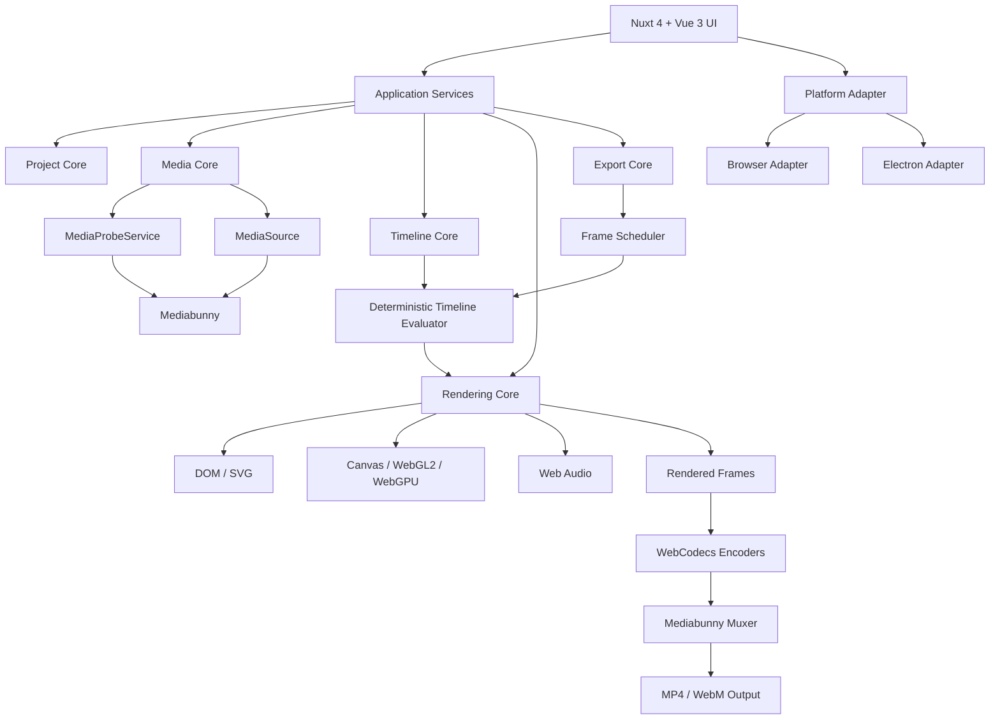
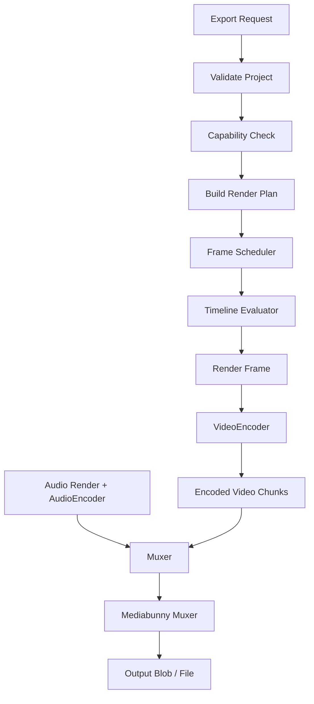

# TMCut — Zero FFmpeg / Zero FFprobe
## Kiến trúc Browser-first Media Engine và roadmap cho AI Coding Agent

**Mục tiêu:** tái cấu trúc TMCut thành video editor chạy trên Web và Electron từ cùng codebase. Loại bỏ hoàn toàn FFmpeg, FFprobe, FFmpeg.wasm, wrapper và mọi binary media-processing khỏi source, dependency, runtime, build, worker và tài liệu. Không giữ FFmpeg làm fallback. Media import, probe, preview, decode, render, encode, mux và export dùng JavaScript libraries cùng Web APIs.

> Đây là tài liệu triển khai dựa trên kiến trúc đã thảo luận. AI phải audit repository thật trước khi sửa code; không được giả định cấu trúc hoặc viết lại toàn bộ ứng dụng một lần.

---

# 0. Chỉ thị bắt buộc cho AI Coding Agent

## 0.1. Non-negotiable requirements

1. Xóa hoàn toàn FFmpeg/FFprobe và mọi wrapper: `ffmpeg`, `ffprobe`, `fluent-ffmpeg`, `ffmpeg-static`, `@ffmpeg/ffmpeg`, `ffmpeg.wasm` và các package tương đương.
2. Không spawn/exec binary media tool. Không thay bằng một CLI native khác.
3. Không có FFmpeg fallback ẩn trong Web, Electron, worker, CI hoặc cloud.
4. Browser là runtime chuẩn. Electron chỉ là shell và platform adapter; không có media engine riêng.
5. Web/Electron dùng chung Project Core, Timeline Core, Media Core, Rendering Core và Export Core.
6. Preview và export dùng chung timeline evaluator, transform, keyframe, effect và composition semantics.
7. Export frame-accurate theo timestamp; không dùng `setTimeout`, `sleep(33)`, CSS wall-clock animation hoặc `MediaRecorder` làm offline export chính.
8. Không đọc toàn bộ video vào RAM nếu không cần. Ưu tiên Blob/File source, chunk/range parsing, Worker và backpressure.
9. Local-first: không upload media mặc định.
10. Không tuyên bố hỗ trợ mọi codec/container. Phải capability-check trên runtime thực tế.
11. Không xóa tính năng đang chạy trước khi có phương án thay thế và test.
12. Không làm mất project cũ; cần schema versioning và migration.
13. Xác minh API đúng với phiên bản dependency đang cài. Không tự bịa method dựa trên ví dụ.
14. Trước tiên audit, báo cáo và lập migration plan; chỉ triển khai sau khi audit hoàn tất.

## 0.2. Quy trình agent

- Đọc `package.json`, lockfile, Nuxt/Vite/Electron config, source, scripts, tests, CI và docs.
- Tìm mọi tham chiếu FFmpeg/FFprobe trong code, dependency, IPC, worker, UI, config, CI, build và tài liệu.
- Phân loại chức năng: probe, demux, decode, encode, mux, transcode, thumbnail, waveform, preview, export, subtitle, audio, downloader.
- Tạo `docs/audit/zero-ffmpeg-audit.md`.
- Ghi lại build/test baseline trước khi sửa.
- Tạo ADR cho quyết định lớn.
- Thực hiện từng phase, mỗi phase phải build/test được.
- Nếu API hoặc format không được hỗ trợ, ghi rõ giới hạn thay vì tạo fallback native.
- Không thay đổi schema âm thầm; cung cấp migration và fixture test.

---

# 1. Tầm nhìn sản phẩm và phạm vi

TMCut là video editor đa nền tảng:

- Web app chạy trong browser hiện đại.
- Desktop app đóng gói bằng Electron.
- Cùng project format, timeline model và rendering engine.
- Multi-track video, image, audio, text, subtitle, shape/overlay.
- Chỉnh sửa source video: zoom, pan, crop, rotate, flip ngang/dọc, scale, opacity.
- Text/caption/template/keyframe/effects.
- Preview tương tác.
- Export MP4/WebM theo capability.
- Thumbnail, waveform, cache và proxy tùy chọn.
- Backend chỉ quản lý user/project/settings/cloud orchestration; không cần xử lý media cơ bản.

**“Hoàn toàn trên Web”** ở đây nghĩa là media được xử lý trên thiết bị người dùng bằng browser APIs/JavaScript. Không có nghĩa ứng dụng không cần backend cho login, lưu project cloud, chia sẻ hoặc đồng bộ.

Không cố tái tạo mọi tính năng của FFmpeg. Xây dựng tập tính năng editor cần, có compatibility matrix và UX rõ ràng.

---

# 2. Kiến trúc tổng thể



## 2.1. Layer responsibilities

| Layer | Trách nhiệm | Không được làm |
|---|---|---|
| UI | Panel, timeline, inspector, dialogs | Parse/encode trực tiếp |
| Project Core | Schema, serialization, migration, undo/redo | Import DOM/Electron |
| Media Core | Source, probe, demux, decode, thumbnail, cache | Gọi CLI |
| Timeline Core | Timebase, clip, trim, speed, keyframe | Dùng wall clock |
| Rendering Core | Scene graph, transforms, effects, composition | Có logic riêng cho Web/Electron |
| Audio Core | Playback, mixing, offline render | Dựa vào playback realtime để export |
| Export Core | Capability, scheduler, encode, mux, progress | Gọi FFmpeg |
| Platform Adapter | File, storage, worker, download, Electron APIs | Chứa media engine |

---

# 3. Stack công nghệ đề xuất

Phải kiểm tra phiên bản, license, API và browser support trước khi chốt.

| Nhiệm vụ | Công nghệ |
|---|---|
| UI/app | Nuxt 4, Vue 3, TypeScript, Nuxt UI |
| Media probe | Mediabunny |
| Demux/mux | Mediabunny |
| Video decode/encode | WebCodecs |
| Audio playback/mix | Web Audio API |
| Audio encode | WebCodecs AudioEncoder khi runtime hỗ trợ |
| Preview 2D | Canvas 2D |
| GPU baseline | WebGL2 |
| GPU enhancement | WebGPU |
| Text/vector | SVG, Canvas, DOM cho preview UI |
| Background work | Web Workers |
| Local cache | IndexedDB, OPFS khi hỗ trợ |
| Desktop | Electron shell |
| Backend | Nuxt server routes |
| Database | MongoDB/Mongoose nếu tiếp tục backend hiện tại |
| Optional jobs | Redis/BullMQ hoặc queue tương đương |

## 3.1. Mediabunny

Là lựa chọn chính cho:
- Đọc File/Blob/byte source.
- Nhận diện container/format được hỗ trợ.
- Đọc metadata và tracks.
- Duration/track duration khi có.
- Codec và thông tin audio/video mà parser cung cấp.
- Packet/sample/timestamp/keyframe theo API hỗ trợ.
- Demux và mux.
- Tích hợp WebCodecs.

Không coi Mediabunny là bản sao 100% của FFprobe. Không phải trường FFprobe nào cũng có mapping tương ứng. Trường không đọc được phải là `undefined` kèm warning, không đoán.

Tài liệu: https://mediabunny.dev/ và https://mediabunny.dev/guide/reading-media-files

## 3.2. MediaInfo.js — optional

Chỉ thêm nếu màn hình Media Details cần thông tin chuyên sâu mà Mediabunny chưa cung cấp. Không chạy song song hai parser trên mọi file trong critical import path.

Docs: https://mediainfo.js.org/docs/intro/

## 3.3. MP4Box.js — optional

Chỉ dùng khi cần thao tác ISO BMFF/MP4 chuyên biệt chưa được Mediabunny đáp ứng. Tránh có hai thư viện cùng chịu trách nhiệm demux/mux nếu không có lý do và test rõ ràng.

Repo: https://github.com/gpac/mp4box.js

---

# 4. MediaProbeService — thay thế FFprobe

UI không gọi trực tiếp Mediabunny. Tạo service abstraction:

```ts
export interface MediaProbeService {
  probe(source: MediaSourceInput, options?: ProbeOptions): Promise<MediaInfo>;
  getCapabilities(): Promise<MediaCapabilities>;
}
```

## 4.1. Internal MediaInfo schema

```ts
export interface MediaInfo {
  id: string;
  name: string;
  size: number;
  mimeType?: string;
  container?: string;
  duration?: number;
  durationSource: 'container' | 'track' | 'estimated' | 'unknown';
  isSeekable?: boolean;
  videoTracks: VideoTrackInfo[];
  audioTracks: AudioTrackInfo[];
  subtitleTracks: SubtitleTrackInfo[];
  metadata?: Record<string, unknown>;
  probeWarnings: MediaWarning[];
  compatibility: MediaCompatibility;
}

export interface VideoTrackInfo {
  id: string;
  codec?: string;
  codedWidth?: number;
  codedHeight?: number;
  displayWidth?: number;
  displayHeight?: number;
  frameRate?: { nominal?: number; average?: number; isVariable?: boolean };
  bitrate?: number;
  rotation?: number;
  pixelAspectRatio?: number;
  colorSpace?: string;
  duration?: number;
  canDecode?: boolean;
}

export interface AudioTrackInfo {
  id: string;
  codec?: string;
  sampleRate?: number;
  channels?: number;
  channelLayout?: string;
  bitrate?: number;
  duration?: number;
  canDecode?: boolean;
}

export interface SubtitleTrackInfo {
  id: string;
  codec?: string;
  language?: string;
  label?: string;
  duration?: number;
}

export interface MediaWarning {
  code: string;
  message: string;
  severity: 'info' | 'warning' | 'error';
}

export interface MediaCompatibility {
  canDemux: boolean;
  canDecodeVideo: boolean;
  canDecodeAudio: boolean;
  canPreview: boolean;
  canExportSourceCodec: boolean;
  limitations: string[];
}
```

Đây là schema của TMCut, không phải cam kết tất cả field đều lấy được. Chỉ populate field có bằng chứng từ parser/runtime.

## 4.2. Probe workflow

1. Người dùng chọn file.
2. Tạo asset trạng thái `probing`.
3. Chuyển File/Blob sang worker nếu phù hợp.
4. Nhận diện container.
5. Đọc metadata và tracks.
6. Lấy duration từ container/track nếu có.
7. Xác định video/audio/subtitle tracks.
8. Kiểm tra decode capability.
9. Tạo compatibility report.
10. Cache metadata.
11. Cập nhật asset thành `ready`, `partial`, `unsupported` hoặc `error`.

Trạng thái import:
`queued | probing | ready | partial | unsupported | error`

Không khóa editor trong lúc probe; cho phép import asset khác.

## 4.3. FPS, VFR và duration

- Không mặc định mọi source là CFR.
- Không tự gán 30 FPS khi không đọc được.
- Phân biệt nominal FPS, average FPS và frame rate suy ra từ timestamp.
- VFR phải dựa trên timestamp thực tế.
- Timeline có FPS riêng; source VFR được sample theo timeline time.
- Dùng rational FPS, ví dụ `30000/1001`.
- Duration có thể thiếu/ước lượng; nếu cần chính xác, đọc track/sample timing theo khả năng parser.
- Quét thêm dữ liệu phải cancellable và có progress.
- File hỏng/truncated phải trả warning/error, không treo import.

---

# 5. Media Source, Asset và Cache

```ts
export type MediaSourceInput =
  | { type: 'file'; file: File }
  | { type: 'blob'; blob: Blob; name?: string }
  | { type: 'url'; url: string; headers?: Record<string, string> };
```

Quy tắc:
- Local File là nguồn ưu tiên.
- URL chỉ hoạt động khi CORS, quyền truy cập và range request phù hợp.
- Không gửi credential nhạy cảm vào worker không đáng tin.
- Không fetch URL tùy ý từ backend; tránh SSRF.
- Không đọc toàn bộ video vào RAM nếu có source/chunk API phù hợp.

Asset record không serialize File object:

```ts
export interface MediaAsset {
  id: string;
  name: string;
  kind: 'video' | 'audio' | 'image' | 'subtitle' | 'unknown';
  sourceRef: MediaSourceRef;
  mediaInfo?: MediaInfo;
  thumbnailRef?: string;
  waveformRef?: string;
  proxyRef?: string;
  status: MediaImportStatus;
  createdAt: number;
  updatedAt: number;
}
```

Cache:
- Metadata theo fingerprint (size, name, lastModified; hash nếu cần).
- Thumbnail theo asset + timestamp + size + renderer version.
- Waveform theo asset + track + sampling resolution.
- Proxy là optional.
- IndexedDB/OPFS khi có; fallback relink/re-import.
- Quota management, LRU eviction và clear-cache UI.
- Không lưu cache vô hạn.

Asset relinking:
- Missing Media khi source không còn.
- Relink Media cho phép chọn file mới.
- So sánh fingerprint/metadata.
- Không tự match chỉ theo tên.

---

# 6. Project Core và Project Format

Project JSON độc lập nền tảng. Không lưu DOM, Canvas/WebGL resource, VideoFrame, AudioData, Electron object, File/Blob trực tiếp hoặc instance thư viện.

```ts
export interface TMCutProject {
  schemaVersion: number;
  appVersion: string;
  id: string;
  name: string;
  settings: ProjectSettings;
  assets: MediaAssetRecord[];
  tracks: TimelineTrack[];
  sequences: Sequence[];
  createdAt: number;
  updatedAt: number;
}

export interface ProjectSettings {
  width: number;
  height: number;
  frameRate: { numerator: number; denominator: number };
  timebase: { numerator: number; denominator: number };
  backgroundColor: string;
  audioSampleRate: number;
  colorSpace?: string;
}
```

- `schemaVersion` bắt buộc.
- Mỗi thay đổi schema có migration.
- Có fixture project cũ.
- Backup trước migration.
- Không xóa field cũ nếu chưa có migration.
- Asset reference dùng sourceRef, không phụ thuộc absolute Windows path.

---

# 7. Timeline Core và time model

```ts
export interface TimelineTrack {
  id: string;
  type: 'video' | 'audio' | 'overlay' | 'subtitle';
  name: string;
  muted?: boolean;
  locked?: boolean;
  hidden?: boolean;
  clips: TimelineClip[];
}

export interface TimelineClip {
  id: string;
  assetId?: string;
  type: 'video' | 'audio' | 'image' | 'text' | 'shape';
  start: number;
  duration: number;
  sourceIn?: number;
  sourceOut?: number;
  playbackRate?: number;
  transform?: Transform2D;
  opacity?: number;
  effects?: EffectInstance[];
  keyframes?: KeyframeTrack[];
}
```

Quy định:
- Chọn một internal time unit (khuyến nghị integer ticks/microseconds) và document rõ.
- Không trộn seconds, milliseconds và frame index.
- Rational frame rate/timebase.
- Timeline evaluator là pure function:

```ts
evaluateTimeline(project, timestamp): RenderScene
```

Evaluator:
- Xác định clip active.
- Map timeline time sang source time.
- Tính transform/effects/keyframes.
- Xử lý opacity, transition, layer order.
- Trả scene graph/render instructions bất biến.
- Không truy cập DOM/GPU/filesystem/clock.

Playback rate phải test với trim, speed up/slow down, clip boundary và timestamp. Reverse playback chỉ hỗ trợ khi decoder/seek strategy đủ tốt; không hứa mọi codec.

---

# 8. Transform, Crop, Zoom, Flip, Rotate

```ts
export interface Transform2D {
  x: number;
  y: number;
  scaleX: number;
  scaleY: number;
  rotation: number;
  anchorX: number;
  anchorY: number;
  crop: { top: number; right: number; bottom: number; left: number };
  opacity: number;
  fit: 'contain' | 'cover' | 'fill';
}
```

Chọn một quy ước duy nhất cho flip (negative scale hoặc flip flags), không lưu hai nguồn sự thật.

Coordinate system:
- Lưu transform theo composition coordinates.
- Preview chỉ scale composition vào viewport.
- Export dùng đúng composition coordinate system.
- Anchor/pivot nhất quán.
- Crop khác clipping viewport.
- Rotation phải xử lý bounding box/aspect ratio.

Transform order đề xuất:
1. Resolve source dimensions/orientation.
2. Apply source crop.
3. Resolve fit mode.
4. Apply scale/flip.
5. Rotate quanh anchor.
6. Translate.
7. Apply opacity/blend.
8. Clip composition bounds.

Mọi thay đổi order phải có ADR và tests.

---

# 9. Rendering Engine

Các renderer:
- DOM: UI và overlay preview; không lấy screenshot DOM làm export engine tổng quát.
- SVG: vector, paths, text khi phù hợp.
- Canvas2D: fallback.
- WebGL2: GPU compositor baseline.
- WebGPU: enhancement, không bắt buộc.

Thiết kế:
- Composition graph/scene graph độc lập renderer.
- Video/image layer đi qua GPU compositor.
- Text/shape rasterize hoặc render SVG/Canvas.
- Preview và export gọi chung `renderAt(timestamp, target, quality)`.
- `target` có thể là preview surface hoặc export frame target; composition semantics không đổi.
- Kiểm soát texture size theo GPU capability.
- Xử lý context lost/recovery.
- Không leak texture/frame/bitmap.

```ts
export interface RenderTarget {
  width: number;
  height: number;
  quality: 'preview' | 'export';
}

export interface RenderingEngine {
  initialize(): Promise<void>;
  renderAt(scene: RenderScene, timestamp: number, target: RenderTarget): Promise<RenderedFrame>;
  dispose(): Promise<void>;
}
```

Định nghĩa ownership/lifecycle rõ cho `VideoFrame`, `ImageBitmap`, texture và audio resources.

---

# 10. Decode và Playback

WebCodecs:
- Dùng `VideoDecoder`/`AudioDecoder` khi supported.
- Kiểm tra `isConfigSupported()` trước configure.
- Quản lý decoder queue/backpressure.
- Không enqueue vô hạn.
- Seek/flush/reset theo đúng API lifecycle.
- Giữ timestamps chính xác.
- Close VideoFrame/AudioData sau khi sử dụng.
- Handle decoder errors và thiếu codec config.

Fallback:
1. WebCodecs khi hỗ trợ.
2. HTMLVideoElement cho realtime preview nếu phù hợp.
3. Canvas drawImage từ video element cho preview đơn giản.
4. Nếu export cần codec không hỗ trợ, báo unsupported và hướng dẫn chọn format khác.
5. Tuyệt đối không fallback FFmpeg/FFmpeg.wasm.

HTMLVideoElement playback không thay thế decoder frame-accurate cho offline export.

Seek/keyframe:
- Inter-frame codec có thể phải decode từ keyframe trước điểm seek.
- Dùng sample/keyframe index nếu thư viện hỗ trợ.
- Cache frame gần playhead.
- Scrub nhanh phải cancel/bỏ stale request.
- Proxy preview có thể bổ sung cho source độ phân giải cao.

---

# 11. Audio Engine

Playback bằng Web Audio API:
- AudioContext, source nodes, GainNode, panning/effects.
- Track mixer, master bus, mute/solo.
- Volume keyframes.
- Waveform generation.

Export:
- OfflineAudioContext/AudioWorklet tùy use case và khả năng.
- Kiểm tra AudioEncoder và codec.
- Đồng bộ audio timeline với video timestamps.
- Sample rate/channel mapping rõ ràng.
- Xử lý gap, overlap, crossfade.
- Không dùng wall-clock playback làm nguồn timeline.
- Không xuất file thiếu tiếng một cách âm thầm; báo lỗi/format fallback nếu audio encode không khả dụng.

---

# 12. Export Engine — Zero FFmpeg



Export settings:
- Resolution, rational FPS, codec, bitrate/quality, audio codec/bitrate, sample rate, channels, container, filename.
- UI chỉ cho chọn tổ hợp đã capability-check.

Frame scheduler:
- Timestamp từ frame index và rational FPS.
- Không dùng interval/sleep để quyết định timestamp.
- Có thể yield theo batch để UI responsive.
- Điều tiết theo encoder queue.
- Giới hạn frames in-flight.
- Cancel/pause theo khả năng pipeline.
- Progress từ frame/audio/muxer work.

Encoder:
- Theo dõi `encodeQueueSize`.
- Không enqueue vô hạn.
- Chờ queue giảm.
- Đóng frame theo ownership contract.
- Flush encoder trước finalize muxer.
- Không finalize khi chunk chưa ghi xong.
- Handle encode/mux errors.

Mediabunny muxer tạo container output được hỗ trợ. WebCodecs chỉ encode/decode frame/chunk, không tự tạo MP4 hoàn chỉnh.

Không dùng MediaRecorder làm offline frame-accurate export chính. Có thể dùng cho realtime recording riêng.

Smart Export/stream copy để phase sau. Cut không trúng keyframe, codec config, timestamps và audio boundaries có thể bắt buộc re-encode; không có FFmpeg fallback.

---

# 13. Thumbnail, Waveform, Subtitle

Thumbnail:
- Dùng decoder/Mediabunny theo timestamp.
- Cancellable, dedupe request.
- Cache theo asset/time/size/version.
- Lazy generate; không scan cả video chỉ để tạo thumbnail đầu.

Waveform:
- Decode audio.
- Tính min/max hoặc RMS theo bucket.
- Chỉ lưu dữ liệu gọn.
- Worker, progress, cancel và cache.

Subtitle:
- Parser riêng cho SRT/WebVTT.
- Timeline subtitle có style, position, timing.
- Burn-in qua renderer.
- Sidecar export riêng.
- Embedded subtitle track phụ thuộc demux/mux support; không hứa hỗ trợ mọi container.

---

# 14. Web, Electron, Vercel và Cloud

## Browser
- Media engine local.
- File/Blob, Worker, WebCodecs, Web Audio, Canvas/WebGL/WebGPU.
- IndexedDB/OPFS.
- Download output.

## Electron
- Dùng cùng media packages.
- Main process cung cấp file dialog, safe filesystem, lifecycle, notifications.
- IPC schema validation.
- Context isolation bật; Node integration renderer tắt.
- Không spawn media binary.
- Không fork media engine.

## Vercel
Có thể host Nuxt frontend, auth/project APIs, settings và cloud job orchestration. Video render trong browser vẫn chạy trên máy user, không phải server Vercel.

Không giữ serverless request mở cho render dài.

## Cloud render optional
Nếu vẫn giữ zero FFmpeg/FFprobe, cloud worker cũng phải dùng JS media stack tương thích. Không giả định Node.js thuần có WebCodecs/browser APIs. Có thể phải dùng headless browser worker; cần đánh giá RAM/GPU, concurrency, sandbox, codec availability và chi phí trước khi quyết định.

Cloud jobs cần queue, retry/idempotency, quotas, object storage, signed URL, cleanup và consent upload. Local editing/export vẫn hoạt động khi cloud unavailable.

---

# 15. Downloader và URL import

- Browser không thể gọi trực tiếp yt-dlp CLI.
- URL import chỉ hỗ trợ nguồn có quyền truy cập, CORS và API phù hợp.
- Không thêm Local Agent/native downloader nếu mục tiêu là browser-only.
- Không vượt DRM, paywall, access control hoặc điều khoản nền tảng.
- Tách URL import khỏi local file import.
- Báo lỗi CORS/auth/unsupported source cụ thể.
- Cloud downloader (nếu sau này có) cần consent, URL allowlist, SSRF protection và tuân thủ điều khoản.

---

# 16. Platform Adapter

```ts
export interface PlatformAdapter {
  files: FileAdapter;
  storage: StorageAdapter;
  downloads: DownloadAdapter;
  workers: WorkerAdapter;
  capabilities: PlatformCapabilities;
}
```

Browser adapter:
- File input/drop.
- IndexedDB/OPFS.
- Worker.
- Download.

Electron adapter:
- Open/save dialog.
- Filesystem API an toàn.
- Notifications/lifecycle.
- Không expose arbitrary filesystem/process APIs cho renderer.

Core không import `electron`, `node:fs`, `node:child_process` hoặc browser globals trực tiếp. Inject adapter qua interface.

---

# 17. Repository structure đề xuất

```text
tmcut/
├─ apps/
│  ├─ web/
│  └─ desktop/
├─ packages/
│  ├─ core/{project,schema,migration,validation}
│  ├─ timeline/{evaluator,timebase,keyframes,transitions}
│  ├─ media/{probe,source,demux,decode,thumbnails,waveform,cache,compatibility}
│  ├─ rendering/{scene,transforms,effects,renderer-canvas,renderer-webgl,renderer-webgpu}
│  ├─ audio/
│  ├─ export/{scheduler,encoder,muxer,presets}
│  ├─ platform/{contracts,browser,electron}
│  └─ shared/
├─ server/
├─ docs/{audit,architecture,adr,roadmap,testing}
└─ tests/{fixtures,media,timeline,rendering,export}
```

Không ép monorepo nếu repository hiện tại không phù hợp. Tạo boundaries trong cấu trúc hiện tại trước, extract packages sau.

---

# 18. Migration từ code hiện tại

## 18.1. Audit keywords

Tìm:
`ffmpeg`, `ffprobe`, `fluent-ffmpeg`, `ffmpeg-static`, `@ffmpeg/ffmpeg`, `ffmpeg.wasm`, `child_process`, `spawn`, `exec`, `filter_complex`, `drawtext`, `-ss`, `-i`, `-map`, `-c:v`, `-c:a`.

`child_process` có thể dùng cho tác vụ không liên quan media; không xóa bừa. Tìm cả command strings trong config/docs/tests và IPC channel kiểu `ffmpeg:progress`, `probe:media`.

## 18.2. Mapping tính năng

| Chức năng cũ | Thay thế |
|---|---|
| FFprobe metadata | MediaProbeService + Mediabunny |
| FFmpeg thumbnail | Mediabunny + WebCodecs/Canvas |
| FFmpeg preview | Shared Rendering Core |
| Crop/scale/rotate | Transform pipeline + GPU |
| Text/drawtext | SVG/Canvas/GPU text renderer |
| Overlay | Composition graph |
| Audio mix | Web Audio + offline audio pipeline |
| Concat | Timeline composition + export |
| Transcode | WebCodecs + muxer |
| MP4 output | WebCodecs + Mediabunny muxer |
| Waveform | Web Audio decode + worker |
| Subtitle burn-in | Subtitle renderer |
| Batch queue | Export Job Scheduler |
| Progress parser | Frame/encoder/muxer progress events |

Không search-and-replace đơn giản. Filter graph, drawtext metrics, transform order, audio filters, codec presets và timestamps không map một-một. Tạo behavior tests thay vì đòi output byte-identical.

---

# 19. Roadmap triển khai

## Phase 0 — Audit và freeze kiến trúc
- Audit source, dependencies, IPC, scripts, docs, CI.
- Ghi flow import/preview/edit/export.
- Lưu sample projects và baseline build/test.
- Tạo `docs/audit/zero-ffmpeg-audit.md`.
- Tạo ADR-001 Browser-first, ADR-002 Mediabunny, ADR-003 WebCodecs.
- Deliver: dependency map, feature migration matrix, risk register, test plan.
- **Exit:** không còn khu vực FFmpeg/FFprobe chưa phân loại.

## Phase 1 — Core contracts
- MediaSource, MediaInfo, MediaAsset.
- Project schema/versioning/migration.
- PlatformAdapter.
- Tách UI khỏi media engine.
- **Exit:** serialize/deserialize/migration tests pass; core không phụ thuộc Electron/DOM.

## Phase 2 — Zero-FFprobe probe
- Tích hợp Mediabunny.
- Probe File/Blob.
- Video/audio track metadata.
- Duration/FPS/codec khi có.
- Capability check, warnings, worker.
- Test MP4, MOV, WebM, MKV và file hỏng.
- **Exit:** không còn FFprobe path; unsupported media không làm treo app.

## Phase 3 — Preview và thumbnail
- Video preview.
- Thumbnail generation/cache.
- Seek/keyframe strategy.
- Cancel stale requests.
- Resource cleanup.
- VFR handling.
- **Exit:** scrub ổn định, không leak frames/bitmaps.

## Phase 4 — Timeline và Transform
- Rational timebase.
- Timeline evaluator.
- Clip source-time mapping.
- Crop/zoom/pan/rotate/flip.
- Keyframes, opacity, layer order, transition cơ bản.
- **Exit:** unit tests boundaries/speed/transform; deterministic evaluator.

## Phase 5 — Shared Rendering Engine
- Scene graph.
- Canvas fallback.
- WebGL2 compositor.
- Video/image/text/subtitle/shape layers.
- Effects cơ bản.
- GPU resource lifecycle/context recovery.
- Visual regression.
- **Exit:** preview/export dùng cùng composition semantics.

## Phase 6 — Audio Engine
- Audio decode/playback.
- Mixer, gain, mute/solo.
- Waveform.
- Volume keyframes.
- Offline audio strategy.
- Audio sync.
- **Exit:** test gap/overlap/crossfade/multitrack.

## Phase 7 — Zero-FFmpeg Export MVP
- Capability matrix/presets.
- Frame scheduler.
- VideoEncoder/AudioEncoder khi supported.
- Mediabunny muxer.
- Backpressure/progress/cancel.
- Output Blob/File.
- **MVP scope:** một sequence, video/image/text/audio cơ bản, transform cơ bản, một số codec/container đã xác minh.
- **Exit:** output play được, audio/video sync, không dùng FFmpeg hoặc MediaRecorder làm offline exporter.

## Phase 8 — Electron parity
- Electron shell và secure IPC.
- File open/save.
- Shared media pipeline.
- Packaging.
- **Exit:** cùng project mở Web/Electron trong phạm vi capability; không native media binary.

## Phase 9 — Performance/reliability
- Worker scheduling.
- Encoder backpressure.
- Memory/GPU budgets.
- Cache eviction.
- Proxy tùy chọn.
- Large file tests, cancel/recovery.
- Benchmark thiết bị yếu/mạnh.
- **Exit:** UI responsive, không tăng memory vô hạn, cleanup đúng.

## Phase 10 — Cloud/collaboration (optional)
- Project sync, cloud metadata.
- Consent upload.
- Queue, worker, storage, signed URLs.
- Worker tiếp tục tuân thủ zero FFmpeg/FFprobe.
- **Exit:** local workflow không phụ thuộc cloud.

---

# 20. Compatibility matrix và UX

Không dùng danh sách codec lý thuyết làm cam kết. Test thực tế theo browser, OS, hardware và version.

| Container | Codec | Probe | Preview | Export |
|---|---|---:|---:|---:|
| MP4 | H.264 + AAC | Test | Test | Test |
| MP4 | HEVC + AAC | Test | Test | Test |
| MP4 | AV1 | Test | Test | Test |
| WebM | VP8/VP9 + Opus | Test | Test | Test |
| MOV | H.264/HEVC | Test | Test | Test |
| MKV | H.264/VP9/AV1 | Test | Test | Test |
| WAV | PCM | Test | Test | Test |
| MP3 | MP3 | Test | Test | Test |
| FLAC | FLAC | Test | Test | Test |
| GIF | GIF | Test | Test | Test |

Trạng thái: `Supported`, `Partially supported`, `Unsupported`, `Not tested`.

Thông báo UX:
- “Trình duyệt hiện tại không giải mã được codec của video này.”
- “Video có thể import nhưng không thể export bằng codec đã chọn.”
- “File không có duration metadata đáng tin cậy; đang phân tích thêm.”
- “Container này chưa được hỗ trợ đầy đủ.”
- “Hãy thử browser khác hoặc chuyển file sang định dạng được hỗ trợ bằng công cụ bên ngoài.”

Không gợi ý người dùng cài FFmpeg.

---

# 21. Testing Strategy

Unit:
- MediaInfo normalization.
- Rational timebase.
- Timeline evaluator.
- Source timestamp mapping.
- Transform matrix/order.
- Keyframe interpolation.
- Export timestamp generation.
- Compatibility decision.

Integration:
- Probe sample files.
- Decode first/middle/last frame.
- Seek quanh keyframe boundary.
- Audio decode/waveform.
- Encode/mux/decode round trip.
- Cancel export.
- Corrupt/truncated file.
- Missing metadata.

Visual regression:
- Composition fixtures.
- Preview/export frame comparison.
- Crop/rotation/flip/anchor.
- Text/subtitle layout.
- Tolerance-based image comparison, không byte-identical.

Browser matrix:
- Chrome/Edge Windows.
- Chrome macOS.
- Safari macOS/iOS nếu nằm trong scope.
- Firefox nếu APIs cần thiết được hỗ trợ.
- Electron version dự án đang dùng.

Performance:
- File nhỏ/vừa/lớn.
- Probe latency.
- Thumbnail.
- Scrub responsiveness.
- Preview FPS.
- Export speed.
- Peak memory.
- GPU context loss.
- 4K source/composition.
- Multi-track.
- Source video 15 phút.

---

# 22. Security và Privacy

- Local-first; media không rời thiết bị nếu user không yêu cầu.
- Không log nội dung media, signed URL hoặc auth headers.
- Validate URL import; không fetch arbitrary URL từ backend.
- Không arbitrary process execution.
- Electron context isolation bật; Node integration renderer tắt.
- IPC schema validation.
- CSP phù hợp.
- Worker chỉ nhận dữ liệu cần thiết.
- Cloud upload cần consent.
- Cache có clear controls.
- Kiểm tra license thư viện và codec implementation trước phát hành thương mại.

---

# 23. Performance và resource lifecycle

Import:
- Probe metadata trước, không decode cả video.
- Lazy thumbnails.
- Worker cho parse/compute.
- Cancellable tasks.
- Concurrency limit.

Preview:
- Preview resolution độc lập export resolution.
- Adaptive quality.
- Cache frame gần playhead.
- Cancel scrub requests cũ.
- Giới hạn decoded frame queue.
- Proxy nếu 4K/8K quá nặng.

Export:
- Frame batch scheduling.
- Encoder backpressure.
- Không giữ encoded chunks vô hạn trong RAM nếu muxer hỗ trợ output sink/stream.
- Nếu buộc dùng Blob output, đặt giới hạn/cảnh báo.
- OPFS/file sink khi browser hỗ trợ.
- Cancel giải phóng encoder, frames, textures và temporary storage.

Mỗi resource phải có owner/dispose contract:
- Parser/input, decoder, encoder, VideoFrame, AudioData, ImageBitmap, texture, AudioContext, Worker, Object URL, temporary files.
- Không revoke Object URL trước khi consumer hoàn tất.
- Close/dispose ngay khi không còn sử dụng.

---

# 24. Chưa làm ở MVP

- Cloud rendering.
- Real-time collaboration.
- Smart Export/stream copy.
- Advanced color grading.
- 3D compositing.
- AI effects.
- Mọi codec/container.
- Reverse playback mọi định dạng.
- Nested sequences phức tạp.
- Embedded subtitle cho mọi container.
- Plugin marketplace.

Ưu tiên: import → preview → timeline → transform/text/audio → export ổn định.

---

# 25. Definition of Done — Zero FFmpeg

## Source/dependencies
- [ ] Không có FFmpeg/FFprobe package trong dependency tree.
- [ ] Không có binary trong repo/build artifacts.
- [ ] Không có spawn/exec media command.
- [ ] Không có FFmpeg IPC/config/environment variable.
- [ ] Không có docs hướng dẫn cài FFmpeg.
- [ ] Không có FFmpeg/FFmpeg.wasm fallback.

## Media
- [ ] Probe bằng MediaProbeService.
- [ ] Unknown metadata được biểu diễn đúng.
- [ ] Capability detection.
- [ ] Compatibility tests.
- [ ] Thumbnail/preview/transform không cần FFmpeg.

## Export
- [ ] WebCodecs encode khi supported.
- [ ] JavaScript muxer.
- [ ] Deterministic frame timing.
- [ ] Audio/video sync.
- [ ] Backpressure.
- [ ] Cancel/cleanup.
- [ ] MediaRecorder không phải offline export chính.
- [ ] Unsupported codec báo rõ.

## Platform/quality
- [ ] Web hoạt động không cần native media tool.
- [ ] Electron dùng chung engine.
- [ ] Project trao đổi được trong phạm vi capability.
- [ ] Unit/integration/visual tests pass.
- [ ] Large-file/memory tests.
- [ ] Browser compatibility report.

---

# 26. ADR cần tạo

- **ADR-001 Zero FFmpeg/Zero FFprobe:** loại bỏ hoàn toàn FFmpeg, FFprobe, wrappers và WASM distributions.
- **ADR-002 Mediabunny:** media toolkit chính trong phạm vi API/format hỗ trợ; không coi là FFprobe clone đầy đủ.
- **ADR-003 WebCodecs:** encode/decode ưu tiên khi runtime hỗ trợ; capability check bắt buộc.
- **ADR-004 Shared rendering semantics:** preview/export dùng chung timeline evaluator và composition model.
- **ADR-005 Browser-first/Electron shell:** Electron không có media engine riêng.
- **ADR-006 Local-first privacy:** media xử lý local mặc định; cloud upload cần consent.

---

# 27. Prompt giao việc cho AI Coding Agent

```text
Bạn đang làm việc trên repository TMCut.

Đọc tài liệu:
docs/roadmap/zero-ffmpeg-zero-ffprobe-browser-first.md

Mục tiêu cuối:
- Loại bỏ hoàn toàn FFmpeg và FFprobe.
- Không dùng FFmpeg.wasm, wrapper hoặc native media CLI thay thế.
- Xây dựng Browser-first Media Engine.
- Web và Electron dùng chung Project, Timeline, Media, Rendering và Export Core.
- Mediabunny là media toolkit chính trong phạm vi hỗ trợ.
- WebCodecs cho decode/encode khi runtime hỗ trợ.
- Web Audio API cho audio processing.
- Canvas/WebGL2, WebGPU progressive enhancement cho rendering.
- Mediabunny muxer cho output format được hỗ trợ.

QUY TẮC:
1. Không viết lại toàn bộ project.
2. Không giả định source structure; audit trước.
3. Trước tiên tạo docs/audit/zero-ffmpeg-audit.md.
4. Liệt kê mọi dependency, file, function, IPC, script, UI và workflow
   đang dùng FFmpeg/FFprobe.
5. Phân loại chức năng và phương án thay thế.
6. Kiểm tra project schema và lập migration plan.
7. Đọc docs/API chính thức và xác minh version thực tế.
8. Không bịa API/method.
9. Không xóa tính năng trước khi giải pháp thay thế có test.
10. Mỗi phase phải build/test được.
11. Không thêm native media binary.
12. UI gọi service abstraction, không gọi parser/encoder trực tiếp.
13. Core không phụ thuộc Electron, Node filesystem hoặc DOM.
14. Export dùng timestamp deterministic.
15. Không upload media khi user chưa đồng ý.

GIAI ĐOẠN ĐẦU:
Chỉ audit và lập kế hoạch, chưa refactor diện rộng.
Tạo báo cáo gồm:
- Architecture hiện tại.
- Tất cả FFmpeg/FFprobe references.
- Feature dependency map.
- Project schema hiện tại.
- Dependency/license/browser support review.
- Migration plan theo phase.
- Rủi ro và test plan.

Sau khi audit xong, dừng và báo cáo trước khi triển khai.
```

---

# 28. Tài liệu tham khảo

- Mediabunny: https://mediabunny.dev/
- Mediabunny reading media files: https://mediabunny.dev/guide/reading-media-files
- WebCodecs API: https://developer.mozilla.org/en-US/docs/Web/API/WebCodecs_API
- VideoEncoder: https://developer.mozilla.org/en-US/docs/Web/API/VideoEncoder
- VideoDecoder: https://developer.mozilla.org/en-US/docs/Web/API/VideoDecoder
- Web Audio API: https://developer.mozilla.org/en-US/docs/Web/API/Web_Audio_API
- WebGPU: https://developer.mozilla.org/en-US/docs/Web/API/WebGPU_API
- WebGL2: https://developer.mozilla.org/en-US/docs/Web/API/WebGL2RenderingContext
- MP4Box.js: https://github.com/gpac/mp4box.js
- MediaInfo.js: https://mediainfo.js.org/docs/intro/

Xác minh lại API, version, browser support và license tại thời điểm triển khai. Các liên kết trên là điểm bắt đầu nghiên cứu, không thay thế việc kiểm tra dependency thực tế.

---

# 29. Kết luận

TMCut không còn `FFmpegService` hoặc `FFprobeService`. Thay vào đó:
- `MediaProbeService`: phân tích media.
- `MediaSourceService`: truy cập nguồn file.
- `DecodeService`: decode.
- `RenderingEngine`: composition.
- `AudioEngine`: audio.
- `ExportEngine`: encode/mux/output.

**Mục tiêu không phải tái tạo toàn bộ FFmpeg bằng JavaScript.** Mục tiêu là xây dựng một editor có feature scope rõ ràng, hoạt động ổn định trên Web/Electron bằng Web APIs và thư viện phù hợp. Codec/container không được runtime hỗ trợ phải được phát hiện sớm và thông báo rõ, không âm thầm phụ thuộc công cụ native.
